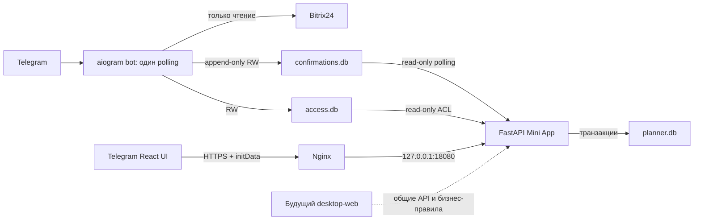

# Основная база знаний проекта «План дня» / @nedozvons_bot

Срез источников: 15 октября 2026 года, Europe/Moscow. Документ составлен по
экспорту переписок, локальным исходникам и отчётам; production повторно не проверяется.

Документационное дополнение от 21.10.2026: подключение приватного GitHub,
начальный исходный снимок и порядок дальнейшей Git-работы (§3, §23, §25, §37–38).
Сведения о production остаются историческими; сервер заново не проверялся.

> Завершённая редакция восстановления знаний от 15.10.2026. Границы покрытия и
> непроверенные сведения перечислены в протоколе полноты в конце. Документ не даёт
> разрешения на разработку, миграцию или развёртывание.

## Инструкция для будущего ChatGPT / Codex

1. Перед существенной задачей прочитать относящиеся к ней разделы и проверить код.
2. Последнее явно утверждённое пользователем решение определяет требования;
   предложение ассистента само по себе не является утверждением.
3. Исходники определяют фактическую локальную реализацию. Локальные тесты и
   наличие архива не доказывают установку на сервере.
4. Не называть планы выполненными. Разделять УТВЕРЖДЕНО, РЕАЛИЗОВАНО,
   ЛОКАЛЬНО ПРОВЕРЕНО, ИСТОРИЧЕСКИ ПОДТВЕРЖДЕНО НА PRODUCTION,
   ПЛАНИРУЕТСЯ, НЕ ПОДТВЕРЖДЕНО и ОТМЕНЕНО.
5. Новые решения и завершённые этапы отражать здесь со ссылкой на источник;
   старые решения сохранять вместе с причиной замены.
6. Общие backend/API/данные/роли Mini App и desktop-web должны оставаться едиными.
   Наличие этого требования не означает готовность веб-авторизации.
7. Не изменять production, рабочую CRM и базы без отдельного разрешения.
8. Не сохранять токены, webhook-ключи, пароли, cookie, initData и данные клиентов.
9. При противоречиях фиксировать обе версии и основание выбора. При нехватке
   сведений писать: **НЕ ПОДТВЕРЖДЕНО — требуется проверка**.
10. Этот документ — индекс знаний и решений, а не замена коду, базам или проверке
    действующего сервера.

### Навигация по основным разделам

- [1. Источники, паспорт и границы достоверности](#1-источники-паспорт-и-границы-достоверности)
- [2. Паспорт системы и главные неизменные правила](#2-паспорт-системы-и-главные-неизменные-правила)
- [3. Хронология и эволюция требований](#3-хронология-и-эволюция-требований)
- [4. Карта CRM и исторические справочники](#4-карта-crm-и-исторические-справочники)
- [5. Реестр принятых решений и отменённых вариантов](#5-реестр-принятых-решений-и-отменённых-вариантов)
- [6. Обязательные бизнес-инварианты](#6-обязательные-бизнес-инварианты)
- [7. Telegram-бот: сценарии, распределитель и исключения](#7-telegram-бот-сценарии-распределитель-и-исключения)
- [8. Bitrix24: карта сущностей и проверенные контракты](#8-bitrix24-карта-сущностей-и-проверенные-контракты)
- [9. Стадии лидов: источник и предел подтверждённости](#9-стадии-лидов-источник-и-предел-подтверждённости)
- [10. Клиенты сопровождения: все группы и смысл показателей](#10-клиенты-сопровождения-все-группы-и-смысл-показателей)
- [11. Задачи Bitrix24, телефония и доступные будущие данные](#11-задачи-bitrix24-телефония-и-доступные-будущие-данные)
- [12. Архитектура и границы компонентов](#12-архитектура-и-границы-компонентов)
- [13. Карта исходников и ответственность](#13-карта-исходников-и-ответственность)
- [14. SQLite: схемы, связи, версии и транзакции](#14-sqlite-схемы-связи-версии-и-транзакции)
- [15. Миграции, сохранность и безопасное восстановление](#15-миграции-сохранность-и-безопасное-восстановление)
- [16. Сотрудники, полномочия и безопасность](#16-сотрудники-полномочия-и-безопасность)
- [17. Mini App: существующий интерфейс и загрузка ресурсов](#17-mini-app-существующий-интерфейс-и-загрузка-ресурсов)
- [18. План и задачи: текущее поведение, не будущая спецификация](#18-план-и-задачи-текущее-поведение-не-будущая-спецификация)
- [19. Таймеры и фактическое время](#19-таймеры-и-фактическое-время)
- [20. Подтверждение, согласование, история и отчёты](#20-подтверждение-согласование-история-и-отчёты)
- [21. Подтверждение распределения, очередь и импорт](#21-подтверждение-распределения-очередь-и-импорт)
- [22. Автоматическая синхронизация и её реальные гарантии](#22-автоматическая-синхронизация-и-её-реальные-гарантии)
- [23. Версии, артефакты и установленное состояние](#23-версии-артефакты-и-установленное-состояние)
- [24. Docker, VPS, HTTPS и безопасная эксплуатация](#24-docker-vps-https-и-безопасная-эксплуатация)
- [25. Полный актуализированный реестр аудита A01–A25](#25-полный-актуализированный-реестр-аудита-a01a25)
- [26. Хотфикс 2.1.1: проверенная локальная редакция и ограничения](#26-хотфикс-211-проверенная-локальная-редакция-и-ограничения)
- [27. Полное ТЗ согласованных будущих возможностей](#27-полное-тз-согласованных-будущих-возможностей)
- [28. Ближайшая версия 2.2: окончательно суженный объём](#28-ближайшая-версия-22-окончательно-суженный-объём)
- [29. Последующие этапы, сохранённый backlog и границы утверждения](#29-последующие-этапы-сохранённый-backlog-и-границы-утверждения)
- [30. Параллельная desktop-web версия для Windows и macOS](#30-параллельная-desktop-web-версия-для-windows-и-macos)
- [31. Утверждённое, но ещё не реализованное](#31-утверждённое-но-ещё-не-реализованное)
- [32. Действительно открытые вопросы](#32-действительно-открытые-вопросы)
- [33. Противоречия источников и установленное разрешение](#33-противоречия-источников-и-установленное-разрешение)
- [34. Ограничения, риски и надёжные части архитектуры](#34-ограничения-риски-и-надёжные-части-архитектуры)
- [35. Приоритеты продолжения после решения владельца](#35-приоритеты-продолжения-после-решения-владельца)
- [36. Тестирование, доступные проверки и критерии приёмки](#36-тестирование-доступные-проверки-и-критерии-приёмки)
- [37. Безопасный выпуск, резервирование и откат: рабочий порядок](#37-безопасный-выпуск-резервирование-и-откат-рабочий-порядок)
- [38. Правила дальнейшей работы и актуализации этой базы](#38-правила-дальнейшей-работы-и-актуализации-этой-базы)
- [39. Технические приложения и индекс первичных источников](#39-технические-приложения-и-индекс-первичных-источников)
- [40. Протокол полноты анализа и готовность документа](#40-протокол-полноты-анализа-и-готовность-документа)

## 1. Источники, паспорт и границы достоверности

Корень: `C:\Users\user\bitrix_missed_calls_bot`.

Экспорт: `C:\Users\user\Downloads\2d4879539f511c381c9f5f8b484be06eaebed9946a5c52417c3151c0195c1192-2026-10-14-11-35-29-206d7abd77be4808a553b822f665cedd.zip`.
ZIP: 15 673 387 байт, 117 элементов; SHA-256
`577eb1e4d0f9dcc7ab3c14ffc77708e5a2fd22612a0c911d44b6f40c5db48b94`.
Основной JSON: `conversations.json`, 8 563 624 байта. Время далее московское.

Обозначения источников переписки: C1–C5 — таблица ниже. Mxxxx — последовательный
номер непустого сообщения в восстановленной основной цепочке от корня к
`current_node`; в техническом индексе указан соответствующий ID узла. Ответвления
учитываются отдельно и не подменяют основную цепочку.

| Код | Разговор | ID | Границы метаданных | Основная цепочка |
|---|---|---|---|---|
| C1 | Создание бота распределения звонков | 6ab0ea80-f7f8-83eb-88b0-b3e699246bbc | 21.09 11:27:45–14.10 14:32:34 | 1059 сообщений: 288 user, 771 assistant; 581 непустое |
| C2 | Ежедневная тренировка продаж | 6abd0b2c-e1bc-83eb-8e32-c8317f24df47 | 30.09 16:14:21–07.10 11:46:58 | 319 сообщений, 206 непустых |
| C3 | Создание приложения трансляции экрана | 6ac3526e-6204-83eb-bb36-5fe7028fef7a | 05.10 10:31:58–14.10 14:01:57 | 360 сообщений, 167 непустых |
| C4 | Ежедневная тренировка продаж | 6ac4a789-0918-83eb-9ac6-76e6b2f62595 | 06.10 10:47:22–14.10 13:59:47 | 10 сообщений assistant |
| C5 | Разработка приложения | 6acf6232-2e30-83eb-ac3a-b6d534cb9f4d | 14.10 14:06:27–14.10 14:29:11 | 47 сообщений, 21 непустое |

В C1 284 непустых user и 297 assistant: число пользовательских узлов 288 включает
четыре узла без текста/parts. Прочие 474 assistant-узла без текста не следует
выдавать за 474 содержательных ответов. Основная цепочка и ответвления различаются.
Архив не содержит решений за 15.10; их источники — текущие локальные отчёты и
прямое задание владельца, а не ретроспективная дата экспорта.

## 2. Паспорт системы и главные неизменные правила

Внутренняя система отдела продаж юридических услуг по банкротству: распределение
дат с лидами, план рабочего дня менеджера, учёт времени/результатов, контроль
руководителя. Бот `@nedozvons_bot` сохраняет распределитель и администрирование
доступа; Mini App «План / факт» — отдельный FastAPI/React компонент.

- Лиды, не сделки, участвуют в действующем распределителе; CRM только читается.
- Дата создания лида — основание группировки; день неделим между менеджерами.
- Сегодня исключается; отсчёт со вчера по Москве.
- Администратор бота не получает автоматически роль supervisor Mini App.
- План, факт, разговор и продажа — разные показатели; не смешивать их.
- Локальная готовность, упаковка и установка — отдельные статусы.

## 3. Хронология и эволюция требований

### 21 сентября: от идеи к распределителю

C1 M0001: три менеджера, периоды 3/4/5, равномерно раздать целые даты с недозвонами.
M0004: сущность — лиды, отдельная стадия, дата создания, только выдача списка;
предложение ассистента менять ответственного отвергнуто этим уточнением.
M0007: добавлены 6/7 дней, альтернативный результат и замена пустой даты;
первоначально пользователь согласился включать сегодня. M0009: это решение
заменено — сегодняшний день не учитывать. M0023: Europe/Berlin из первого шаблона
заменён явным пользовательским Europe/Moscow.

C1 M0027: создание @nedozvons_bot; в переписке был раскрыт токен. Значение здесь
не сохраняется. Рекомендация заменить его не доказывает факт последующей ротации.
M0033: Telegram ID Вячеслава 8306778724. M0038: имена Яна/Вячеслав/Женя и
MISSED_CALL_STAGE_ID=IN_PROCESS. M0043: пользователь подтвердил успешный
проверочный запрос crm.item.list (entityTypeId=1, stageId=IN_PROCESS).
M0045–M0052: сетевые ошибки Telegram и поиск .env через stdin; после явного
dotenv_path пользователь M0053/M0055 сообщил об успешной работе.
M0061: запрошены /adduser, /removeuser, /users; SQLite access.db и отдельные
ADMIN_TELEGRAM_IDS. M0063/M0065: переход к круглосуточной работе на Ubuntu;
systemd обсуждался, но не является основанием считать его текущим способом запуска.

### 22 сентября: предложения развития

C1 M0069–M0070: предложены ссылки на лиды, история, повторное распределение,
ручное исправление, отсутствие менеджера, долгосрочная балансировка, /stats,
/status, сообщения об ошибках, backups и утреннее предложение. Это предложения
ассистента, не автоматическое утверждение всех перечисленных функций.

### 13 октября: планировщик и исследование CRM

C1 M0071/M0073: пользователь запросил автоматический план, редактирование,
руководительскую панель и отметки выполнения в течение дня. M0075 — реальный
пример рабочего отчёта; персональные данные клиентов в эту базу знаний не переносятся.
M0077: утверждён комбинированный факт: надёжные показатели CRM автоматически,
комментарии и остальные результаты вручную. M0080: сторонняя телефония сохраняет
звонки в Bitrix24; название телефонии не сообщено в этом участке.
M0082 — требования руководителя на изображении: задача / время / результат.
M0084: выбран Mini App вместо усложнения переписки с ботом. M0086: руководитель
может редактировать планы, ставить задачи и менять цели. M0088: изменение
защищённых целей менеджером вступает в силу только после утверждения.

C1 M0094–M0099: проверка телефонии сначала insufficient_scope/HTTP401, затем
HTTP200 и статистика за 12.10: 185 записей, 137 с кодом 200, 33 разговора >180 с;
цифры сверены с изображениями M0096/M0098. M0100/M0103: лиды и сделки
различаются, продажи и сопровождение находятся в разных канбанах. M0105:
пользователь явно оставил распределение только для лидов, сделки — для плана.
M0107/M0108: исторические категории 0 («Продажа»), 2 («Сопровождение»), 6
(«Маркетинг»), 10 («Агенты»), 12 («Восстановление КИ»). Различие «Продажа» в
выводе и «Продажи» в разговорном названии нельзя превращать в разные категории.

### 13 октября: подтверждённые дополнительные решения и первый запуск

C1 M0111: три стадии завершённых клиентов указаны пользователем явно.
M0113: «На паузе» и «потерян» исключены из обычного обзвона. M0119/M0121:
Женя уволился; в отделе остаются Яна (Bitrix110) и Вячеслав (Bitrix460), а не все
семь сотрудников из телефонии. M0128: первичный вывод задач — Яна 2 сегодня/76
просроченных, Вячеслав 12/6. Это снимок 13.10, не сегодняшняя нагрузка.
M0130: задачи CRM только читать. M0132: желательна проверка расхождения статуса.
M0134/M0136 заменяют упрощённую трактовку: перенесённая задача может быть
отработана сегодня; нужен выбор «Выполнена и перенесена» / «Просто изменён срок».
Это будущая интеграция, не текущее поведение внутренних move-задач.

M0140: настоящий руководитель 1073597301, отдельный от Вячеслава. M0142: Яна
7939114214, рабочий интервал 10:00–19:00 МСК. M0144: отчёт Codex об этапе 1,
85 тестов локально. M0146/M0150: подтверждён действующий Docker-бот. M0156:
access.db в data/, UID/GID10001:10001, mode600; выбран loopback18080. M0158:
реальный домен prav-buro.ru, не ранние примеры pravburo.ru/planner.example.com.
M0164: подготовка production,96 тестов, не установка.

M0189: серверная установка pnpm длительностью 26–27 мин завершилась timeout/ECONNRESET.
M0190: Windows prebuilt frontend,101 тест, архив stage1-production-v3-prebuilt;
отказ от Node/pnpm внутри серверного Docker, не от проверок зависимостей.
M0196–M0204: исторические свидетельства сборки/старта Mini App, доступа RO к
access.db, healthy и 401; сначала сертификат не подходил plan.prav-buro.ru.
M0234/M0236: HTTPS200 и API401 без авторизации, M0238: Menu settings updated.
M0242: пользователь связал первоначальную проблему открытия с разной VPN-маршрутизацией;
это пользовательское объяснение, не автоматически установленная причина других инцидентов.
M0244–M0275: создание плана/задачи, повторное открытие и сохранение, таймер/пауза,
результат/комментарий, done, история и закрытый отчёт проверялись в Telegram.

M0214: пользователю понравились пять будущих направлений — автоматический план,
вечерний план/факт, переносы/просрочки, аналитика времени/результатов, продажи.
M0216: автоматический план сначала draft, затем личное подтверждение менеджером.
M0218/M0220: согласована связь с подтверждённым утренним распределением.
M0222: обработка недозвона определяется сменой стадии лида, а не доказанным
разговором. Поведение при возврате стадии и подробный алгоритм в ответе M0223
являются детализацией ассистента; прямое утверждение пользователя касается
правила смены стадии. M0229 — проект дорожной карты, не реализация.
M0276–M0280: для проверки руководителя использован второй аккаунт 399005637;
настоящий руководитель в тот момент не мог участвовать. Это существенно для
последующего расследования 14.10: успешный тест 13.10 не был тестом его аккаунта.


### 13 октября: пять частей 2.1, до производственного обновления

C1 M0341 — самостоятельное подтверждение плана менеджером, без обязательного
повторного утверждения руководителем. M0349–M0350 — согласована отдельная
SQLite-очередь, явные полномочия подтверждающего, дневная уникальность и отсутствие
автоматической замены. Общая роль manager не даёт это право. M0351: часть 1,
113 тестов, очередь и импорт, схема 2→3. M0353: часть 2,120 тестов, /confirm и
защита импортированной цели. M0355: часть 3,130 тестов, Telegram-кнопка и re-fetch.
M0359: часть 4,137 тестов, фоновый reader и UI, схема 3→4. M0361: часть 5,142 теста,
проверка всей цепочки, backup и отдельный релиз. Это сообщения с отчётами Codex,
а не доказательства установки на Ubuntu в этот день.

### 14 октября: фактическое согласованное обновление 2.1

C1 M0364–M0372: исходные контейнеры, проекты, образы, bind mounts и UID/GID.
M0374–M0376: backup до миграции и его проверка. M0378–M0384: передача и SHA256
архива, проверка состава. M0390–M0396: уточнены manager slots и имя параметра
PLANNER_ACCESS_DIR; ACCESS_DIR в тексте инструкции — описка. M0400–M0402:
копия схемы 2 мигрировала дважды до 4, integrity_check=ok, foreign_key_check пуст,
сотрудники 4/планы 2/задачи 2/аудит 16/отчёты 2 сохранены по количеству.
M0410/M0412: оба образа собраны. M0418: Linux smoke сообщил PASS для живого writer,
RO mount, UID/GID и DELETE; M0420: изолированная цепочка PASS. Поздний аудит A18
обнаружил ограничение самого smoke-теста, поэтому PASS не является исчерпывающим
доказательством его качества.

M0426 — пользователь разрешил обновить сейчас; это историческое разовое
разрешение. M0428: остановлен только planner, сделана финальная копия,
запущен stage2-1-production-v1. M0430–M0436: healthy, HTTPS200, API401 без
initData, schema4 и ops ready: true. M0438–M0442: обновлён только bot, polling
@nedozvons_bot, отдельная очередь 600/каталог 700. M0446–M0452: сообщения
queue unavailable до создания файла, затем успешное RO-чтение и отсутствие
свежих ошибок в проверенном интервале; постоянный сбой не доказан.

M0460/M0462/M0464: реальное подтверждение 30 лидов, по 15 Яне и Вячеславу,
задачи появились у обоих. Вариант 1; даты Яны 05,06,07,09,11.10, Вячеслава
04,08,10,12,13.10.2026. Эти ID лидов здесь не публикуются. Нового подтверждения
для диагностики не выполнять: оно занимает единственный дневной слот.

### 14 октября: продуктовые уточнения и ограничение размера релизов

M0470 — обязательное исправление будущих правил: первоначальное плановое время
в draft менеджер должен задавать сам; количество распределения защищено.
M0474–M0482: разговоры >3 минут — цель 5, время заранее неизвестно; нынешний ввод 0
не равен будущему состоянию «не задано». M0496–M0518: общие задачи/подпункты,
ручной ввод и выбор CRM, отсутствие двойного времени/количества, разные правила
добавления и уменьшения обязательств. M0519 — большое сводное предложение 2.2.
M0522/M0524/M0526: менеджеры работают за отдельными Windows, руководитель на Mac,
будущий вход логин/пароль и управление учётками руководителем. Ответвление с
«одним компьютером» не является актуальной основной редакцией.

M0528 — сначала стабилизировать Telegram, затем web, отдельные приложения позже.
M0530–M0534: реальные замеры 2 ГБ RAM,2CPU,43 ГБ свободно, нет swap, OOM13–14.10.
M0536 — сервер чужой, изменения через администратора; swap самостоятельно
запрещён. M0540/M0542/M0544: администратор предлагает перенос всего сервера на 8 ГБ,
дата неизвестна. Факт завершения переноса не найден.

M0552–M0560: обзвон клиентов сопровождения ради обратной связи и рекомендаций;
не импортировать весь канбан в дневную задачу; цель — успешные разговоры,
попытки отдельно:26 попыток/4 успешных, три звонка одному —3 попытки.
M0564: отдельная таблица звонков не относится к дневному плану — предложение
интеграции таблицы отменено. M0571 — пользователь выбрал последовательные
небольшие релизы вместо всего объёма 2.2. M0573 — прямо согласовано одно общее
дневное подтверждение выбранных трёх стадий с отдельной статистикой стадий.
M0576–M0581 и C5 — неполные вставки/HTML, попытки восстановить контекст,
переход в проект «Слава разработка» и экспорт всей истории.

### 14–15 октября: инцидент, аудит и локальный хотфикс

Источники этого периода — текущий диалог Codex и локальные отчёты, не C1:
production2.1 у настоящего supervisor показывал 0 сотрудников и зависал,
менеджеры работали. Первичный 2.1.1 разделил загрузки и ввёл timeout/validation;
конкретный сбой production и виновность /distributions не установлены.
Временная активация тестового supervisor399005637 совпала с восстановлением
настоящего 1073597301, без обновления/рестарта; причинная связь не доказана.
15.10 PROJECT_AUDIT.md зафиксировал 25 пунктов. Затем отдельным разрешением
исправлены только A02/A09/A10 локально;143 Python-теста и 23 новых браузерных
сценария прошли по сохранённому отчёту. Новый полный релиз не подготовлен,
production по последним свидетельствам остаётся 2.1. Нынешнее задание 15.10
утверждает параллельное развитие Mini App и desktop-web, корректируя прежнюю
очерёдность интерфейсов, но не разрешает писать этот функционал сейчас.

### 21 октября 2026: первая фиксация исходников в GitHub

Создан приватный репозиторий GitHub, исходники проекта впервые зафиксированы
в Git. Первый коммит `9c9ee025aeac16a9ed6f06815189d5457e263908` (`9c9ee02`),
ветка `main`, 98 проверенных файлов. Актуальный адрес —
https://github.com/emerald634/planner. При первоначальном импорте использовалось
имя `planer`; 21.10 проверены прежний ID репозитория и тот же SHA под именем
`planner`. Это тот же приватный репозиторий, не новая независимая история.
GitHub становится средством контроля изменений исходного кода.

Источники: отчёт первоначального импорта `GITHUB_IMPORT_REPORT.md` (сохранён
отдельно в `C:\Users\user\Documents\ChatGPT\План дня`), задание владельца
на актуализацию документации и текущая сверка локального/удалённого SHA.
По отчёту импорта прошли 143 Python-теста, TypeScript и проверка API-клиента;
в документационной задаче эти тесты повторно не запускались. Production не менялся.

## 4. Карта CRM и исторические справочники

### 4.1. Лиды и сделки — разные ID и разные задачи

Действующий распределитель: лиды entityTypeId=1, стадия IN_PROCESS. Сделки
entityTypeId=2; в категории 0 недозвон имеет **PREPARATION**, а не IN_PROCESS.
Категория 2 использует префикс C2:. Нельзя переносить коды стадий между сущностями.
Последнее первичное текстовое перечисление ниже: **13.10.2026 11:02:09 МСК,
C1 M0109, узел 587a03d6-784f-428b-9d74-eb13f5cb5235**, вывод crm.status.list.
Новых обращений к CRM при составлении документа нет.

### 4.2. Категория 0 «Продажа» — все 19 стадий из первичного вывода

| Технический STATUS_ID | Точное NAME | Семантика вывода | Значение для приложения |
|---|---|---|---|
| NEW | Не обработан | process | Возможный фильтр будущей CRM-панели |
| UC_OM0N7Q | Приоритет | process | Возможный фильтр |
| PREPARATION | Недозвон | process | В действующее распределение лидов не входит |
| PREPAYMENT_INVOICE | Неудобно говорить | process | Не путать с PROCESSED лидов |
| UC_Q6ZN5G | Думает | process | Возможный фильтр |
| EXECUTING | Возражение | process | Возможный фильтр |
| FINAL_INVOICE | Условно качественные | process | Возможный фильтр |
| UC_K0Z3P6 | Мусор | process | Критерий статистики продаж ещё не задан |
| UC_8IETDG | Брак (ситуация изменилась) | process | То же |
| UC_NPZOBZ | Нет смысла звонить | process | То же |
| UC_O7XFI5 | Начал работать с другой компанией | process | То же |
| UC_1BEALQ | Ушли в игнор | process | Возможный фильтр |
| UC_6IE5TH | Возврат на первую линию | process | Возможный фильтр |
| UC_A9OZAG | Прогрев на МФЦ | process | Возможный фильтр |
| UC_4FG1MT | Ждём паспорт | process | Возможный фильтр |
| UC_4FX5NE | Договор составлен, ждём оплату | process | Кандидат для будущей аналитики, не готовая метрика |
| WON | Сделка успешна | success | Не доказательство точного правила «договор заключён» |
| LOSE | Сделка провалена | failure | Не смешивать с завершением сопровождения |
| APOLOGY | Анализ причины провала | apology | Точная семантика сохранена из вывода |

Все коды этой таблицы подтверждены сохранённым текстовым ответом CRM на 13.10.
Перечень выбранных для будущих фильтров стадий предложен ассистентом M0110;
отдельного утверждения пользователем каждого фильтра не найдено в этом участке.

### 4.3. Категория 2 «Сопровождение» — все 24 стадии и классификация 17/3/4

| № | STATUS_ID | Точное NAME из CRM | Группа обзвона | Основание |
|---:|---|---|---|---|
| 1 | C2:NEW | Новый договор | Действующий | Остаток активных стадий после исключений |
| 2 | C2:UC_M5ONI8 | Сбор документов | Действующий | То же |
| 3 | C2:UC_BYQ4OO | Сбор документов(Продажником) | Действующий | То же |
| 4 | C2:PREPARATION | Анализ ситуации | Действующий | То же |
| 5 | C2:UC_X34H6V | Устранение недостатков | Действующий | То же |
| 6 | C2:PREPAYMENT_INVOICE | Оплата кредитов | Действующий | То же |
| 7 | C2:EXECUTING | Решение имущественных вопросов | Действующий | То же |
| 8 | C2:UC_NTJ514 | На паузе | Исключённый | Прямой ответ пользователя M0113 |
| 9 | C2:UC_3UN7JP | потерян | Исключённый | Прямой ответ пользователя M0113 |
| 10 | C2:UC_XV7AKF | Недостатки устранены/ Анализ | Действующий | Остаток активных стадий |
| 11 | C2:FINAL_INVOICE | Сроки | Действующий | То же |
| 12 | C2:UC_MYA2I0 | ОБСУЖДЕНИЕ депозита | Действующий | То же |
| 13 | C2:UC_A6KQS5 | Готовим заявление в суд | Действующий | То же |
| 14 | C2:UC_0Y0VBU | Заявление подано в суд | Действующий | То же |
| 15 | C2:UC_UC440D | Реструктуризация | Действующий | То же |
| 16 | C2:UC_O1RGMD | Реализация | Действующий | То же |
| 17 | C2:UC_J1J1AF | Торги | Действующий | То же |
| 18 | C2:UC_6985A7 | Продление | Действующий | То же |
| 19 | C2:UC_E7LEH0 | Направлен на ИТОГИ | Действующий | То же |
| 20 | C2:UC_CKLAM6 | Завершен, отправить определение | Завершённый | Прямой выбор пользователя M0111 |
| 21 | C2:UC_7TR7XT | Завершен | Завершённый | Прямой выбор пользователя M0111 |
| 22 | C2:WON | Сделка успешна | Завершённый | Прямой выбор пользователя M0111 |
| 23 | C2:LOSE | Проиграна по вине клиента | Исключённый | failure; классификация ассистента M0112/M0114 |
| 24 | C2:APOLOGY | Приостановлено по инициативе компании | Исключённый | apology; классификация ассистента M0112/M0114 |

Проверка счёта:24−3−4=17. Технические коды всех 24 подтверждены первичным
CRM-выводом 13.10. Это не означает существующую фильтрацию в текущем коде Mini App.
Прямое утверждение пользователя M0111 относится к трём завершённым, M0113 —
к исключению паузы/потерян. Остальные 17 получаются из предложенной схемы исключений;
отдельного прямого утверждения каждым пользователем всех 17 либо LOSE/APOLOGY
не найдено в приведённых сообщениях. Перед реализацией не скрывать эту границу
достоверности за фразой «все 24 бизнес-правила утверждены».

Не нормализовать STATUS_ID по виду букв/цифр: в `UC_BYQ4OO` последние два символа
— O; в `UC_0Y0VBU` нули; в `UC_MYA2I0` последний 0. Русское название
«Завершен, отправить определение» в последующем сообщении содержит добавленный
пробел, а исходный NAME — без него. Для API используется код CKLAM6, не исправленное название.

### 4.4. Что подтверждено API исторически

- crm.item.list: чтение лидов IN_PROCESS подтверждено пользователем 21.09 M0043.
- crm.category.list(entityTypeId=2): категории 0/2/6/10/12, скриншот M0107.
- crm.status.list: все стадии выше, первичный текст M0109.
- voximplant.statistic.get: после insufficient_scope получен HTTP200;
  185 записей за 12.10, поля PORTAL_USER_ID, CALL_DURATION, CALL_FAILED_CODE,
  CRM_ENTITY_TYPE, CRM_ENTITY_ID; нужны пагинация и дедупликация.
- user.get: после insufficient_scope и выдачи user_brief получены сотрудники,
  M0119: Яна 110, Вячеслав 460; остальные ID не относятся автоматически к отделу.
- scope: в M0126 показаны crm, task, telephony, user_brief; наличие scope не
  гарантирует доступ владельца webhook ко всем чужим данным.
- tasks.task.list: после insufficient_scope получен первичный текст M0128,
  задачи по RESPONSIBLE_ID, DEADLINE, STATUS; результаты 2/76 и 12/6.

HTTP200 или код телефонии 200 не равны качественной консультации/продаже. Разговор
«больше 3 мин» — строго >180 сек, не >=180. Звонок по контакту/сделке/лиду
не должен считаться несколько раз. Название внешней телефонии в исследованных первичных материалах не установлено;
сами исторические API-тесты не доказывают интеграцию телефонии в Mini App.


## 5. Реестр принятых решений и отменённых вариантов

Статус «утверждено» относится к требованию, а не автоматически к реализации.
Ссылки C1 Mxxxx разрешаются через индекс источников ниже. Решения из текущего
диалога имеют приоритет только в своей теме и не отменяют остальные требования.

| ID | Дата / источник | Решение пользователя | Текущий статус / что заменило |
|---|---|---|---|
| D01 |21.09 C1 M0004|Распределять лиды по дате создания, выдавать инструкцию, не менять CRM|Реализовано; отменено предложение автоматической смены ответственного|
| D02 |21.09 M0007→M0009|Начинать со вчера, сегодня исключить|Реализовано; заменило включение сегодня|
| D03 |21.09 M0023|Москва|Реализовано; заменило Europe/Berlin из первого шаблона|
| D04 |21.09 M0001/M0007; текущая история улучшений|Периоды 3–7, затем 10/15; целые дни; варианты и замена пустых дат|Реализовано distribution.PERIODS, bot handlers|
| D05 |21.09 M0061|Администратор добавляет/удаляет доступ, видит список|Реализовано ACL SQLite; env seed остаётся особым правилом|
| D06 |Текущий диалог до Mini App, README/config|Группы и личные чаты, уведомление 10:00 Москва в обоих, Женя→Евгений|Реализовано; это напоминание бота, не новая рассылка Mini App|
| D07 |Текущий ответ о STATUS_ID; README|Неудобно говорить=PROCESSED, Не обработан=NEW|Пользовательская конфигурация; сырой исторический вывод этих двух стадий лидов не найден|
| D08 |Текущий диалог о результате по датам|При нескольких стадиях показывать на каждой дате числа каждой стадии, включая 0|Реализовано format_result|
| D09 |13.10 M0077/M0084|Mini App, автоматические достоверные CRM-показатели + ручные результаты|Часть реализована; новая CRM-статистика пока контракт|
| D10 |13.10 M0086/M0088|Руководитель ставит/редактирует задачи, изменение защищённых целей согласовывается|Реализовано, будущие уточнения D20|
| D11 |13.10 M0105|Недозвоны распределять из лидов, не смешивать со сделками продаж|Реализовано; отвергает альтернативное предложение из ответвления|
| D12 |13.10 M0111/M0113|Три стадии завершённых; пауза и потерян исключены|CRM-справочник восстановлен, интеграция обзвона пока план|
| D13 |13.10 M0130/M0132/M0134/M0136|CRM только чтение; различать работу с переносом и только смену срока|Утверждено; контракт есть, синхронизации задач нет|
| D14 |13.10 M0140/M0142|Две manager-привязки, отдельный supervisor;10–19 Москва|Реализовано; не повышать администратора бота в supervisor|
| D15 |13.10 M0189–M0190, задание prebuilt|Frontend собирать Windows, Docker только Python; проверки зависимостей не отключать|Реализовано; отменяет Node/pnpm внутри VPS Docker|
| D16 |13.10 M0341 и текущие разрешения частей|Каждый менеджер подтверждает только свой draft; supervisor /approve сохранить|Реализовано; не требуется второе обязательное утверждение босса|
| D17 |13.10 архитектура/утверждение частей|Отдельная очередь; одно распределение на московский день; без автоматической замены|Реализовано schema1; обновление не разрешено бессрочно|
| D18 |Текущие уточнения части 1/3|Подтверждение общего распределения только явной capability, Вячеслав имеет, руководитель отдельно|Реализовано allowlist; роль сама по себе не даёт право|
| D19 |14.10 M0426|Разрешено конкретное обновление двух компонентов 2.1|Исторически выполнено; не разрешает последующие обновления|
| D20 |14.10 M0470, M0510, M0512|До confirm первоначальная настройка свободна; после изменения времени/снижение целей/удаление утверждённого через согласование|Утверждено на будущее; нынешний locked draft строже; увеличение без запроса присутствует в сводных предложениях M0519/M0570|
| D21 |14.10 M0504/M0506/M0514|Общая задача, подпункты вручную и из CRM, сначала сегодняшние клиенты затем поиск|Утверждено, не реализовано|
| D22 |14.10 M0496/M0500/M0516|Не удваивать время/количество, режим в течение дня без угадывания времени|Утверждено, не реализовано как новая модель|
| D23 |14.10 M0524/M0526|Логин/пароль, руководитель создаёт учётки; Windows менеджеров, Mac руководителя|Утверждено для web; не реализовано|
| D24 |14.10 M0528|Стабильная Mini App→web→отдельные приложения позже|Исторический порядок; web-очерёдность заменена D32, приложения остаются позже|
| D25 |14.10 M0536/M0542/M0544|Инфраструктуру меняет администратор, предполагается перенос всего сервера|Не выполнено по доступным подтверждениям; срок неизвестен|
| D26 |14.10 M0552/M0554/M0558/M0560|Сопровождение: обратная связь/рекомендации; не все клиенты канбана; успешные разговоры + отдельные попытки|Утверждено, будущая функция|
| D27 |14.10 M0564|Отдельная таблица звонков не относится к дневному плану|Отменена идея интеграции таблицы без нового решения|
| D28 |14.10 M0571|Небольшие последовательные релизы|Заменяет большой единый 2.2; сохраняется|
| D29 |14.10 M0573|Одно общее дневное подтверждение выбранных стадий, раздельные показатели стадий|Утверждено для 2.2, schema1 сейчас только IN_PROCESS|
| D30 |14–15.10 текущий диалог|2.1.1 исправлять локально, без 2.2/Ubuntu/реальных токенов|Выполнено по отчётам; сервер не обновлён|
| D31 |15.10 задание audit fixes|Исправить только A02/A09/A10, тесты, остановиться перед полным релизом|Локально выполнено; другие 25 пункты не объявлять устранёнными|
| D32 |15.10 текущее задание §8|Mini App и desktop-web развивать параллельно; первая web для менеджера и supervisor|Последнее явное решение; общие backend/API/правила/БД, разные UI; реализации ещё нет|
| D33 |15.10 текущее задание|Только восстановление знаний, один новый Markdown, не исправлять проект|Граница этой работы|

Не утверждены автоматически: PostgreSQL, Tauri/Electron, собственный установщик,
точная модель work logs, все идеи /stats и долгосрочной балансировки, offline-first,
отдельная рассылка согласований, увеличение RAM/swap силами Codex. Числа 5 разговоров,
2+2 сопровождения,15 задач — примеры пользователя/конкретного дня, не неизменные
нормативы для всего отдела. Изменение импортированного количества D20 не разрешает.

## 6. Обязательные бизнес-инварианты

1. Любое распределение относится к целым датам создания выбранных лидов; одно
   и то же назначение не делится между менеджерами, CRM остаётся неизменной.
2. Чужие планы доступны только supervisor; право подтвердить распределение,
   администрировать бот и руководить Mini App — три независимые возможности.
3. Повтор доставки/рестарт не увеличивает исходную цель и не создаёт дубликат
   одного распределения. Отчёт об успехе означает commit, а не попытку операции.
4. Подтверждение утреннего распределения и подтверждение личного плана — разные
   действия с разными авторами и API. Системный импорт не приписывается сотруднику.
5. Подтверждённые/закрытые планы автоматически не переписываются; недопустимые
   привязки блокируют создание всех заданий, конфликт сохраняется для рассмотрения.
6. Первоначальный снимок и закрытый отчёт сохраняются независимо от последующих
   согласований, смены состава отдела, повторного импорта и обновления приложения.
7. Каждая минута факта учитывается один раз; количество звонков, людей, действий,
   лидов и задач различается. Текущая система гарантирует один живой таймер,
   но не умеет распознавать смысловое пересечение вручную заведённых задач.
8. Данные CRM/телефонии считаются автоматическим фактом только после проверки
   источника, прав, полноты пагинации, дедупликации и понятной семантики показателя.
9. График 10:00–19:00 является рабочей настройкой, не запретом вечернего
   редактирования. Напоминания Mini App нельзя включать автоматически.
10. Доступные локальные знания не заменяют новую проверку сервера. Не выполнять
    тестовое подтверждение в рабочую очередь и не запускать второй polling.

## 7. Telegram-бот: сценарии, распределитель и исключения

**Код:** bot.py, keyboards.py, distribution.py, config.py, bitrix.py, access.py,
reminders.py. **Статус:** работает по текущим исходникам;2.1 исторически установлен.

/start сбрасывает FSM и открывает меню. Выбираются 1–3 из трёх конфигурационных
слотов (по умолчанию все 3), затем одна/несколько настроенных стадий и период
3,4,5,6,7,10,15. Незаданный дополнительный STATUS_ID отключает его выбор.
Нельзя продолжить без менеджера/стадии. Набор дней — календарный, выходные
учитываются; текущий московский день исключён. DateCreated переводится в
заданный timezone, диапазон REST полуоткрытый [00:00 первого;00:00 после последнего).

Пустые даты выводятся отдельно и не участвуют в распределении. Пользователь:
добавляет ближайший предыдущий непустой день; вводит другую прошлую дату;
продолжает без замены; начинает заново. Поиск предыдущего дня использует
самый новый подходящий лид до курсора и затем считает весь найденный день,
пропуская пустоты и уже выбранные дни. Жёсткой границы поиска в годах нет.
Вручную допустимы ДД.ММ.ГГГГ либо ДД.ММ текущего года, без автоматического
перехода в прошлый год. Сегодня/будущее/несуществующая/повторная/пустая дата
отклоняется. В группе дата принимается ответом на конкретный ForceReply.

best_distributions исключает нули, принимает не более 15 непустых дат и 1–3 разных
имён. Перебор branch-and-bound сортирует даты по убыванию количества, затем
дате; пробует менеджеров с меньшей нагрузкой, отсекает симметрию пустых корзин
и ветви, которые не улучшат минимум. Оценка лексикографическая:

- сначала spread=max(loads)−min(loads);
- затем Σ(n·load−total)², эквивалентная минимизации SSE при фиксированном n;
- выводимые SSE=вторая оценка/n², standard_deviation=sqrt(SSE/n).

Хранится до 6 оптимальных вариантов, не вся история перебора. При достижении
теоретического spread0/1 и заполненном лимите поиск прекращается. Если альтернатив
меньше лимита и менеджеров>1, добавляется циклическое переименование владельцев
первого варианта. Это баланс **внутри текущего набора**, не учёт нагрузки
предыдущих недель. Целый большой день может делать точное равенство невозможным.
Результат показывает даты, суммы, разницу и номер варианта; после последнего
варианта понятный отказ, без скрытого сохранения и кругового бесконечного выбора.

Для нескольких стадий балансу подаётся суммарное число по дню; результат выводит
разбивку, например «25.09.2026 — недозвоны 3, неудобно говорить 0, не обработан 6».
Разбивка результата бота уже работает; импорт нескольких стадий ещё не работает.

FSMStrategy.USER_IN_TOPIC разделяет пользователей/чаты/темы. MemoryStorage не
постоянная: после рестарта старые кнопки недействительны, очередь сохраняется.
SimpleEventIsolation сериализует один FSM-сценарий. Callback содержит userID+
случайную revision; middleware сверяет автора, revision, message_id и стадию FSM.
Один человек не управляет чужими кнопками даже в общей группе.

Группы используют обычный /start или /start@nedozvons_bot, отдельный start не
нужен. Каналы/анонимный sender_chat не обслуживаются. Обычный групповой текст
игнорируется, кроме ожидаемого ответа с ручной датой. Команды ACL только в личке.
/plan и WebApp-кнопка — в личке; в группе предлагается личный чат. Блокировка
бота пользователем может запретить отправку именно в его чат, но в коде нет
автоматического отключения всех supervisor или переназначения общей роли.

## 8. Bitrix24: карта сущностей и проверенные контракты

Лиды: entityTypeId=1, Lead(id: int, created_at: aware datetime, stage_id: str).
Сделки: entityTypeId=2, категории из§4; коды стадий сделок не равны кодам лидов.
Основной клиент bitrix.py использует только crm.item.list.json, не операции записи.
Поля запроса select=[id, createdTime, stageId]; фильтр =stageId при одной стадии,
@stageId при нескольких, >=createdTime и <createdTime; order idASC либо
createdTimeDESC/idDESC для поиска прошлого непустого дня; start из next.

HTTP timeout30 с на страницу, redirects отключены, HTTP/API error/malformed
result превращаются в BitrixError без секретного URL. Проверяются object/list,
положительный int/числовая строка ID, наличие timezone, ожидаемая стадия,
даты в диапазоне, next: int>start и прогресс пагинации. Leads дедуплицируются
по ID во временном dict. Число страниц/совокупное время/память пока не ограничены
(A05); верхняя граница signed64 для leadID отсутствует (A03).

### Инвентаризация методов, включая ранние предложения

| Метод | Сущность, параметры и поля | Назначение / статус | Ограничение и источник |
|---|---|---|---|
|crm.item.list(.json)|entityTypeId1; select id/createdTime/stageId;=stageId/@stageId; полуночи; start/next|Используется ботом, исторически проверен M0042–43|Чтение от прав владельца webhook, не Telegram-аккаунта|
|crm.status.list|ENTITY_ID=STATUS для лидов; DEAL_STAGE/DEAL_STAGE_2 для сделок; NAME, STATUS_ID, SEMANTICS|Сделки реально проверены M0109; лиды обсуждались в ранней настройке/README|Не приписывать сделочные ID лидам|
|crm.category.list|entityTypeId2; result.categories id/name|Исторически проверен M0107, категории 0/2/6/10/12|Не является интеграцией текущего planner|
|user.get|ID/NAME/LAST_NAME; соответствие 110/460|Исторически проверен после insufficient_scope, M0117–19|Права user_brief; не все возвращённые пользователи являются отделом|
|voximplant.statistic.get|FILTER по дате/PORTAL_USER_ID; CALL_DURATION, CALL_FAILED_CODE, CRM_ENTITY_TYPE, CRM_ENTITY_ID; пагинация|Исторический тест M0094–99, HTTP200/185 строк|Нет действующего адаптера; код 200≠качественный разговор; CRM-linked не значит LEAD|
|tasks.task.list|RESPONSIBLE_ID;<DEADLINE; select ID/TITLE/DEADLINE/STATUS/RESPONSIBLE_ID; start/next|Исторически проверен M0128 и предложение в ветке 13.10|Клиенты/результаты/история переноса отдельно не проверены|
|crm.activity.list|CRM-активности, предложение поиска звонков/связей|Только обсуждался в раннем планировании|Точный фильтр и полнота в проекте не подтверждены|
|crm.lead.list|Старый альтернативный способ чтения лидов|Обсуждался, в текущем клиенте не используется|Не заменять crm.item.list без совместимости|
|crm.item.update|Предлагался для назначения ответственного в самом начале|Отклонён пользовательским требованием readonly M0004|Не вызывать; включён в реестр как отменённая идея|
|scope|Список доступных разрешений: crm, task, telephony, user_brief|Исторически проверен изображением M0126|Разрешение метода не гарантирует права на чужие карточки|

Текстовые совпадения crm.item, crm.lead без полного метода, а также Python
«tasks.extend», «user.slice/target» не считаются дополнительными REST-методами.
Нет подтверждённых вызовов записи CRM, завершения задач, редактирования сроков
или карточек действующим проектом. Полный webhook/ключ здесь отсутствуют.

## 9. Стадии лидов: источник и предел подтверждённости

| Русское название | Код лидов | Конфигурация | Основание |
|---|---|---|---|
|Недозвоны|IN_PROCESS|MISSED_CALL_STAGE_ID|Ранний пользовательский env + успешный crm.item.list21.09; повторно чтение и реальное подтверждение 14.10|
|Неудобно говорить|PROCESSED|INCONVENIENT_STAGE_ID|Прямой ответ пользователя в текущей истории, README/пример env; не получен полный сырой crm.status.list лидов в архиве|
|Не обработан|NEW|UNPROCESSED_STAGE_ID|То же; не путать со сделкой category0 NEW|

Точные значения уже известны из сохранённых источников. Поздние сводки C1 M0519,
M0574/M0579 ошибочно называли два ID неизвестными; заново спрашивать их без
признака изменения портала не нужно. Перед будущим релизом 2.2 можно отдельно
подтвердить актуальность **чтением** CRM после разрешения, не считать это уже сделанным.
Конфиг не жёстко фиксирует эти значения: фактический env может их переопределять;
рабочие секретные настройки в этом исследовании не читались.

## 10. Клиенты сопровождения: все группы и смысл показателей

Полные таблицы всех 19 стадий продаж и 24 стадий сопровождения находятся в§4:
это технический справочник **внутри этого же файла**, не внешняя ссылка.
Все 24 кода восстановлены из первичного текста C1 M0109 от 13.10.2026.
Три completed явно выбраны пользователем M0111, исключение паузы/потерян
подтверждено M0113. Ещё два excluded — C2:LOSE/C2:APOLOGY — вывод обсуждения
ассистента по failure/apology; отдельного поштучного пользовательского ответа
на них в архиве не найдено. Семнадцать active — остаточная группа по process
после этих исключений. Поэтому 17/3/4 восстановлено, но не выдаётся за 17
отдельных актов прямого утверждения или за действующий фильтр кода.

Отдел продаж звонит клиентам отдельного юридического сопровождения, не ведёт
их процедуру. Две будущие задачи: «Обзвон действующих клиентов» и «Обзвон
завершённых клиентов». Цель в каждой — выбранное количество успешных разговоров
с обратной связью и возможной рекомендацией. Не требуется добавлять всех
клиентов канбана в дневной план. Не путать «завершённый клиент» с task.done.

Попытки — каждое исходящее обращение, повтор одному номеру считается повторной
попыткой. Успех — содержательная связь, не только статус соединения телефонии;
менеджер уточняет результат. Успешный разговор: выбранный клиент/ручное имя,
телефон, краткий комментарий, обратная связь, рекомендации, дата. Повторные
успешные разговоры с одним человеком за день: правило уникальности не выбрано.

Общее рабочее время — обычный таймер задачи, включая поиск, ожидание и оформление.
Длительность разговоров — желательная отдельная автоматическая аналитика,
входящая в общее время.90 мин таймера+40 мин разговоров≠130 мин работы.
Отдельная существующая таблица звонков не интегрируется и не изменяется (M0564).
Ни список клиентов, ни автоматические попытки/длительности пока не реализованы.

## 11. Задачи Bitrix24, телефония и доступные будущие данные

Исторический тест 13.10 получил Яне 2 сегодня/76 просроченных, Вячеславу 12/6.
Это снимок одного дня, не постоянные цели. По тестовому фильтру «сегодня» —
крайний срок в московской дате, прошлые даты — overdue; исключались status5/6/7,
без срока пропускались. Задача со сроком уже прошедшим **сегодня** остаётся в
сегодняшнем списке с возможным признаком просрочки по времени. Такое поведение
проверочного скрипта не означает окончательный состав будущей автозадачи.

Нужно сохранять externalID, сроки/снимки их изменений, статус, исполнителя,
связь с клиентом и результат. Дедлайн может перейти на завтра у той же задачи:
это не новая задача и не доказательство сделанной работы. Два отдельных исхода:
work_done_and_moved («Выполнена работа и перенесена») и deadline_only («Только
изменён срок»). Незавершённый CRM-status не отменяет сделанную сегодня часть
работы; done в Mini App не должен закрывать CRM-задачу. Предупреждение о
расхождении должно учитывать явный исход, а не объявлять все переносы ошибкой.

Текущий planner/integrations.py — только Protocol ReadOnlyCRM и ExternalTask,
DeadlineOutcome. CRM_STATUS.connected=False, read_only=True, категории[0,2],
порог long_call_seconds180. Столбцы tasks.external_* /work_done_today/
deadline_outcome предусмотрены, но нет клиента загрузки задач/статистики.

Телефония сторонняя, данные записываются в Bitrix; название провайдера неизвестно.
Проверочный voximplant показал возможность прочитать часть данных, не полную
гарантию автоматизации. Требуются пагинация, правильный интервал даты, сопоставление
110/460, тип CRM-сущности, уникальный callID и отличие попыток/соединений/содержательных
разговоров/>180 сек. Строго >3 мин значит >180 сек, не >=180. Поисковые методы
карточек по имени/телефону и связи задач с карточками **не проверены**; нельзя
обещать поиск с корректными правами только из-за общего CRM-webhook.

## 12. Архитектура и границы компонентов



Нет прямой записи бота в planner.db и нет polling Telegram в Mini App. Общая
очередь — файловый bind mount, не сетевой брокер; порты для импорта не открываются.
Доставка at-least-once, применение идемпотентное. Две БД не имеют одной общей
транзакции: bot commit остаётся доступен при падении reader, а planner commit
атомарен внутри распределения. UI не является источником полномочий.

FastAPI синхронные endpoints работают через штатный threadpool; sync_once вынесен
в asyncio.to_thread. На каждый процесс lifespan свой цикл; ограничения SQLite
защищают несколько импортёров, но многопроцессный режим специально не настраивался.
Три разных области данных и минимальные mounts важнее формального общего UID.
Read-only queue mount защищает запись со стороны Mini App даже при одинаковом UID.
Код и SQLite-триггеры не защищают от root/владельца файла, способного их заменить.

## 13. Карта исходников и ответственность

Принято владельцем 21.10.2026: PR №2 (release tooling, тесты и инструкция) и
PR №3 (`miniapp/desktop/`, документация и команды) объединены в main. Карта
ниже сохранена. Утверждённые правила — `WEB_AUTH_NEXT_STAGE.md`, архитектура —
`WEB_AUTH_ARCHITECTURE.md`; ТЗ первого будущего программного PR —
`WEB_AUTH_FOUNDATION_SPEC.md` (изолированные planner/web_auth/, synthetic tests,
проект schema5 и отдельный bridge-план). Перечисленные в ТЗ файлы ещё не созданы;
кода web-входа нет. PR №4 меняет только документацию.
Дополнение 21.10.2026, ветка `release/2.1.1-preparation`: упаковщик получил
planner-only профиль, release ID/Git SHA и проверку архива до публикации;
`tests/test_hotfix_release.py` проверяет A19. См. `HOTFIX_2_1_1_RELEASE.md`.


| Файл / основные сущности | Ответственность | Связанные проверки |
|---|---|---|
|bot.py: Flow, AccessAndErrorsMiddleware, finish, next_result, confirm_distribution, main|Telegram-сценарий, ACL/кнопки, выбранный вариант, polling|test_bot, test_bot_confirmation|
|keyboards.py: results_menu, stages_menu, empty_days_menu|Клавиатуры и callback revision|test_bot|
|config.py: Config, load_config|Env validation,3 слота, stage IDs, capability, секреты repr=False|test_config|
|bitrix.py: Lead, BitrixClient|Readonly REST, даты/пагинация/ошибки|test_bitrix|
|distribution.py: best_distributions, previous_days, parse_manual_date|Чистый алгоритм баланса и даты|test_distribution|
|access.py: AccessStore|ACL/reminders/claims, init seed|test_access|
|reminders.py: send_due_reminders, reminder_loop|10:00 Москва, подписки, at-most-once|test_reminders|
|planner/api.py: create_app, actor, lifespan|API/auth/errors/static, запуск sync|test_planner, production, sync|
|planner/auth.py: validate_init_data|Telegram HMAC, возраст, дубли полей, ID|test_planner|
|planner/models.py|Pydantic входные контракты, extra=forbid|test_planner, confirmation|
|planner/store.py: Store|Schema4, транзакции, роли, планы/задачи/таймер/аудит/отчёт|test_planner, confirmation, production|
|planner/settings.py: Settings, WORKDAY|Раздельные пути, production, график|production|
|planner/distribution_queue.py: DistributionQueue, validate, BINDINGS|Схема 1, canonical hash, publish/read/find|distribution_import, bot_confirmation|
|planner/distribution_import.py: import_snapshot, MIGRATION|Schema3 inbox, атомарное применение, system_audit|distribution_import|
|planner/sync.py: sync_once, sync_loop, distribution_notices|Периодический RO reader, attempts, scoped notices|test_sync|
|planner/integrations.py|Контракты будущего readonly CRM, без реализации сети|code review/планируемые тесты|
|planner/backup.py|SQLite BackupAPI, SHA256, verify/restore exclusive|production, release_stage2|
|planner/ops.py|Readonly readiness путей/привязок/ACL|production|
|planner/frontend.py: validate_static|Allowlist assets, no demo/maps/secrets, manifest|frontend_release|
|miniapp/src/App.tsx|Обе роли, ресурсы, навигация, формы, таймерная индикация|4 Edge-набора|
|miniapp/src/api.ts|initData header, deadline15 с, JSON, ошибки|hotfix-api.cjs|
|miniapp/src/response.ts|Runtime validators всех используемых ответов|hotfix-api, ui-audit-fixes|
|miniapp/src/types.ts, main.tsx, style.css|Контракты TS, Telegram theme/entry, responsive UI|tsc/build/UI|
|miniapp/src/demo.tsx, preview.html|Только локальная демонстрация, без записи production|frontend_release|
|deploy/package_release.py|Локальная сборка и allowlist tar.gz|frontend_release, release_stage2|
|deploy/release_check.py|Полный файловый manifest и static integrity|release_stage2|
|deploy/sqlite_mount_check.py|Изолированный Linux RO/RW smoke, имеет A18|release smoke|
|deploy/test_release_chain.py|Временные queue/planner, цепочка без сети|release_stage2|
|deploy/*compose.sh,*.Dockerfile, compose*.yaml|Точные Compose-проекты, Python-образы, mounts|локальная статическая проверка/исторические Linux результаты|

|miniapp/desktop/ (локальная ветка feature/desktop-web-shell)|Независимая desktop-оболочка, demo-only fixtures, отдельные entry/config/dist; общие TS DTO Mini App|desktop/tests/ui.cjs|
|DESKTOP_WEB.md, WEB_AUTH_ARCHITECTURE.md|Локальный просмотр, ограничения, проект web-сессий/CSRF/миграций на согласование|Реальная авторизация не реализована|

Корневые Dockerfile/compose.yaml и DOCKER.md сохранены исторически, но сейчас
собирают неполного бота (A04). Будущий выпуск должен использовать release-конфиги,
а не выполнять старое «scp *.py; docker compose build» вслепую.

## 14. SQLite: схемы, связи, версии и транзакции

**access.db**: allowed_users(telegram_id PK, created_at, added_by),
reminders(chat_id, thread_id PK, enabled_by, enabled, last_attempt_date).
AccessStore.initialize создаёт отсутствующие таблицы и INSERT OR IGNORE seed.
Она не является planner-schema и не мигрируется Store.initialize.

**planner.db schema4:**

| Таблица | Ключи, поля и ограничения |
|---|---|
|employees|id PK; telegram_id UNIQUE positive nullable; bitrix_id UNIQUE positive nullable; name; role manager/supervisor; active default1|
|plans|id PK; employee_id FK; day; status draft/approved/closed; initial_snapshot; created_at/approved_at/closed_at; approved_by FK; UNIQUE(employee_id, day), UNIQUE(id, employee_id)|
|tasks|id PK; plan_id+employee_id составной FK; title/description; kind quantitative/general/client/bitrix; planned_minutes>=0; target nullable; actual_value; actual_seconds>=0; timer_started nullable; status todo/in_progress/done/moved; result/comment; created_by FK; locked; revision; created_at; moved_to/source_task_id FK; external_id/url/status; work_done_today; deadline_outcome; creation_actor employee/system|
|goal_requests|id PK; task_id/employee_id FK; field target/planned_minutes; old_value/proposed/reason; status pending/approved/rejected/cancelled; created_at/decided_at/decided_by/decision_comment|
|audit|id PK; plan_id FK; entity/entity_id; actor_id FK; action; before_json/after_json; created_at; immutable update/delete triggers|
|reports|plan_id PK/FK; snapshot; closed_by FK; created_at; immutable update/delete triggers|
|schema_migrations|version PK; applied_at; details JSON|
|distributions|id textPK; workday UNIQUE; sha256; payload; status imported/review; reason; imported_at|
|distribution_tasks|distribution_id+employee_id PK/FKs; task_id UNIQUE nullableFK; status imported/review|
|distribution_leads|distribution_id+lead_id PK; employee_id FK; created_date; initial_stage CHECK IN_PROCESS|
|system_audit|idPK; plan_id FK; entity/entity_id/action/after_json/created_at; immutable update/delete|
|import_attempts|idPK; status imported/review/error; attempts; last_attempt; error_code|

Индексы: one_timer_per_employee partial UNIQUE по employee_id при timer_started
NOT NULL; tasks_plan(plan_id); one_pending_goal(task_id, field) WHERE pending;
audit_plan(plan_id, id). Хранятся ID лидов без client-name/phone payload.

**queue schema1:** confirmations(distribution_id TEXT PK, workday TEXT UNIQUE,
payload TEXT, sha256 TEXT). Запрещены UPDATE/DELETE триггерами. Это отдельная БД,
не таблица в access/planner. Не удалять её ради повторного дневного подтверждения.

Store.connection открывает соединение на операцию, foreign_keys=ON,
BEGIN для чтения, BEGIN IMMEDIATE для записи, timeout10 с, commit/rollback/finallyclose.
Сбой BaseException откатывает транзакцию. Нет разделяемого глобального соединения.
Это защищает атомарность, но writer единственный, длинные читатели могут мешать
commit в DELETE journal. A15 — риск конкуренции, не воспроизведённый production lock.

## 15. Миграции, сохранность и безопасное восстановление

Store.initialize выполняет автоматическую миграцию при lifespan старте, поэтому
запуск API с рабочим путём БД — уже потенциальная запись, не read-only диагностика.

- version0: только пустая отдельная БД; существующие неизвестные таблицы отвергаются;
  начальные 3 сотрудника и schema1. Новый файл создаётся O_EXCL с 600, старый не заменяется.
- 1→2: только заполняет пустую Telegram-привязку Яны по bitrix110; непустую не
  перезаписывает; занятый TelegramID вызывает rollback; создаёт schema_migrations.
- 2→3: task.creation_actor defaultemployee, distributions/tasks/leads и system_audit.
- 3→4: import_attempts и запись миграции. Уже имеющиеся сотрудники/роли/планы/
  задачи/факт/таймеры/согласования/аудит/отчёты не переписываются.
- Более новая version>4 отвергается. Повторный initialize не создаёт дубли.

Все шаги текущего initialize находятся в одной write-транзакции. Отчёты 13.10
содержат проверки отката при внедрённом сбое и сохранения всех прежних колонок
на искусственной schema2, а история 14.10 — миграцию реальной копии и сверку
числа записей. Эти два вида доказательств не взаимозаменяемы.

Backup API: read_only resolve(strict), query_only, проверка knownschema/tables,
integrity_check, foreign_key_check, sqlite3.Connection.backup pages256/sleep0.1,
проверка результата, fsync, отдельный sha256. Файл назначения O_EXCL600.
verify требует совпадения имени/хеша и целостности; restore только в новый
planner.db либо confirmations.db в существующем новом каталоге. Исходник не
изменяется. Расписание/retention/offsite автоматически не настроены.

Два backup разных БД не атомарны вместе. Сначала сохранить текущие версии,
перед миграцией в согласованное окно остановить только соответствующий writer
и сделать финальную копию. Не cp живую SQLite отдельно от её журнала. Для
невалидного payload штатный строгий queue backup может отказать(A08): нужна
отдельно спроектированная forensic-копия, а не удаление повреждённой строки.

Откат 4→2 не поддержан обратной миграцией. Старый backend отвергает новую БД.
Восстановление старой копии в новый каталог теряет в активном представлении
записи после времени копии; сохранить актуальную БД/очередь и отдельно согласовать
перенос новых результатов. Обещание «без потери данных одной командой» неверно.

## 16. Сотрудники, полномочия и безопасность

| Лицо | Telegram ID | BitrixID | Mini App | Особые права / статус |
|---|---|---|---|---|
|Вячеслав|8306778724|460|manager|Администратор бота отдельно; явный confirmer по настройке релиза|
|Яна|7939114214|110|manager|Не получает confirmer автоматически|
|Настоящий руководитель|1073597301|не задан|supervisor|Просмотр отдела/редактирование/задачи/согласования; confirmer только отдельно|
|Тестовый руководитель|399005637|не установлен|supervisor исторически|13.10 временно активирован, затем отключён; не seed новой базы|
|Женя / Евгений|не задан|не подтверждён|не активный manager Mini App|Третий слот старого бота сохранён; импорт с ним запрещён|

Порядок исторических manager-slots:1 Яна,2 Вячеслав,3 Женя→Евгений; новые
MANAGER_N_TELEGRAM_ID сверять с именами, а не предполагать обратный порядок.
API создания сотрудников создаёт **только manager**, публичного повышения роли
или создания supervisor нет. Произвольное изменение role/locked/kind/owner
отвергает extra=forbid. Строку сотрудника не удаляют ради увольнения: active=0
сохраняет историю. save_employee при отключении останавливает его живой таймер.
Заметка A13: неполный PATCH может стереть IDs/включить active — ещё не исправлено.

Каждый /api-запрос проходит: Authorization tma initData → HMAC → auth_date →
проверка доступа к боту (allowed_users либо отдельный bot-admin allowlist) →
store.actor по **этому TelegramID AND active=1** → проверка роли/владельца.
ID из query/body не заменяет actor. Менеджер видит только свои планы, tasks,
requests, history, report, distribution notices. Supervisor видит отдел и может
назначать/редактировать цели; таймер запускает только сам исполнитель.
Бот читает ACL RW, Mini App —mode=ro, timeout5; при недоступности ACL503, отказе 403.
Админы бота обходят только ACL, а не employees.active/role.

HMAC-SHA256 по Telegram WebAppData, constant-time compare, max_age43200 сек,
допуск будущего 30 сек; initData≤16384 символа и≤32 поля; повторные query-поля,
невалидный hash64hex и ID вне положительного signed64 отклоняются. Роли не
берутся из Telegram JSON. Нет demo bypass в production; initData не в URL
и не localStorage. Подпись допускает повтор в 12 часовом окне, это не одноразовый
токен и не самостоятельная web-сессия. При истечении открыть Mini App заново.

SQL с параметрами, допустимые имена update полей ограничены Pydantic; входные
ошибки 422 не возвращают raw body/секреты. Integrity409, SQLite503, DomainError
с его статусом. CSP self+telegram.org для script, connectself, objectnone,
baseurinone, frameancestorsTelegram; nosniff, no-referrer, no-store. Новых CORS
допусков нет. Это конкретные меры, не гарантия отсутствия всех уязвимостей.

### Инцидент supervisor и две учётные записи

В stage1-v3 и stage2.1 архивном Store.actor одинакова выборка TelegramID+active,
а employees() выбирает role='manager' ORDER BY name **без active-фильтра**.
Нет глобального «первого supervisor», кэша роли на всех пользователей, фонового
переназначения supervisor или привязки его роли к отправке напоминания.
TelegramForbiddenError в reminders относится к одному chat; у private даже
не выключает planner.employee. Два разных TelegramID supervisor не конфликтуют
по UNIQUE, inactive запись не выбирается для авторизации другого аккаунта.

Следовательно, прямой механизм «тестовый заблокировал бота→сломал настоящего»
кодом не подтверждён; наличие двух supervisor само по себе конфликтом не является.
Ручная активация меняла только одну запись, общий импорт/миграцию/кэш не запускала
по имеющимся данным. Совпадение восстановления с сетью/нагрузкой/новым initData
возможно, но точных timing/response/logs нет. Это не доказанное объяснение.
Нельзя удалять старую учётку, менять роли или выдавать админство как «лечение».

## 17. Mini App: существующий интерфейс и загрузка ресурсов

Статус после принятия 21.10: Telegram Mini App и её HMAC/API-клиент сохранены.
Desktop из PR №3 — отдельная принятая локальная оболочка, без реального API,
учётных записей или сессий. Тёмная карточная концепция двух ролей принята; это
не production web-версия. Исторические описания локальной ветки ниже сохранены.

Manager: «Мой план дня», «Задачи», «Мои результаты», «История планов».
Supervisor: «Менеджеры», «Планы», «Прогресс», «Запросы», «История», «Отчёты»;
выбор менеджера/всех, даты, создание/изменение manager-привязок. Интерфейс
мобильный/responsive, тема Telegram, формы native dialog. Это ещё не отдельный
полноценный desktop-web с логином/паролем, широким рабочим процессом и сессиями.

Первый /me обязателен до рабочего UI. При ошибке безопасный экран и повторное
открытие. Затем независимые состояния employees/plans/requests/distributions/
history. Plans detail/report зависит только от найденного плана; history
запускается отдельно и не задерживает план. До ответа employees «Загрузка
сотрудников», при отказе «Сотрудники не загружены», после успеха число active
менеджеров; в карточках доступны и отключённые manager-записи для истории.
У каждой ошибки имя раздела и повтор именно этого ресурса; успешные прежние
данные могут сохраниться при временной ошибке, которая остаётся видимой.

/api.ts ставит AbortController+Promise.race deadline15000 мс на fetch **и**
чтение JSON, включая error body. Сетевой отказ, HTTP без понятного detail,
malformed JSON и schema error различаются текстом. POST/PATCH автоматически
не повторяются: timeout не означает, что сервер не успел сохранить.
Обновление каждые 30 сек/focus/кнопка; при modal, busy, loading либо hidden очередной
автоматический refresh не запускается. Индикация времени пересчитывается раз в 1 сек
с server_time offset; таймер хранится на backend, не в вкладке.

A02/A10 исправлены view identity(day, employeeId), generation, resourceVersions,
selectedPlanId и latestRefresh ref. Навигация туда-обратно тоже новый контекст.
Запоздалый результат загрузки/изменения не помещает чужой план в новый экран;
ID/day/employee detail сверяются; история очищается при навигации/дне без плана.
Время операции остаётся за исходным серверным объектом, а UI обновляет текущий.
Это не серверное versioning всех API и не решение таймерного A11.

Runtime response.ts проверяет объекты/массивы/числа/допустимые статусы и
вложенные поля, которые использует JSX: workdayHH: MM, summary, distribution_source,
исторические tasks, externalURL. URL только absoluteHTTP(S)без credentials;
UI кликает только HTTPS. Старые optional/null поля разрешены там, где безопасны.
Исторический snapshot не обязан содержать все новые поля live task. При добавлении
нового используемого поля validator и негативные тесты требуется обновлять вместе.

Дополнение 21.10.2026, ветка `feature/desktop-web-shell`: отдельная desktop-
оболочка не меняет этот Telegram-интерфейс, его API-клиент и HMAC. Локальный
web показывает вымышленные снимки; production entry закрыт до web-авторизации.

## 18. План и задачи: текущее поведение, не будущая спецификация

План один на employee/day. Создать может сам manager либо supervisor выбранному
активному manager. Сейчас план может быть закрыт и из draft; обязательной проверки
approved перед close нет. Будущий день закрыть нельзя, прошлый/сегодня можно.
Ограничение 100 задач, список 366 последних планов. Создание из прошлого берёт
последний существующий более ранний **будний** план; праздник-календарь отсутствует,
это не обязательно непосредственно вчера. Копируются плановые поля, source_task_id,
защита; факт/результат/comment/таймер не копируются, done становится todo.
Внешние bitrix, moved и imported distribution tasks пропускаются.

Три создаваемых типа: general («Обычная задача», обычная плоская запись),
quantitative (неотрицательная цель обязательна), client (плоская задача по клиенту).
**general не является будущим контейнером «Общая задача»**. bitrix существует в
schema/UI как readonly внешняя запись, не создаётся пользовательским TaskInput.
Нет подзадач, поля phone отдельной карточки или автоматического CRM-поиска.
Описание/результат/comment до 4000 символов, title180, planned_minutes0–1440,
quantity≤1e9, actual_minutes≤525600; в patch нет явного null. Редактировать kind,
план/owner/locked/creation_actor/external-поля пользователь не может.

PATCH требует task.revision; устаревшая 409, запись одним BEGIN IMMEDIATE.
Supervisor может менять плановые поля, это ставит locked=1. Manager в unlocked
draft меняет свои плановые поля; в approved любое изменение target/planned_minutes
через согласование, включая увеличение (в отличие от будущих пожеланий).
Если task.locked, manager не меняет также title/description; imported создаётся
locked даже в draft, поэтому первое время тоже через запрос — известное неудобство.
Факт/результат/comment/status доступны после confirm, не после close.

Импортированная target запрещена всем ролям даже через goal_request/approve
старого запроса. Перенос запрещён; копирование не создаёт повторную задачу.
DELETE tasks API отсутствует вообще. Обычную ручную количественную задачу с
таким же названием можно создать, но она не получает IDs/связь распределения.
Не выдавать это за обход/изменение исходной импортированной цели.

Обычный move требует revision, reason, незавершённую unmoved task, дату позже исходной
и не раньше сегодняшней. Создаёт/использует незакрытый целевой план; новая запись
с нулевым фактом, исходная moved сохраняет факт и связь moved_to. Защита сохраняется;
таймер останавливается, pending requests исходной задачи отменяются. Перенос
не считается выполнением. Это перенос внутренней задачи, не смена deadlineCRM.

## 19. Таймеры и фактическое время

start доступен только исполнителю, на текущую московскую дату, незавершённой
внутренней задаче незакрытого дня. BEGIN IMMEDIATE+partialunique запрещают два
живых таймера сотрудника на любых датах. Повтор start уже работающего того же
объекта не запускает второй интервал. Другой живой таймер даёт понятный отказ.

Сохраняются actual_seconds и timer_started серверного wallclock. Эффективный факт
=actual_seconds+max(0, now−timer_started). pause/stop сохраняют разницу и NULL;
новый start продолжает накопленное. Закрытие окна/потеря сети не останавливает
серверный отсчёт; после открытия метка восстанавливается. Отметка done и close дня
останавливают таймер. Ручное actual_minutes заменяет накопленный факт, не добавляет
его; при живом таймере запрещено. Отключение manager также завершает его интервал.
Supervisor не запускает таймер за сотрудника.

Гарантия «один живой интервал» не равна идеальной идемпотентности STOP: нет
timer_session/revision в TimerInput. A11: start100→stop160→start170→повтор старого
stop180 завершает новый интервал (70 сек в примере); второй идентичный stop при
NULL сам не начисляет второй раз. Нужны отдельное исправление и sequence-тесты.

Wallclock может измениться; max0 не решает большие положительные скачки. Таймер,
забытый вечером, идёт через 19:00/полночь до stop/close; новый start на вчера нельзя,
stop существующего возможен. Не вводить автоматический обрез по 19:00 без решения.
Два параллельных ручных факта с одинаковым revision конфликтуют, но пользователь
может смыслово дважды записать одну работу в разные задачи — нынешняя модель
этого не распознаёт. Общие задачи/work logs и дедупликация телефонии — будущая
модель, а не скрытая функция 2.1.1.

## 20. Подтверждение, согласование, история и отчёты

/confirm повторно читает active/role manager **в транзакции**, разрешает только
его план. draft→approved, initial_snapshot всего плана, approved_at/by,
событие plan_confirmed с confirmed_by_telegram_id. Повтор approved возвращает
текущий detail без второго события/снимка/времени, даже если ранее /approve сделал
supervisor. Чужой/closed/не manager отклоняется. /approve остаётся отдельным
action supervisor, только draft, plan_approved; повторный approve —отказ.

Запрос goal: только manager своей writabletask, fieldtarget/planned_minutes,
не то же значение, reason обязательна. До решения действует прежнее значение.
Один pending на task+field. Supervisor approve/reject сохраняет своё ID/время/comment;
при approve проверяет, что старое значение не изменилось, обновляет goal и locked,
пишет task-audit+request-audit. Повторное решение запрещено; move/close отменяют pending.
Запрос изменения importedtarget запрещён, времени допустим. Рассылки запросов в
Telegram нет: UI обновляется polling30 сек/focus.

Аудит обычных действий: реальный employee actor_id, before/afterJSON, timestamp,
entity/action/plan. Отдельный system_audit отдаёт actor_id=null, actor_name«Система»;
metadata содержит реального Telegram-инициатора распределения и confirmed_at.
creation_actor=system объясняет, что task.created_by хранит происхождение
подтверждения, а не выдаёт системное создание за ручной ввод менеджера.
История комбинируется по created_at/abs(id), системные IDs отрицательные.

close в одной write-транзакции останавливает таймеры/отменяет pending, меняет
statusclosed, создаёт reports.snapshot report_version1 и day_closed audit.
Повтор close отдаёт тот же snapshot; любые изменения closed запрещены всемролям.
Отчёт включает задачи/плановые ифактические показатели/result/comment/initial_snapshot;
/readreport отдаёт сохранённое, не пересчитывает старый день из новой CRM.
Триггеры immutable защищают reports/audit/system_audit от UPDATE/DELETE.

«История планов» —список дней; «История изменений» —события конкретного плана;
«Отчёты» supervisor —закрытые дни. Нынешний дневной отчёт не автоматическая
Telegram-рассылка вечернего отчёта и не будущая аналитика успешных CRM контактов.
История не пагинируется(A06), в fullsnapshot до 100 задач возможен большой JSON.

## 21. Подтверждение распределения, очередь и импорт

Кнопка видна только если stage_ids==('IN_PROCESS',), очередь настроена, есть
вариант и callbackuser входитв DISTRIBUTION_CONFIRMER_IDS. Handler повторяет
проверки; обычный admin/manager/supervisor автоматически неуполномочен.
Другой результат меняет только variant_index. При finish создаётся distribution_sessionUUID;
UUIDv5(session, index) —стабильный distribution_id/variant_id выбранного варианта.

Перед первым publishqueue.initialize/find проверяют существующее confirm того UUID.
Повтор после commit возвращает прежний итог без CRM/новой записи —восстановление
после утраты ответа Telegram. Длянового варианта сверяются manager Telegramslots
с BINDINGS и PLANNER_ACTIVE_MANAGER_IDS, затем каждая назначенная дата отдельно
перечитывается get_leads только IN_PROCESS: len==expected, stage, date, uniqueID,
непересекающиеся dates/managers. Неактивный/непривязанный слот —ничего не сохранять.
Ошибка Bitrix, изменившееся число, invalid структура, ошибка очереди —понятный отказ/retry.

Важно: первоначальный расчёт хранил количества, а не исходный ID-набор. При
томже количестве и других ID сохраняется **актуальный состав на подтверждении**.
Нет распределённой CRM-транзакции: лид может изменить стадию после проверки
своего дня. Это ограничение, а не обещание строгого снимка CRM одного мгновения.

Snapshot schema1 строго допускает только поля distribution_id, schema, stage_id,
confirmed_at, workday, confirmed_by, variant_index, variant_id, allocations, total.
Allocation: telegram_id, bitrix_id, name, dates, leads, count; lead: id, stage_id, created_date.
Телефоны/имена клиентов не допускаются. Workday —московская дата confirmed_at
после чтения CRM; assigneddates строго раньше её. Вложения≤2manager, ID/даты
уникальны, counts/total совпадают. BINDINGS жёстко 110↔7939114214,460↔8306778724.
Canonical sortedJSONcompact+SHA256 удостоверяют целостность, **не цифровую подпись**.
Подделка файла владельцем с пересчётом hash не исключается.

publishBEGINIMMEDIATE, UNIQUEworkday/UUID. Совпадают UUID+digest→идемпотентно false;
другой снимок дня→отказ. UPDATE/DELETE запрещены. Итого Telegram: дата/вариант/менеджеры/
даты/количества, прямо«сохранено в очередь; импорт отдельно», не фиктивный успех UI.

import_snapshot проверяет digest и явного confirmed_by, затем в одной planner
транзакции inbox, привязки, plans/tasks/leads/systemaudit. Повтор UUID/day+digest
не делает задач; конфликт дня/digest ошибка. Неизвестный инициатор либо неактивный/
непривязанный manager→весь snapshotreview, задачи никому не создаются. При наличии
approved/closed только его назначение review; допустимый draft другого manager
может получить task, **общий statusreview**. Это предусмотренная атомарная обработка,
а не незаметно объявленный частичный успех. При SQLite сбое откатывается весь snapshot.

Draft нет→создать один; draft есть→добавить одну задачу, ручные не затирать; лимит 100
вызывает rollback. Quantitative«Обработка недозвонов», targetcount, datesdescription,
planned_minutes0, locked1, creation_actorsystem. Подтверждённые/closed планы не менять.
ID лидов остаютсявБД, mainUI их не выдаёт. Review не применяется автоматически после
реактивации, нет action замены/разрешения review. Не удалять review для перезапуска.

## 22. Автоматическая синхронизация и её реальные гарантии

При заданном DISTRIBUTION_QUEUE_PATH lifespan после Store.initialize создаёт
sync_loop. Первый проход выполняется сразу; следующие — через 30 секунд после
окончания предыдущего. sync_once работает в отдельном потоке. Он открывает
существующий файл очереди через mode=ro/query_only с проверкой schema1,
читает confirmations и закрывает соединение до записи в planner.db.
Отсутствующий файл не создаётся.

Известные UUID с тем же digest не импортируются повторно. Диагностика
import_attempts восстанавливается по сохранённому inbox. Новые записи проходят
validate/import_snapshot. Обычные ValueError, KeyError, TypeError, PermissionError,
sqlite3.Error изолируются по записи: безопасное общее сообщение в лог,
status=error в import_attempts; следующие записи продолжают обрабатываться.
Число попыток, last_attempt, error_code сохраняются в planner.db, а не в очереди.
Если inbox уже закоммичен, но запись диагностики не завершилась, следующий проход
восстановит состояние без повторных задач. BEGIN IMMEDIATE и UNIQUE защищают
параллельных импортёров.

OSError, ValueError, sqlite3.Error при чтении очереди приводят к общему warning
и следующей попытке. После перезапуска перечитывается вся очередь, пропущенные
распределения догоняются. UI обновляется отдельно каждые 30 секунд: обычная
видимая задержка может составлять около 60 секунд плюс время обработки; это не SLA.
При завершении процесса coroutine отменяется, но начатая SQLite-операция в потоке
может закончить свою атомарную транзакцию. Новые сетевые порты, CRM-запросы
и Telegram polling этим механизмом не создаются.

**Неустранённые ограничения A03/A07/A08/A16:** OverflowError не пойман и может
завершить worker; healthz не проверяет его живость или backlog. Вся очередь
читается через fetchall; обработка старых записей может создавать лишние блокировки
записи. find() бота строго читает всю историю, поэтому плохой JSON мешает поиску.
Обещание «любая ошибка одной записи не останавливает всё» для текущего кода
неверно. Исправления A02/A09/A10 эти проблемы не затрагивают.

Менеджер получает только свои notices с совпадающей Telegram/Bitrix-привязкой.
После смены привязки прежний snapshot другому человеку не раскрывается.
Supervisor видит отдел, обобщённые ошибки и ситуации review без клиентских данных.
Статусы: imported, review, error. Причины: plan_already_confirmed_or_closed,
inactive_or_missing_manager, initiator_not_bound, import_retry. Интерфейс отдельного
разрешения review и автоматическое применение после реактивации пока отсутствуют.

## 23. Версии, артефакты и установленное состояние

**Дополнение 21.10.2026:** PR №4 — открытый документационный PR
https://github.com/emerald634/planner/pull/4, ветка
`docs/merged-baseline-web-auth-plan`. В нём закреплены утверждённые web-решения
и ТЗ foundation. Не объединён автоматически; main, release-архив и установленная
версия этим дополнением не меняются. Ветка feature/web-auth-foundation не создана.

**Состояние после слияний 21.10.2026:**

| Объект | Подтверждённое значение |
|---|---|
| PR №2 — Merged | `b48a26ca996571c9a2d6c8664e743f64d29b0bc0` |
| PR №3 — Merged | `a55bd71de30c562a08d7384868d6380332bab9d8` |
| main после двух PR | `a55bd71de30c562a08d7384868d6380332bab9d8` |
| Исходный release-коммит 2.1.1 | `d51cd92d9f69863e615d774f0a5f54aa3dacecff` |
| Исходный desktop-коммит | `8dbb11334292896275a57d9f8a80f85debf47bd9` |

Архив `deployment-artifacts/planner-2.1.1-rc1-20261021.tar.gz`, 35 файлов,
SHA256 `378ccb128f8c4dd29bb5ff0adacd8364b111493fa665372cbe7c8eb0f40eba4d`.
Манифест продолжает ссылаться на исходный d51cd92, не на последующее слияние;
архив не пересоздавался. 2.1.1 **ЛОКАЛЬНО ПОДГОТОВЛЕНА И ПРОВЕРЕНА**, не
установлена. Production по последним подтверждениям остаётся на 2.1. Git-слияние
не является установкой. Данные о первых ветках/релизах ниже — история подготовки.
Локальная подготовка 2.1.1 от 21.10.2026 ведётся отдельно в
`release/2.1.1-preparation`: полный архив только planner, schema 4/queue 1,
без обновления бота. Release ID `planner-2.1.1-rc1-20261021`; Git SHA, полный
состав и SHA256 записываются в проверяемых артефактах и отчёте PR. Это кандидат
для отдельного согласования установки, не подтверждение production-обновления.


**Исходный Git-репозиторий с 21.10.2026:** https://github.com/emerald634/planner,
Private, основная ветка `main`. Начальный коммит
`9c9ee025aeac16a9ed6f06815189d5457e263908` содержит 98 файлов существующего
локального состояния разработки, включая материалы кандидата 2.1.1.
Локальная `main` и удалённая `main` сверены перед документационным изменением.

Последняя подтверждённая production-версия — **2.1**. Версия **2.1.1** остаётся
локальным кандидатом, установка на production не подтверждена. GitHub хранит
исходный код и историю, но не доказывает фактическую установку. Историческую
исходную версию установленной 2.1 нельзя автоматически восстановить из первого
Git-коммита; он не объявлен исходным снимком того релиза.

| Этап | Локальный результат по историческим отчётам | Схема / deployment |
|---|---|---|
|Исходный бот|Распределение, ACL, группы, стадии, напоминания|Docker исторически работал до MiniApp|
|Stage1|Планы/таймеры/цели/отчёты;85 тестов в C1 M0144|Базовая schema1; этоотчёт разработки|
|Productionprep13.10|96 тестов, модули backup/ops, bindings|schema2, локально, домен placeholder в старом отчёте|
|stage1-production-v2|Архив 58603 байта; Node в Docker сборка зависла|Не считать успешным рабочим выпуском|
|stage1-production-v3-prebuilt|101 тест, Windowsbuild, PythonDocker|Исторически установлен 13.10, HTTPS проверен|
|2.1 часть 1|113 тестов, queue/inbox|schema3, неотдельный productionrelease|
|2.1 часть 2|120 тестов, managerconfirm/targetlock|schema3|
|2.1 часть 3|130 тестов, botconfirm|schema3|
|2.1 часть 4|137 тестов, autopoll/UI|schema4|
|2.1 финал|142 теста, React,2Edge, isolatedchain|queue1/planner4; архив b462...|
|2.1 установка 14.10|Linuxbuild/smoke/цепочка, healthy, API401,30 лидов 15+15|Исторически подтверждена, не проверялась сейчас|
|Первый 2.1.1,14.10|Независимые ресурсы/deadline/schema,142 теста, Edge|Только frontend+fixtures, без миграций, не установлен|
|Аудит 15.10|142 теста,25 пунктов, новые воспроизведения|Ничего не исправлял|
|Доработанный 2.1.1,15.10|A02/A09/A10,143 теста,23 новых UI,3 прежних UI|Локальный кандидат, полный release ещёнет|
|2.2+desktop-web|Утверждённые будущие требования|Не реализовано/не развёрнуто|

В строке stage1-v2 действительное значение 58603 байта; ранние разговорные«58 КБ»
приблизительны. Версия miniapp/package.json1.0.0 —техническая метка package,
**не доказательство**, что рабочий релиз 1.0 вместо 2.1.

Полный release2.1 `deployment-artifacts/planner-stage2-1-production-v1.tar.gz`,
162833 байта,49entries, SHA256
`b462e98728d01e78b10d2cb9616f18931071c3dc8ff5cc23ed5e179d0fe3192c`.
Старый frontend-кандидат 2.1.1 `deployment-artifacts/planner-hotfix-2.1.1-frontend.tar.gz`,
103233 байта,9entries, SHA256
`11c50e16b6c8793edeeffc12b62b5169358fcaeb3ddf3775a5d735aefc4b53f0`.
Он предшествует A02/A09/A10, не равен текущему dist, неполный Dockerrelease.
Остальные архивы/хеши в техническом приложении.

Desktop-прототип 21.10.2026 создаётся независимо от release-ветки 2.1.1, от
той же main `469344c`. Его исходники в `miniapp/desktop/`, dist отдельный;
web не входит в архив хотфикса. Наличие прототипа не доказывает web-развёртывание.

## 24. Docker, VPS, HTTPS и безопасная эксплуатация

Исторически 13–14.10: Ubuntu24.04.4LTS, Python3.12.3 на host; Docker29.6.1,
Composev5.3.0 —из присланного пользователем вывода, не повторная проверка.
Hostnamepravburobot; root в SSH, владелец проекта каталога bitrixbot.

| Объект | Проверенный исторический путь/значение |
|---|---|
|Корень VPS|/opt/bitrix_missed_calls_bot|
|Release2.1|/opt/bitrix_missed_calls_bot/planner-releases/stage2-1-production-v1|
|Предыдущий release|.../planner-releases/stage1-production-v3-prebuilt|
|Planner данные|.../planner-data/planner.db → /planner-data/planner.db RW|
|ACL|.../data/access.db → bot/dataRW; planner/bot-dataRO|
|Queue|.../distribution-queue/confirmations.db → /distribution-queue RO в planner, RW в bot|
|Backup|.../planner-backups|
|Planner проект/сервис/контейнер|bitrix-workday-planner / planner / bitrix-workday-planner-planner-1|
|Bot проект/сервис/контейнер|bitrix-missed-calls-bot / bot / bitrix-missed-calls-bot-bot-1|
|Образы 2.1|bitrix-workday-planner: stage2-1-production-v1; bitrix-missed-calls-bot: stage2-1-production-v1|
|UI/API|https://plan.prav-buro.ru/ → Nginx →127.0.0.1:18080→container8000|
|UID/GID|10001:10001 уобоих; каталог 700, SQLite600|

Не путать `data/access.db` с прежним корневым `access.db`: исторически оба файла
существовали, текущий бот использовал/data/access.db. Перед новой установкой проверять
mount и processpath, не подменять корневой старой копией.

Plannercompose: read_onlyroot, tmpfs/tmp, cap_dropALL, no-new-privileges, pids128,
mem512m, cpus1, restartunless-stopped, init, grace30 с, health30 с, logs3×10 МБ.
Botrelease: read_onlyroot, tmpfs/tmp, restartunless-stopped, init, grace30 с, logs3×10 МБ;
**mem_limit/cpu/capdrop для бота нет**. Ни один новый порт бот не публикует.
Bindcreate_host_path=false не создаёт по ошибке пустую папку вместо реальнойБД.
QueuejournalDELETE; ROreader не может восстановить hotjournal, это делает writer
initialize; reader повторяет позже. Переключать на WAL без отдельного теста ROmount нельзя.

FrontendprebuiltWindows: pnpm11.25.0, закреплённый lock, offlinefrozeninstall→
pnpmrunbuild(tsc+Vite)→validate_static→tarallowlist. Есликэшанет, сначала локально
заполнить зависимости обычным frozeninstall; не отключать supply-chain проверки.
DockerPython3.12-slim-bookworm копирует dist/frontend-build.json, проверяет hash
без Node/pnpm. PyPI сетьдля Python зависимостей остаётся. Plannerconstraints закреплены,
botrequirements диапазонами; mutablebase и CVE-проверка остаются рисками A21.

Пакетировщик не перезаписывает target, исключает.env/DB/node_modules/maps/pyc,
проверяет asset/lock; stage2 включает также бот, обычный stage1—нет. Generatedmanifest
frontend-build.jsonhashesassets+lock+built_at; release-files.jsonhashesallfiles,
planner_schema4/queue1. Release-tag жёстко stage2-1-production-v1(A19), для 2.1.1
нужна отдельная подготовка версии/manifest, а не архив с другим именем и старой меткой.

Nginx существующий host, не Docker контейнер. Старые sitesadmin/call/lead.prav-buro.ru
сохраняются. Пример planner.example.com —placeholder, реальный plan.prav-buro.ru.
BootstrapHTTP только ACME, остально 404; HTTPSTLS1.2/1.3, HTTPredirect, proxyloopback,
body64k, headerbuffers4×16k, readtimeout30 с, access_logoff. Исторически был TLS
сертификат чужого домена, затем администратор исправил, HTTPS200 подтверждён M0234.
Меню BotFather уже указывало на HTTPS планировщик, имя«Пландня»M0238; это не новыйбот
ине настройка webhook. Наличие WebApp менюне запускает второй polling.

Исторически занятые порты: loopback8080lead-flow,8123admin,8043call-tracker;
public80/443Nginx,22SSH,10050monitoring. Другие PostgreSQL/Redis нетрогать.
12 контейнеров 14.10, наш bot~160.4MiB, planner~39.91MiB; RAM1.9GiB, available132MiB,
CPU2, диск 58G/15G использовано/43G свободно, swap0. OOM13–14.10 убивал celery,
uvicorn, systemd; принадлежность каждого процесса не установлена, инцидент supervisor
этим не объяснён. Администратор предложил перенос всего сервера на 8 ГБ, неподтверждён.
Изменять swap/тариф/другие сервисы Codex самостоятельно не разрешено.

## 25. Полный актуализированный реестр аудита A01–A25

Источник доказательств — PROJECT_AUDIT.md от 15.10. Ниже сохранены конкретные
места, воспроизведения, последствия, рекомендуемые исправления, риски и тесты.
Исходный текст пункта описывает состояние **на момент аудита**, а строка
«Актуальный статус» перед ним учитывает поздний HOTFIX_2_1_1_AUDIT_FIXES.md,
а для A20/A23 — отчёт первоначального Git-импорта и сверку от 21.10.2026.
Повторных воспроизведений и тестов в этой задаче не запускали. Пункты являются
реестром знаний, не новым разрешением их исправлять.

### A01. Общая загрузка в production 2.1 блокирует независимые разделы

**Актуальный статус:** Механизм исправлен в локальном 2.1.1; дополнен защитами A02/A09/A10. На сервере по последним данным 2.1; конкретная первопричина инцидента неизвестна.

- **Серьёзность:** высокая.
- **Место:** frontend сохранённого `planner-stage2-1-production-v1.tar.gz`, блок
  `refresh` с `Promise.all` для `/plans`, `/requests`, `/employees`, `/distributions`;
  старая версия `miniapp/src/api.ts` без таймаута.
- **Почему:** применение списка сотрудников происходит после завершения всего
  блока и связанных detail/history-запросов.
- **Проявление:** `/employees` уже ответил 200, но показываются 0 сотрудников;
  один pending-запрос удерживает spinner. При reject `finally` снимает загрузку,
  однако независимые успешные ответы всё равно не применяются.
- **Подтверждение:** код двух архивов и ранее воспроизведённый механизм Promise;
  конкретный виновный endpoint production-инцидента неизвестен.
- **Исправление:** независимые состояния/применение ответов, конечный deadline,
  отдельные ошибки и retry. В 2.1.1 основная часть уже реализована.
- **Риск исправления:** гонки независимых запросов и stale closures; см. A02/A10.
- **Тесты:** pending/rejected/malformed каждый из четырёх ресурсов, body timeout,
  разные supervisor ID, доступные сотрудники при ошибке планов/уведомлений.


### A02. Запоздалое сохранение возвращает интерфейс к прежнему контексту

**Актуальный статус:** ЛОКАЛЬНО ИСПРАВЛЕНО 15.10 в доработанном 2.1.1; регрессионные сценарии прошли по позднему отчёту. В production и старом frontend-архиве исправления не подтверждены. См.§26.

- **Серьёзность:** высокая.
- **Место:** `miniapp/src/App.tsx:70` (`refresh`, чтение `generation.current` при
  вызове) и `App.tsx:135` (`act`, `await refresh()` из старого замыкания).
- **Почему:** проверка поколений отсеивает ответы уже начатых старых загрузок,
  но не старый callback, который начал загрузку только после завершения POST.
  В этот момент он берёт новое поколение, сохранив старые `day/employeeId`.
- **Проявление:** менеджер запускает таймер и переключает дату до ответа. После
  ответа видит задачи старого плана под новой выбранной датой; последующий ввод
  может изменить не тот день, который пользователь считает выбранным.
- **Подтверждение:** Edge с искусственным задержанным `/tasks/1/timer`: выбран
  `2026-10-16`, после ответа снова видна задача `2026-10-15`. Это воспроизводится
  на текущем compiled 2.1.1. Нельзя утверждать, что ошибка впервые появилась в
  хотфиксе: аналогичный stale-callback риск был и в прежнем устройстве `act`.
- **Исправление:** фиксировать контекст операции до `await`, после ответа сравнивать
  его с актуальным; обновлять только текущий контекст через актуальный callback/ref
  или не применять старую загрузку. Дополнительно проверять соответствие detail
  выбранному `employeeId/day`. Не обязательно блокировать всю навигацию.
- **Риск исправления:** можно пропустить нужное обновление после успешной операции
  либо создать циклический React effect. Сам POST отменять/повторять вслепую нельзя.
- **Тесты:** задержанный timer/approve/PATCH/create, смена даты/сотрудника до ответа,
  успешный commit, новая вкладка остаётся актуальной, возврат показывает сохранение.


### A03. Необработанная ошибка одной записи останавливает весь importer

**Актуальный статус:** НЕ ИСПРАВЛЕНО по доступным материалам; уровень подтверждённости указан ниже. Ни локальный 2.1.1, ни эта консолидация не устраняют данный пункт.

- **Серьёзность:** высокая.
- **Место:** `bitrix.py:78` (`_parse_lead`), `planner/distribution_queue.py:20`
  (`validate`), `planner/distribution_import.py:18`, `planner/sync.py:15,44`,
  `planner/api.py` (`lifespan`).
- **Почему:** положительный ID лида не ограничен диапазоном signed SQLite INTEGER.
  `2**63` проходит валидатор очереди, но binding в `distribution_leads` вызывает
  `OverflowError`. Его нет среди перехватываемых исключений цикла.
- **Проявление:** asyncio task завершается, следующие распределения больше не
  импортируются до перезапуска; HTTP-приложение продолжает отвечать.
- **Подтверждение:** временная очередь с некорректным ID и следующей корректной
  записью: `BACKGROUND_DONE=True`, `OverflowError`, импортировано 0 распределений.
  Экстремальная дата также вызывает неперехваченный `OverflowError` в `validate`.
  Реальный Bitrix обычно даёт значительно меньшие ID; наличие такого production
  payload не подтверждено.
- **Исправление:** строгие границы и типы в одном контракте; изоляция ошибок записей,
  верхнеуровневая защита/наблюдение worker с сохранением причины. Не подавлять
  `CancelledError` и системные ошибки без диагностики.
- **Риск исправления:** слишком широкий catch может скрыть дефект или повторять
  невосстановимую ошибку бесконечно. Успех нельзя фиксировать после rollback.
- **Тесты:** ID на границах 64 бит, overflow даты, malformed запись перед корректной,
  worker остаётся жив, shutdown корректен, статус ошибки сохранён без секретов.


### A04. Корневые Dockerfile/Compose больше не запускают текущего бота

**Актуальный статус:** НЕ ИСПРАВЛЕНО по доступным материалам; уровень подтверждённости указан ниже. Ни локальный 2.1.1, ни эта консолидация не устраняют данный пункт.

- **Серьёзность:** высокая.
- **Место:** `Dockerfile:16`, корневой `.dockerignore`, `compose.yaml`, импорт
  `planner.distribution_queue` в `bot.py`; старые команды в `DOCKER.md`.
- **Почему:** основной Dockerfile копирует только корневые Python-файлы, а `bot.py`
  теперь безусловно импортирует модуль из `planner/`.
- **Проявление:** стандартное `docker compose build/up` из корня собирает образ,
  который падает ещё при импорте. На обновлении можно получить restart loop.
- **Подтверждение:** точный набор файлов `COPY` воспроизведён во временной папке;
  `import bot` завершился с `ModuleNotFoundError`. Docker Engine не запускался.
  **Новый `deploy/Bot.Dockerfile` включает нужные файлы и этой ошибки не содержит.**
- **Исправление:** согласовать корневой путь с новым Dockerfile либо явно запретить
  устаревший путь и перенаправить все актуальные инструкции. Добавить import smoke.
- **Риск исправления:** случайно включить весь backend, `.env` или базы в bot image;
  нельзя применять изменения к работающему контейнеру без отдельного согласования.
- **Тесты:** import smoke для каждого поддерживаемого Dockerfile, compose config
  с искусственными переменными, содержимое build context и один polling-процесс.


### A05. Бот не имеет ограниченного бюджета RAM и длительности CRM-операций

**Актуальный статус:** НЕ ИСПРАВЛЕНО по доступным материалам; уровень подтверждённости указан ниже. Ни локальный 2.1.1, ни эта консолидация не устраняют данный пункт.

- **Серьёзность:** высокая для хоста 2 ГБ.
- **Место:** `bitrix.py:95` (все страницы в `found`), `bot.py:457` (подтверждение,
  `items/seen_ids/allocations`), `compose.bot.release.yaml`, `compose.yaml`.
- **Почему:** таймаут 30 с задаётся странице, а не всей операции; нет предела числа
  страниц/лидов и общего семафора. У bot service нет `mem_limit/cpus/pids_limit`,
  а параллельные разрешённые сценарии могут иметь собственные крупные выборки.
- **Проявление:** долгий callback, накопление объектов лидов/снимков и конкуренция
  с другими приложениями; возможен host/container OOM. Сам OOM не воспроизводился.
- **Подтверждение:** код и Compose; реальный размер CRM/число параллельных пользователей
  не известны. Алгоритм распределения на пяти малых наборах был быстрым, поэтому
  объявлять именно его причиной прежнего OOM нельзя.
- **Исправление:** общий deadline/лимит параллельности, безопасные пределы с явным
  отказом, потоковая агрегация counts, измерение RSS и разумный лимит контейнера.
  Не обрезать список лидов молча — количественный снимок должен оставаться точным.
- **Риск исправления:** низкий лимит сам вызовет OOM контейнера; слишком короткий
  deadline сорвёт легитимный большой расчёт. Значения выбрать после измерений.
- **Тесты:** много страниц, медленные страницы, 429/timeout, одновременные сценарии,
  пик RSS/отмена, отсутствие частичного подтверждения после прерывания.


### A06. История аудита выдаётся целиком и быстро растёт

**Актуальный статус:** НЕ ИСПРАВЛЕНО по доступным материалам; уровень подтверждённости указан ниже. Ни локальный 2.1.1, ни эта консолидация не устраняют данный пункт.

- **Серьёзность:** высокая при длительной эксплуатации/малой памяти.
- **Место:** `planner/store.py:508` (`history`), `audit` с before/after JSON,
  `miniapp/src/App.tsx` (загрузка history при refresh).
- **Почему:** нет LIMIT/cursor для истории; каждое изменение хранит полные снимки
  полей задачи, которые могут содержать длинные тексты. Клиент запрашивает историю
  даже до раскрытия панели, в том числе при периодических обновлениях.
- **Проявление:** большие JSON-ответы, рост RAM/времени сериализации и DOM;
  2.1 связывала это ещё и с общей загрузкой. Не установлен фактический production
  размер истории и не подтверждён OOM именно на этом endpoint.
- **Подтверждение:** запрос без ограничения, сборка списка и JSON parsing кодом.
- **Исправление:** cursor pagination, загрузка по раскрытию панели, ограниченный
  preview; журнал сохранять целиком в БД, не удалять исторические события.
- **Риск исправления:** неполная видимость может быть ошибочно принята за отсутствие
  старых изменений; нужны явные «показать ещё» и стабильный порядок.
- **Тесты:** десятки тысяч искусственных событий, границы страниц/системный аудит,
  RAM/размер ответа, сохранение неизменяемости и прав доступа.


### A07. Каждые 30 секунд перечитывается вся очередь и создаются лишние write-locks

**Актуальный статус:** НЕ ИСПРАВЛЕНО по доступным материалам; уровень подтверждённости указан ниже. Ни локальный 2.1.1, ни эта консолидация не устраняют данный пункт.

- **Серьёзность:** средняя, растёт с историей и числом процессов.
- **Место:** `planner/sync.py:20` (`fetchall`), обработка `previous`,
  `distribution_notices`; `planner/store.py:245` (N+1 summary по планам).
- **Почему:** весь outbox загружается в память; даже импортированная запись требует
  проверки и отдельной write-транзакции `import_attempts`. Supervisor notices
  читают историю без предела, summary выполняет запрос задач на каждый из 366 планов.
- **Проявление:** фоновый рост I/O, JSON parsing, памяти и ожидания SQLite; несколько
  worker делают одинаковую работу, хотя дублей задач ограничения не допускают.
- **Подтверждение:** структура циклов/SQL. Нагрузочное испытание истории за годы не
  выполнялось; утверждение о сегодняшнем превышении RAM не делается.
- **Исправление:** порционное чтение, checkpoint плюс отдельная очередь retry,
  исключение лишних записей состояния, SQL aggregation и пагинация notices.
- **Риск исправления:** checkpoint не должен навсегда пропускать старую ошибочную
  запись, восстановленный backup или позднюю запись за прошлый день.
- **Тесты:** большой outbox, late arrival, restart, два worker, retry старой записи,
  восстановление разных по времени planner/queue backups.


### A08. Повреждённый снимок блокирует подтверждение ботом и строгий backup очереди

**Актуальный статус:** НЕ ИСПРАВЛЕНО по доступным материалам; уровень подтверждённости указан ниже. Ни локальный 2.1.1, ни эта консолидация не устраняют данный пункт.

- **Серьёзность:** средняя.
- **Место:** `planner/distribution_queue.py:112,127` (`read/find`),
  `planner/backup.py:43,58` (`validate_queue/copy_database`).
- **Почему:** `find` ищет через валидирующее чтение всей истории. Ошибка более ранней
  записи выбрасывается до искомой. Backup сначала проверяет семантику всех снимков.
- **Проявление:** одна плохая запись мешает подтверждать новые корректные варианты;
  штатный backup не сохраняет даже пригодную для расследования повреждённую базу.
- **Подтверждение:** искусственный `invalid-json` перед корректной записью дал
  `JSONDecodeError` и в `find`, и в backup. Sync при этом импортировал корректную
  запись, что показывает несогласованную устойчивость двух путей.
- **Исправление:** точечный поиск по UUID с валидацией найденного снимка; отдельный
  карантин/диагностика. Разделить forensic SQLite-copy и «проверенная для restore
  копия», не выдавая повреждённую копию за валидную.
- **Риск исправления:** нельзя автоматически игнорировать конфликт дневного слота
  или разрешить восстановление непроверенного payload в рабочую систему.
- **Тесты:** плохая запись до/после нужной, испорченный checksum, дневной конфликт,
  проверенный и forensic backup с разными явно обозначенными статусами.


### A09. Runtime validation 2.1.1 не охватывает все значения, используемые JSX

**Актуальный статус:** ЛОКАЛЬНО ИСПРАВЛЕНО 15.10 в доработанном 2.1.1; регрессионные сценарии прошли по позднему отчёту. В production и старом frontend-архиве исправления не подтверждены. См.§26.

- **Серьёзность:** средняя.
- **Место:** `miniapp/src/response.ts:9,12,14`, проверка `/me`,
  `miniapp/src/App.tsx:220` (workday), отображение `external_url`.
- **Почему:** например, `/me` не проверяет структуру optional `workday`; task guard
  не проверяет тип `external_url`. `as T` не компенсирует эти пробелы.
- **Проявление:** объект вместо строки времени проходит guard, затем React падает.
  Число/объект вместо URL также опасен для вызова `startsWith`.
- **Подтверждение:** Edge: искусственный `workday.start={bad:true}` дал React error
  #31. Сервер сейчас возвращает константный корректный WORKDAY, поэтому наличие
  такого production-ответа не подтверждено; это дефект защитного слоя.
- **Исправление:** проверять все фактически используемые optional/nested поля,
  ограниченно валидировать снимки отчётов; добавить ErrorBoundary для отказа раздела.
- **Риск исправления:** чрезмерно строгая схема может отвергнуть легитимные старые
  отчёты или nullable значения. Проверять совместимость, а не слепо дублировать БД.
- **Тесты:** malformed nested fields, URL, summary, даты, исторические snapshots,
  отсутствие optional полей, совместимость с реальными контрактами backend fixtures.


### A10. Ошибка истории остаётся на дне без плана, её retry не работает

**Актуальный статус:** ЛОКАЛЬНО ИСПРАВЛЕНО 15.10 в доработанном 2.1.1; регрессионные сценарии прошли по позднему отчёту. В production и старом frontend-архиве исправления не подтверждены. См.§26.

- **Серьёзность:** низкая.
- **Место:** `miniapp/src/App.tsx:88,115`, `loadErrors.history`, `selectedPlanId`.
- **Почему:** смена контекста не очищает эту ошибку, если нового detail нет;
  `refresh('history')` при пустом ref просто возвращается.
- **Проявление:** пользователь видит неприменимую ошибку прежнего плана и кнопку,
  которая ничего не делает. Остальное приложение при этом не зависает.
- **Подтверждение:** воспроизведено в Edge: ошибка history → другой день без плана
  → retry → alert по-прежнему существует.
- **Исправление:** связывать error с plan ID/контекстом; очищать либо скрывать его
  при отсутствии соответствующего плана, отключать неприменимый retry.
- **Риск исправления:** нельзя скрыть сохраняющуюся ошибку актуального плана.
- **Тесты:** history error → пустой день → обратно; смена сотрудника; повтор для
  текущего плана и поздний ответ предыдущего.


### A11. Таймерные команды не защищены от устаревшей повторной доставки

**Актуальный статус:** НЕ ИСПРАВЛЕНО по доступным материалам; уровень подтверждённости указан ниже. Ни локальный 2.1.1, ни эта консолидация не устраняют данный пункт.

- **Серьёзность:** средняя.
- **Место:** `planner/store.py:349`, `planner/models.py` (`TimerInput`).
- **Почему:** команды `start/pause/stop` не несут revision или идентификатор сессии.
  Повтор STOP одинаков для уже закончившейся и новой сессии.
- **Проявление:** два устройства/задержанный запрос могут остановить вновь начатый
  интервал. Это не доказательство двойного начисления времени.
- **Подтверждение:** START100 → STOP160 → START170 → повтор старого STOP180 даёт
  `timer_started=null`, `actual_seconds=70`: новая сессия прекращена старой командой.
  Сериализация транзакций и уникальный индекс предотвращают два активных таймера
  одного сотрудника и повторное начисление одного STOP.
- **Исправление:** timer-session ID или ожидаемая revision, идемпотентный command ID.
- **Риск исправления:** старые клиенты начнут получать конфликты; нужен понятный
  reload и совместимый переход API.
- **Тесты:** reorder/повтор START и STOP, два устройства, concurrency, restart,
  ручное время после stop; сумма секунд не увеличивается повторной командой.


### A12. Создание обычных задач не идемпотентно после неопределённого сетевого исхода

**Актуальный статус:** НЕ ИСПРАВЛЕНО по доступным материалам; уровень подтверждённости указан ниже. Ни локальный 2.1.1, ни эта консолидация не устраняют данный пункт.

- **Серьёзность:** средняя.
- **Место:** `planner/api.py` (`POST .../tasks`), `planner/store.py:296`,
  `miniapp/src/api.ts` (15-секундный timeout), `App.tsx:135`.
- **Почему:** нет client operation ID. Одинаковые POST могут быть как намеренным
  созданием двух задач, так и повтором после потерянного ответа.
- **Проявление:** задача уже создана, клиент получил timeout/непрочитанный JSON,
  человек отправляет ещё раз и получает вторую. Импортированные задачи отдельно
  защищены; этот риск касается обычных mutations, прежде всего create-task.
- **Подтверждение:** код INSERT без idempotency key; повтор на уровне API разрешён.
  Потеря ответа production не воспроизводилась. Предупреждение 2.1.1 снижает риск,
  но не устраняет его. Manager confirm/close и import имеют более сильные гарантии.
- **Исправление:** операция с UUID и сохранением результата, scoped к actor/endpoint;
  до этого — обязательное обновление перед повтором, без автоматического retry POST.
- **Риск исправления:** нельзя объединять две действительно разные задачи по одному
  title/payload; ключ должен обозначать действие, а не содержание.
- **Тесты:** commit без ответа, повтор с тем же/новым ключом, несколько устройств,
  запрет получения чужого результата по operation ID.


### A13. PATCH сотрудника с неполным телом стирает привязки и включает активность

**Актуальный статус:** НЕ ИСПРАВЛЕНО по доступным материалам; уровень подтверждённости указан ниже. Ни локальный 2.1.1, ни эта консолидация не устраняют данный пункт.

- **Серьёзность:** средняя.
- **Место:** `planner/models.py` (`EmployeePatch`), `planner/api.py` (`edit_employee`,
  `model_dump()`), `planner/store.py:197`.
- **Почему:** пропущенные Telegram/Bitrix ID заменяются defaults `None`, active —
  `True`; затем обновляются все поля. PATCH фактически имеет replacement-семантику.
- **Проявление:** авторизованный supervisor хочет переименовать сотрудника через
  частичный API-запрос, но лишает его доступа и потенциально меняет active.
- **Подтверждение:** запрос только с `name` дал 200 и `telegram_id=null`,
  `bitrix_id=null`, `active=1`. Текущий UI посылает полное тело, поэтому обычное
  редактирование формы этим воспроизведением не обвиняется.
- **Исправление:** настоящий partial PATCH через `exclude_unset` либо явно
  обязательный полный replacement-контракт/PUT. Сохранять аудит старого/нового.
- **Риск исправления:** отличать «пропущено» от явного null при отвязке аккаунта;
  изменение Telegram ID само по себе предоставляет доступ к истории этой записи.
- **Тесты:** rename-only, active-only, явная отвязка, уникальность ID, запрет manager,
  предупреждение/подтверждение при смене личности существующего сотрудника.


### A14. Состав распределения зафиксирован в нескольких независимых местах

**Актуальный статус:** НЕ ИСПРАВЛЕНО по доступным материалам; уровень подтверждённости указан ниже. Ни локальный 2.1.1, ни эта консолидация не устраняют данный пункт.

- **Серьёзность:** средняя; известное ограничение этапа 2.1.
- **Место:** `config.py` (три слота), `distribution.py:57` (до трёх менеджеров),
  `planner/distribution_queue.py` (`BINDINGS`, до двух allocations),
  `planner/store.py` (`EMPLOYEE_BINDINGS`), `planner/ops.py`, active list бота.
- **Почему:** Mini App позволяет создавать менеджеров, но импорт принимает только
  Яну и Вячеслава. Изменение active в Mini App не обновляет список бота.
- **Проявление:** новый сотрудник виден в интерфейсе, но недоступен распределению;
  бот подтверждает по устаревшему active list, затем весь импорт уходит в review.
- **Подтверждение:** явные условия кода; importer повторно проверяет active и
  защищает от частичного создания задач при отключённом сотруднике.
- **Исправление:** единый версионированный roster/контракт возможностей, безопасный
  обмен активностью; до этого сверка настроек и явная отметка ограничений UI.
- **Риск исправления:** случайно дать право подтверждения всем менеджерам или
  принять бывшего сотрудника. Полномочия confirmer должны оставаться отдельными.
- **Тесты:** третий/четвёртый manager, активность меняется между preview/confirm/import,
  переименование, пустая/конфликтующая привязка, supervisor capability отдельно.


### A15. SQLite остаётся единой точкой конкуренции, одних timeout недостаточно

**Актуальный статус:** НЕ ИСПРАВЛЕНО по доступным материалам; уровень подтверждённости указан ниже. Ни локальный 2.1.1, ни эта консолидация не устраняют данный пункт.

- **Серьёзность:** средняя.
- **Место:** `planner/store.py:86` (10 с, `BEGIN IMMEDIATE`), `access.py`,
  queue connect, `planner/sync.py` (много транзакций), `api.py` SQLite error→503.
- **Почему:** все writes в одной planner.db сериализуются. Длинные read-транзакции
  с JSON-обработкой задерживают commit при DELETE journal. Необязательная фоновая
  работа соперничает с интерактивными изменениями.
- **Проявление:** 503, ожидания до 10 с, каскадные frontend timeouts; на маленьком
  хосте добавляется конкуренция диска. Конкретный серверный lock-инцидент не доказан.
- **Подтверждение:** структура соединений и нагрузочные пути; полноценного теста
  Linux/реального filesystem с несколькими процессами нет.
- **Исправление:** сократить транзакции, пакетировать диагностические updates,
  измерять busy/latency, bounded retry только безопасных операций. WAL для planner
  рассматривать отдельно; очередь не переводить в WAL вслепую из-за RO mount.
- **Риск исправления:** retry может дублировать mutation, WAL потребует других
  прав/backup-проверок, агрессивный timeout может увеличить число отказов.
- **Тесты:** writer lock/slow reader, два worker + несколько API writers, backups,
  disk full/readonly, восстановление после снятия блокировки.


### A16. HTTP health не отражает живость импорта и пригодность важных API

**Актуальный статус:** НЕ ИСПРАВЛЕНО по доступным материалам; уровень подтверждённости указан ниже. Ни локальный 2.1.1, ни эта консолидация не устраняют данный пункт.

- **Серьёзность:** средняя.
- **Место:** `planner/api.py` (`health/lifespan`), Compose healthcheck,
  `planner/ops.py`, `planner/sync.py`.
- **Почему:** health проверяет только чтение plans/access; нет проверки worker.done,
  времени последнего успешного цикла, backlog, размера/длительности ошибок.
- **Проявление:** healthy контейнер с умершим importer; персонал ждёт черновики,
  в UI их нет. Логи «record failed» безопасны, но недостаточны для локализации.
- **Подтверждение:** код health и воспроизведение A03. Причина production-инцидента
  руководителя из этого не следует.
- **Исправление:** отдельный защищённый operational status/метрики, heartbeat worker,
  counters/last success, correlation ID и latency без payload/Authorization.
  Общую готовность UI не обязательно делать failed при временно недоступной очереди.
- **Риск исправления:** утечка служебных данных публичным health или restart storm,
  если каждый временный queue error объявлять смертельным.
- **Тесты:** worker dead, queue missing, invalid record, recovery, public health
  не раскрывает business data, монитор различает degraded и failed.


### A17. Резервирование хорошее, но полного автоматического DR без потери новых данных нет

**Актуальный статус:** НЕ ИСПРАВЛЕНО по доступным материалам; уровень подтверждённости указан ниже. Ни локальный 2.1.1, ни эта консолидация не устраняют данный пункт.

- **Серьёзность:** средняя; часть риска уже явно описана в инструкциях.
- **Место:** `planner/backup.py:58,85,111`, `STAGE2_1_RELEASE.md` (backup/rollback).
- **Почему:** planner и queue резервируются раздельно; есть окно новых записей.
  Старый backend schema2 не принимает schema4; восстановление старой копии не
  переносит новые факты/отчёты. Копирование данных и создание checksum — два шага.
- **Проявление:** технически успешный rollback может потерять изменения после
  backup. Ошибка создания checksum оставит непроверенную копию, не готовую к restore.
- **Подтверждение:** алгоритм и документация; новый user-data loss не воспроизводился.
  Backup API/проверки/эксклюзивный restore и сохранность на тестовой миграции работают.
- **Исправление:** формализовать quiesce/final backup, журнал восстановлений и dry-run
  всего rollback; контролировать расписание/диск/off-host копии. Сначала сохранять
  актуальные БД, не обещать автоматического merge schema4→2.
- **Риск исправления:** остановка на final backup даёт downtime; автоматическая
  очистка может удалить единственную нужную копию; импорт после rollback требует
  согласования, если daily планы уже были повторно созданы старым кодом.
- **Тесты:** crash до/после checksum, запись между двумя backups, restore на новом
  хосте, сверка новых отчётов, несовместимая схема, disk-full и проверка oldest backup.


### A18. Linux smoke gate допускает неверную причину отказа записи

**Актуальный статус:** НЕ ИСПРАВЛЕНО по доступным материалам; уровень подтверждённости указан ниже. Ни локальный 2.1.1, ни эта консолидация не устраняют данный пункт.

- **Серьёзность:** средняя.
- **Место:** `deploy/sqlite_mount_check.py`, блок reader с
  `except sqlite3.OperationalError`.
- **Почему:** любой OperationalError считается доказательством RO mount, в том
  числе возможный SQLITE_BUSY/ошибка I/O. Проверка прогресса writer за 0,3 с
  дополнительно чувствительна к планировщику загруженного VPS.
- **Проявление:** ложный PASS при неправильной причине запрета записи либо ложный
  FAIL при медленном writer. Это ослабляет будущую проверку production-подготовки.
- **Подтверждение:** анализ ветки исключения. Реальный ложный PASS на Linux не
  воспроизводился, Docker отсутствует; не объявляется, что mount сейчас writable.
- **Исправление:** различать sqlite_errorcode READONLY и BUSY/IOERR, проверять mount
  отдельно; bounded polling прогресса, cleanup временного контейнера при сбое.
- **Риск исправления:** расширенные READONLY-коды и разные filesystem дают различия;
  слишком узкое сравнение способно отвергнуть корректный защищённый mount.
- **Тесты:** настоящий RO bind, RW bind, exclusive lock на RW, другой UID, медленный
  writer и гарантированное удаление только собственных smoke ресурсов.


### A19. Упаковщик не параметризует версию нового релиза/хотфикса

Дополнение 21.10.2026: реализация принята в main через PR №2, merge b48a26c.
Новый planner-only архив проверен, старый --stage2 совместим; ниже сохранены
локальные доказательства и исходный пункт аудита. Production-установка, Linux
Docker/mounts и другие замечания аудита этим не подтверждаются.

**Актуальный статус от 21.10.2026:** РЕАЛИЗОВАНО ЛОКАЛЬНО для planner-only
2.1.1: уникальный release ID, Git-коммит чистых исходников, frontend/release
манифесты, SHA256 и список состава. Старый `--stage2` сохранён; бот и схемы
не обновляются. Проверки упаковки включают разные ID, запрет перезаписи,
несогласованные манифесты и lockfile, отсутствие bot/web/данных. Установка,
Linux Docker-проверки и актуальная инфраструктура нового сервера не подтверждены.
Ниже сохранён исходный пункт аудита 15.10 до этого изменения.

- **Серьёзность:** средняя.
- **Место:** `deploy/package_release.py:77`, `deploy/planner.env.example`,
  `HOTFIX_2_1_1.md`, manifests сохранённых архивов.
- **Почему:** stage2 metadata/теги фиксированы как `stage2-1-production-v1`, а CLI
  меняет только имя выходного архива. Frontend-кандидат 2.1.1 — отдельный неполный
  архив, общий release-files.json прежнего релиза описывает другие файлы.
- **Проявление:** новый frontend можно упаковать/назвать новым именем, но объявить
  прежним release ID; overlay ломает integrity check и достоверность rollback-тега.
- **Подтверждение:** hardcoded строки и два типа архивов. Текущая инструкция
  2.1.1 правильно запрещает overlay; этот запрет нужно сохранить.
- **Исправление:** один release ID/tag/manifest из CLI, неизменяемые новые каталоги,
  полный проверенный Mini App релиз для hotfix; bot image без необходимости не менять.
- **Риск исправления:** случайно обновить бота/схему вместе с frontend-only hotfix;
  смешать артефакты двух сборок или перезаписать старый Docker tag.
- **Тесты:** два release ID, refuse overwrite, согласованность manifests/tags,
  отсутствие DB/env/maps, проверка архива после извлечения в новую папку.


### A20. Историческая воспроизводимость исходников недостаточна

**Актуальный статус на 21.10.2026:** ЧАСТИЧНО РЕАЛИЗОВАНО.
**РЕАЛИЗОВАНО:** Git-репозиторий создан, начальная история существует, код доступен
в приватном https://github.com/emerald634/planner. Первый коммит `9c9ee02`
фиксирует текущий локальный срез; локальная и удалённая `main` сверены.
**ОГРАНИЧЕНИЕ:** исторические исходные снимки ранее выпущенных версий не
восстановлены автоматически. Полная историческая воспроизводимость релизов
не доказана, поэтому весь A20 окончательно устранённым не считается.
Ниже сохранены исходные наблюдения на момент аудита 15.10, до появления Git.

- **Серьёзность:** средняя.
- **Место:** каталог проекта без `.git`, allowlist `deploy/package_release.py`.
- **Почему:** старые production-архивы содержат compiled React, но не его полный
  исходный срез. Сравнение frontend 2.1 сейчас возможно по minified bundle, а не
  по проверенному commit/tag с TypeScript.
- **Проявление:** сложно доказать состав релиза, отследить регрессию и подготовить
  строго frontend-only исправление, не захватив незавершённые изменения.
- **Подтверждение:** `.git` отсутствует; архивы не содержат App.tsx этапа 2.1.
- **Исправление:** закрытый VCS с безопасным ignore, tags, source snapshot/commit SHA
  и отдельными build artifacts. Production image не обязан содержать frontend source.
- **Риск исправления:** первоначальный commit способен захватить реальные secrets/DB;
  сначала проверять staging, не делать бездумный add всех файлов.
- **Тесты:** сборка из чистого source tag, соответствие source/lock/build metadata,
  отсутствие секретов и изменённых локальных файлов при выпуске.


### A21. Проверка зависимостей и воспроизводимость Docker не завершены

**Актуальный статус:** НЕ ИСПРАВЛЕНО по доступным материалам; уровень подтверждённости указан ниже. Ни локальный 2.1.1, ни эта консолидация не устраняют данный пункт.

- **Серьёзность:** средняя.
- **Место:** `requirements.txt`, planner lock, `miniapp/pnpm-lock.yaml`, все
  `FROM python:3.12-slim-bookworm`, тестовая Windows-среда.
- **Почему:** bot dependencies — диапазоны без отдельного точного lock; base image
  изменяемый tag. Локальные Python 3.14-тесты не заменяют Python 3.12/Linux image.
  `pip check` не ищет CVE; offline advisory DB отсутствует.
- **Проявление:** та же команда позднее собирает иной bot image/уязвимый transitive
  набор или выявляет несовместимость только на сервере.
- **Подтверждение:** требования и среда; конкретные CVE не установлены и не заявляются.
  Frontend lock и allowBuilds esbuild сохраняют существующий контроль сборки.
- **Исправление:** lock бота/хеши, контролируемый base digest/update policy, SBOM и
  отдельный advisory scan в разрешённой среде, image smoke на целевом Python.
- **Риск исправления:** чрезмерное закрепление оставляет старые уязвимости без
  обновлений; Windows lock не должен навязать Linux несовместимые платформенные пакеты.
- **Тесты:** clean Linux build/install, импорт, тесты и SBOM/CVE scan без реальных
  токенов; документированное обновление зависимостей отдельным релизом.


### A22. Отзыв доступа может быть отменён seed-импортом при перезапуске

**Актуальный статус:** НЕ ИСПРАВЛЕНО по доступным материалам; уровень подтверждённости указан ниже. Ни локальный 2.1.1, ни эта консолидация не устраняют данный пункт.

- **Серьёзность:** средняя; документированное поведение, не новая регрессия.
- **Место:** `access.py:initialize`, `bot.py:main`, `README.md:262`.
- **Почему:** каждый старт INSERT OR IGNORE импортирует оставшиеся
  `ALLOWED_TELEGRAM_IDS`; удалённая командами запись возвращается из настроек.
- **Проявление:** администратор считает доступ отозванным, но после обновления бот
  снова разрешает его. Mini App дополнительно проверяет active сотрудника, что
  уменьшает, но не отменяет риск для самого бота.
- **Подтверждение:** код, README и существующий тест reimport. Это явно описанное
  исключение, а не найденный тайный механизм блокировки другого supervisor.
- **Исправление:** очистить seed после bootstrap по инструкции либо использовать
  одноразовую миграцию/tombstone revocation. Менять семантику только согласованно.
- **Риск исправления:** можно потерять первичный доступ или случайно отозвать admin;
  неизменяемый admin capability требует отдельного контроля.
- **Тесты:** remove→restart→нет доступа, повторный explicit add, bootstrap и admins.


### A23. Папка новой очереди не исключена из будущего VCS

**Актуальный статус на 21.10.2026:** ПРАВИЛА ИСКЛЮЧЕНИЯ РЕАЛИЗОВАНЫ И ПРОВЕРЕНЫ
ДЛЯ ПЕРВОГО ИМПОРТА. `.gitignore` дополнен для рабочих SQLite-баз и journals
(`-journal`, `-wal`, `-shm`), `distribution-queue/`, секретных конфигураций,
резервных копий, архивов и локальных зависимостей/кешей. Безопасные env-примеры
включены. По отчёту импорта реально выполнены `git check-ignore` для env, баз,
очереди/sidecars, кешей и архивов; проверены точный список 98 staged-файлов,
их содержимое, отсутствие SQLite/архивов и секретов, а после push — состав
дерева и совпадение локального/удалённого SHA. Рабочие данные остались локально.
**ОСТАТОЧНЫЙ РИСК:** `.gitignore` не защищает от намерительного добавления файла
(`git add -f`) и не заменяет проверку секретов внутри исходников/документов.
Эти проверки импорта не объявляются новым запуском в документационной задаче.
Ниже сохранены исходные наблюдения на момент аудита 15.10, до добавления правил.

- **Серьёзность:** низкая сейчас, выше при начале Git-работы.
- **Место:** `.gitignore`: есть data/planner-data/backups, но нет
  `distribution-queue/` и общего правила для `confirmations.db`/journal.
- **Почему:** локальное размещение рекомендованной очереди внутри проекта может
  попасть в новый репозиторий вместе с ID лидов и назначениями.
- **Проявление:** утечка внутренних данных при неосторожном initial commit.
- **Подтверждение:** ignore rules; фактической публикации или наличия очереди в Git
  нет, поскольку самого Git-репозитория нет. Release allowlist базы исключает.
- **Исправление:** добавить точные ignore rules для очереди и backup/journal-файлов,
  проверять staged files и secret scanning перед публикацией.
- **Риск исправления:** слишком широкий glob может скрыть нужные тестовые fixtures;
  секрет, однажды попавший в историю, нельзя исправить одним ignore.
- **Тесты:** check-ignore для queue/sidecars и проверка состава source release.


### A24. Учёт времени зависит от wall clock и дисциплины остановки таймера

**Актуальный статус:** НЕ ИСПРАВЛЕНО по доступным материалам; уровень подтверждённости указан ниже. Ни локальный 2.1.1, ни эта консолидация не устраняют данный пункт.

- **Серьёзность:** средняя; продуктовая политика, а не доказанный double-count bug.
- **Место:** `planner/store.py:effective_seconds/stop_timer`, `timer_started`,
  ручной `actual_minutes`, отображение часов в App.tsx.
- **Почему:** считается разница Unix time до явного stop; после рестарта интервал
  продолжается, в том числе ночью. Нет интервалов/подтверждения забытых сессий;
  ручное время может превышать реальный рабочий день.
- **Проявление:** забытый вечером таймер добавит ночь; изменение системного времени
  вперёд добавит скачок. Одновременные ручные факты двух задач не сверяются по времени.
- **Подтверждение:** формула; автоматически останавливать в 19:00 ранее не требовали.
  Уникальный индекс и транзакции защищают от двух running timers одного сотрудника.
- **Исправление:** сначала согласовать правила: предупреждение о длинной сессии,
  подтверждение коррекции, интервал-сессии и серверный источник времени.
- **Риск исправления:** clamp/автостоп в 19:00 изменят реальные отчёты и допустимую
  вечернюю работу; нельзя применять молча или переписывать закрытые snapshots.
- **Тесты:** переход суток, restart, скачок часов, долгий offline, коррекция с аудитом,
  закрытие работающего таймера и отсутствие повторного начисления.


### A25. Доставка утренних напоминаний имеет семантику at-most-once

**Актуальный статус:** НЕ ИСПРАВЛЕНО по доступным материалам; уровень подтверждённости указан ниже. Ни локальный 2.1.1, ни эта консолидация не устраняют данный пункт.

- **Серьёзность:** низкая; осознанный компромисс, отражённый в README.
- **Место:** `reminders.py:send_due_reminders`, `access.py:claim_reminder`.
- **Почему:** дневной claim записывается до Telegram send; после неопределённого
  сетевого сбоя автоматического retry в тот же день нет.
- **Проявление:** напоминание может быть пропущено при временном сбое. Блокировка
  бота одним пользователем даёт локальную ошибку отправки, не отключает других.
- **Подтверждение:** код и существующие reminder tests. Межпользовательского влияния
  блокировки Telegram на Mini App не найдено.
- **Исправление:** менять только если нужна более сильная гарантия доставки;
  различать definite reject и ambiguous send, хранить состояние попытки.
- **Риск исправления:** простой retry после timeout может отправлять дубли.
- **Тесты:** 403, 429, definite/ambiguous network failure, restart до/после send,
  корректность отключения подписки группы и отсутствие влияния на другие чаты.


## 26. Хотфикс 2.1.1: проверенная локальная редакция и ограничения

Итог принятия 21.10: PR №2 объединён; полный planner-only кандидат 2.1.1
готов к отдельному рассмотрению установки, не развёрнут. A01/A02/A09/A10
подтверждены существующими локальными проверками, A19 дополнен и проверен.
Причина production-инцидента неизвестна; старый неполный frontend-архив не
заменяет новый пакет. Свежая проверка VPS/backup/rollback обязательна.
Дополнение 21.10.2026: A01/A02/A09/A10 не переписывались; актуальный frontend
заново собран и проверен всеми четырьмя Edge-наборами, включая 23 сценария
ui-audit-fixes. Полная локальная упаковка planner-only теперь предусмотрена
отдельным профилем A19; см. `HOTFIX_2_1_1_RELEASE.md` и отчёт PR. Описанное ниже
отсутствие полного архива относится к историческому состоянию 15.10, не к новому
кандидату. Production-инцидент по-прежнему не имеет доказанной первопричины.


**Последний отчёт:** HOTFIX_2_1_1_AUDIT_FIXES.md,15.10.2026. Он уточняет и
частично заменяет оценку прежнего кандидата из PROJECT_AUDIT.md. Запрет выпуска
до исправления A02 был выполнен локальным исправлением, но полный выпуск и
production ещё требуют отдельного решения. Нельзя цитировать старое заключение
«A02 не исправлен» как актуальное состояние исходников.

Первый 2.1.1 устранил общую зависимость ресурсов. Сравнение сохранённых JS
stage1-v3 и 2.1 показало: Promise.all существовал **ещё до 2.1** для plans/requests/
employees и затем detail/history;2.1 добавил distributions в тот же блок.
Следовательно, расширился набор потенциальных зависимостей, но дефект связывания
не обязательно впервые появился 14.10. Зависший promise без deadline способен
удержать loading бесконечно; reject с finally снимает loading, но теряет
неприменённые успешные ответы. HTTP200 /employees не доказывает setEmployees.
В коде нет доказательства, что production завис именно на distributions.

Доработка 15.10:

- A02: контекст операции фиксируется до await; старый refresh не запускается;
  применяется актуальный refresh через ref. Plan detail проверяется по id/day/
  employee, предыдущий план не отображается даже до очистки эффектом React.
- A09: защищены все дополнительные вложенные значения, используемые текущими
  JSX/обработчиками, реальные HH: MM, optional/null/старые initial_snapshot и
  безопасные URL. Ошибка конкретного ресурса обрабатывается до setState.
- A10: история связана с конкретным планом/контекстом/версией запроса; поздняя
  ошибка/успех игнорируются, на дне без плана старой ошибки/retry нет.

Изменены именно App.tsx, response.ts, hotfix-api.cjs; добавлены
ui-audit-fixes.cjs и test_hotfix_compatibility.py; dist пересобран и 3 прежних
скриншота обновлены. api.ts с 15 сек не менялся в поздней доработке. Backend,
схемы, бот, зависимости/lock, рабочие .env/SQLite, Docker не изменялись.

**Исторические результаты 15.10, не новый запуск здесь:**143 Python-теста,
12.478 сек; tsc/Vite успешно; hotfix-api успешно; Edge ui.cjs/ui-hotfix.cjs/
ui-distributions.cjs успешно; новый ui-audit-fixes.cjs23 сценария,0 ошибок;
validate_static3 файла. До исправлений этот новый набор на старом dist имел
7 успехов/15 неуспехов из 22; после исправлений все 22, затем 23-й тест неверного
detail-контекста. Это воспроизводимые искусственные сбои, не production-трейсы.

Последний dist:

| Файл | Размер | SHA256 |
|---|---:|---|
|miniapp/dist/index.html|559|9d0c3a45df38e9eb1a92f388cb55139d8c520548414a93e502ccee2c92748450|
|miniapp/dist/assets/index-CL8zd7_c.js|264409|ddde0684cbd25f399e76bdefab480a2b3fb383a182bd501aa358cc89771397ec|
|miniapp/dist/assets/index-C9clPzl-.css|16109|f03c55a3335ceb937e79e6e67dceb9abb33ca1dc1662c721a9b91a79aac4c00e|

Оставшиеся риски: неизвестная первопричина инцидента; реальные Mac/iOS WebView
не проверены после исправления; строгая validation может выявить реальные плохие
старые данные; неопределённый исход сохранения при timeout; нет серверной
идемпотентности всех операций; A03–A25, кроме A09/A10, не исправлены. Нет нового
полного release-files.json/архива 2.1.1 и новых серверных команд. Нельзя копировать
этот dist поверх подписанного старым manifest каталога или выдавать старый
frontend-архив за исправленный release.

## 27. Полное ТЗ согласованных будущих возможностей

Это требования/направления, **не разрешение начать разработку прямо сейчас**.
Объём нельзя терять при переносе между предварительными версиями.

### Утренний и текущий план

Автоматически подготовить достоверные задания из распределения и Bitrix24,
дать менеджеру дополнить собственные задачи, установить время до confirm и
самостоятельно подтвердить. Хранить исходный план отдельно от добавленной за
день работы и одобренных изменений. У руководителя общий контроль, а не
обязательная повторная подпись каждого личного плана.

### Общие задачи и подпункты

Новый вариант «Общая задача» в выборе типа: заявки, задачи Bitrix, обзвон
действующих/завершённых. Подпункт: клиент/телефон, действие, результат, comment,
фактическое время, статус, CRMID/ссылка при наличии. Источники равноправны:
ручной ввод и CRM. Сначала клиенты сегодняшних задач, затем поиск по имени/
телефону среди разрешённых менеджеру карточек. Утром и в течение дня можно
добавить клиента/работу. Нельзя превращать 15 исходных CRM задач+4 подробных клиента
в 19 задач; не требовать вручную переписывать все 15 ради 4 подробностей. Один клиент
с несколькими действиями — не несколько разных клиентов автоматически.

### Режим «В течение дня»

Независим от типа, например разговоры >3 мин. Количественная цель возможна,
плановое время **не задано**, отличается от 0. Не нужны фиктивные часы/постоянно
включённый весь день таймер; несколько подходов, факт по мере работы. Пример
цели 5 разговоров не стандарт для всех. Автоматическая длительность из телефонии
желательна после подтверждения источника.

### Изменение обязательств

До confirm — первоначальная настройка времени/целей/описания без запроса,
при сохранении неизменных импортированных ID/дат/количества. После confirm
добавлять задачи/подпункты/незапланированную работу, результаты/comment/факт
свободно. Изменение утверждённого времени, снижение цели и удаление утверждённой
задачи/подпункта — reason+согласование supervisor; до решения исходное действует.
Увеличение цели без согласования зафиксировано в сводных требованиях ассистента
M0519/M0570, основанных на обсуждении M0510/M0512; отдельного прямого «да»
именно на увеличение не найдено. Перед реализацией точной матрицы это место
лучше подтвердить, а не превращать молчание в отдельное разрешение.

### Фактическая работа, время и результаты

Общий итог включает детализацию, а не повторно складывает её.90 минобщей работы,
20+30 мин клиентских деталей и 40 минпрочей дают 90. Аналогично разговоры внутри
рабочего таймера. Нужен единый способ учёта интервалов/источников, сохранение
деталей, обнаружение пересечений. Work logs как отдельный источник истины —
техническое предложение, формат не выбран. Раздельно считать клиентов,
CRM задачи, лиды, действия и подпункты. Завершение подпункта не удаляет время.

### Отчёты и аналитика

Исходный план, дополнительная работа, согласованные изменения/причины, фактические
показатели, невыполненное/перенесённое, результат по клиентам, попытки/разговоры,
обработанные лиды и время без удвоения. Менеджер проверяет готовый черновик
вечером, руководитель видит отдел. Точная доставка автоматического вечернего
отчёта ещё не спроектирована; не считать её имеющейся рассылкой. Далее день/
неделя/месяц, личные консультации/качественные клиенты/договоры/ожидание оплаты/
план продаж. Метрики продаж должны опираться на отдельные согласованные критерии,
а не автоматически приравнивать любой WON к нужному бизнес-событию.

### Сохранность и приёмка

Все старые планы/задачи/таймеры/согласования/аудит/отчёты сохраняются. Миграции
на копиях, рестарт/retry/параллельность/невалидные данные, роли, закрытые планы,
слабая сеть, две manager-учётки и supervisor обязательны. CRM только чтение,
недоступность CRM не лишает ручного плана. Тесты на искусственных данных,
финальная установка отдельно. Серверный перенос и функциональный релиз не
совмещать в одно неразличимое изменение.

## 28. Ближайшая версия 2.2: окончательно суженный объём

Основание: прямой C1 M0571 и M0573, а не раннее большое ТЗ M0519.

1. Выбранные стадии IN_PROCESS/PROCESSED/NEW входят в **одно** подтверждение
   общего распределения за московский день. Явные полномочия сохранить.
2. Сохранять исходные leadID, стадию, manager, назначенные даты и количества
   **по каждой стадии**, плюс общий итог. Первоначальное не менять при polling.
3. Показывать «Назначено / обработано / осталось» по стадиям и всего.
4. Критерий обработки — достоверно обнаруженный переход из исходной стадии,
   не обязательный успешный разговор. Один лид не засчитывается повторно.
5. Если лид вернулся, история обнаруженного перехода сохраняется; текущее
   состояние отдельно. Простой опрос текущей стадии может пропустить переход
   и возврат между опросами — нужна проверка доступной истории/событий.
6. CRM read-only, защита исходного снимка/целей, retry/рестарт/идемпотентность,
   manager privacy, approved/closed handling остаются обязательными.

Текущая queue schema1 допускает только IN_PROCESS, а schema4 distribution_leads
имеет CHECK initial_stage='IN_PROCESS'. Потребуются новая совместимая модель и
миграции **обоих форматов**, порядок обновления reader/writer и тесты старых
снимков. Это ещё не спроектировано и не выполнено. Не снимать CHECK без
согласованного формата и не переписывать старые payload.

Критерии: selected stages и единичное confirmation; суммы совпадают с leadIDs;
переходы/возвраты/удалённые/недоступные leadIDs показываются честно; сбой CRM не
даёт фиктивный 0 обработанных; исходное распределение неизменно; старые schema1
снимки читаются; повтор не занимает второй слот. Классификация недоступного или
удалённого лида отдельно требует решения, нельзя считать его обработанным по
отсутствию ответа. Конкретная частота CRM polling и гарантии исторических
переходов пока не выбраны. Параллельное desktop-web направление из§30 не
раздувает 2.2 автоматически новыми бизнес-функциями.

## 29. Последующие этапы, сохранённый backlog и границы утверждения

Предварительные номера из C1 M0572:2.3 — общие задачи/подпункты/режим дня/
согласования;2.4 — CRM задачи/переносы/просрочки/точное время;2.5 — обзвоны
сопровождения/попытки/разговоры/вечерние отчёты/аналитика. Номера после 2.2
рабочие, не обещанные даты и не основание выбросить взаимозависимые требования.
Продажи/недельная-месячная аналитика остаются последующими направлениями.

Сохранённые **идеи без автоматического включения в утверждённый релиз**:
понятнее разделить историю/отчёты supervisor; русские статусы; напоминания о
важных контактах; недельные планы; предупреждение перегрузки; история клиента;
быстрый поиск; черновики при потере интернета; ссылки на лиды; ручная смена
назначений; отсутствие менеджера; долгосрочный баланс; /stats и /status.
Каждую оформлять отдельным решением и проверять, не пересекается ли с уже готовым.

Не реализовывать внешние CRM записи ради удобства. Отказ от интеграции отдельной
таблицы звонков не отменяет две задачи сопровождения. Желательная телефония
не отменяет обычный таймер и ручной ввод результатов. Одобрение удобного UI
не подтверждает автоматически предлагаемую внутреннюю модель work logs.

## 30. Параллельная desktop-web версия для Windows и macOS

Решение владельца 21.10.2026: PR №3 принят и объединён в main. Тёмная
карточная концепция, структура экранов manager/supervisor утверждены. Реализован
только локальный визуальный прототип. Рабочий web-вход, серверные сессии,
реальные API/CRM-метрики/обзвоны и развёртывание по-прежнему отсутствуют.
Последующее решение владельца 21.10.2026: независимый web-доступ утверждён,
Telegram ID и bot ACL для него не нужны. Оба канала используют employees.id,
employees.active и актуальные роли. Inactive employee блокирует оба канала;
отключение credential — только web. Telegram HMAC/ACL остаются прежними.
Менеджер видит своё, supervisor сохраняет существующие права; bot admin не
становится supervisor. Правила записаны в `WEB_AUTH_NEXT_STAGE.md` и
`WEB_AUTH_ARCHITECTURE.md`, ещё не реализованы.

Сессии утверждены: 90 дней абсолютно от входа, 30 дней без посещений; фоновые
запросы не считаются посещением. Постоянная Secure/HttpOnly cookie переживает
закрытие браузера и выключение компьютера в пределах этих сроков. Logout,
reset/disable revocation и CSRF сохраняются. Чувствительные supervisor-действия
требуют повторного подтверждения пароля. Руководитель создаёт web-учётки
существующим manager и инициирует reset после своего пароля; reset-код одноразовый,
30 минут. Менеджер сам задаёт постоянный пароль; supervisor его не видит.
Финальное уточнение владельца 21.10.2026: reset немедленно делает старый пароль
недействительным, отзывает все web-сессии и запрещает обычный вход до установки
нового постоянного пароля менеджером по действующему одноразовому коду на 30 минут.
Проверяемое состояние reset_pending или эквивалент — без утверждения физического
DDL. Истечение кода не возвращает старый пароль; повторный reset аннулирует
прежние неиспользованные коды. Состояние, недействительность старого пароля,
отзыв сессий и создание кода с отменой прежних — атомарно, при ошибке полный
rollback без частичного успеха. Гонка login/reset не допускает выдачи пригодной
старой сессии после commit reset. Погашение кода атомарно меняет пароль,
помечает код использованным и снимает reset_pending при сохранении иных
active/role ограничений. Старый код повторно не работает. Telegram-доступ,
планы, задачи, таймеры и история не меняются. Аудит без пароля/кода; публичной
регистрации нет, manager API не сбрасывает других supervisor. Прежнее правило
только об отзыве сессий уточнено запретом повторного входа старым паролем.
Будущие сценарии reset/expiry/replay/repeat/login-race/rollback описаны в
WEB_AUTH_FOUNDATION_SPEC.md; программно пока не реализованы и не проверены.

История решений: прежнее требование согласовать независимость web от ACL и
предложения связать web с Telegram, ограничить сессию 12 часами / 30 минутами
заменены 21.10.2026. Это не текущие открытые варианты. Код по-прежнему прежний.

**Локальный этап 21.10.2026, feature/desktop-web-shell:** реализована тёмная
карточная оболочка для manager/supervisor, боковое меню, личный/командный обзор,
read-only планы/задачи, шесть недоступных CRM-метрик с периодами/датой,
два обзвона «В разработке» и пустые история/отчёты/настройки. Demo использует
только вымышленных сотрудников и снимки; API и SQLite не открывает. Таймер —
готовое значение снимка, собственный отсчёт не запускается. Production entry
не импортирует demo и показывает закрытый экран. Web-вход/сессии/реальные
интеграции не реализованы. Прежний текст о полном отсутствии shell ниже
описывает состояние 15.10; отсутствие рабочей авторизации остаётся актуальным.

Проект будущего входа, новых API и возможной schema5 описан в
`WEB_AUTH_ARCHITECTURE.md`: принципы утверждены, техническая реализация требует
отдельных небольших PR. Исторические предложения до последнего решения ниже
не отменяют актуальные правила в начале этого раздела.
Никакие auth-миграции не созданы и не применены. Обязательны существующие
employee ID/roles/Store-правила, безопасные сессии/пароли/CSRF/revocation/rate limit;
независимость bot ACL для web утверждена, Telegram ACL не меняется. Нормы метрик из нового задания
действуют с 01.11.2026; правила новичков/полная памятка недоступны. Для процентных
целей период не выдумывается. Дизайн собран по тексту, изображения референсов
не найдены — нужна финальная визуальная сверка. См. `DESKTOP_WEB.md`.

**Последнее прямое требование 15.10,§8 текущего задания:** развивать Mini App и
полноценную desktop-web параллельно. Первая опубликованная web-версия сразу
поддерживает manager и supervisor, а не только директора или только менеджера.
Это заменяет историческое «сначала закончить Telegram, web после»14.10.
Отдельные устанавливаемые Windows/Mac приложения остаются на потом.

Единые backend/API/бизнес-правила/роли/БД, статусы, таймеры, результаты, согласования
и отчёты. Не создавать отдельную копию planner на каждое устройство/пользователя.
Telegram — компактная мобильная работа; desktop — широкие таблицы, боковая
навигация, фильтры, поиск и подробная аналитика. Responsive CSS нынешнего UI
не подтверждает готовность такой web-версии.

Вход web — логин/пароль, защищённые сессии и централизованное управление
учётными записями руководителем. Соответствие сотрудник↔Telegram↔Bitrix сохраняется;
отключение доступа не стирает историю. Самостоятельная открытая регистрация не
утверждена. Tauri/PWA — обсуждённые варианты, не выбранный обязательный стек.

**Не реализовано:** password hash, login/logout/reset/session storage, session
revocation, cookie/CSRF policy, rate limiting, supervisor account-admin API,
привязка новой webidentity к текущему employee, отдельный desktop shell/публикация.
Техническое проектирование должно выбрать эти механизмы, ограничить возможности
общего CRMwebhook правами employee и покрыть обе авторизации одной матрицей ролей.
Не заменять Telegram HMAC общим параметром userID ради web. Не называть
параллельную разработку разрешением сейчас менять код или production.

## 31. Утверждённое, но ещё не реализованное

После принятия двух PR 21.10 подготовка 2.1.1 и локальный desktop shell
завершены и приняты в Git. Перечисленные ниже реальные интеграции и web-
авторизация остаются будущими функциями. Ветку feature/web-auth-foundation,
новые auth-маршруты и миграции не начинать до принятия обновлённого PR №4
и следующего разрешения. ТЗ — `WEB_AUTH_FOUNDATION_SPEC.md`: чистые модели/policy,
проект дополнительных auth-таблиц и явная миграция только synthetic schema4,
без новых production-зависимостей, рабочих login routes и startup hook.
Рабочие SCHEMA_VERSION=4 и Store.initialize не меняются; guard новой версии
нельзя просто удалить. Сроки rate limits/retention, hash library/параметры,
login normalization, visit protocol, bootstrap/recovery, доставка приглашений
и точный DDL ещё открыты. Принятые 90/30 дней и reset 30 минут не пересогласуются.

Уточнение 21.10.2026: локальный визуальный shell из §30 не означает готовность
полноценной web-версии ниже. Реальные учётные записи, сессии, интеграции и
серверные действия остаются нереализованными; production не менялся.

| Требование | Имеющаяся опора | Чего нет |
|---|---|---|
|Три стадии в Mini App|Бот считает несколько стадий|Многостадийный queue/inbox/статистика переходов|
|Свободное первое время импортированного draft|Поле времени и goal_request|Новая матрица draft/approved, сейчас locked строже|
|Общие задачи и подпункты|Плоский general/client|Иерархия, items, защита/отчёты/миграции|
|Режим «В течение дня»|Можно вручную ввести 0 мин|Nullable planned time/режим/независимая цель|
|Автозадачи Bitrix на день|ExternalTask/столбцы и исторический API тест|Реальный адаптер/отбор/обновление/детали клиентов|
|Работа+перенос vs только срок|DeadlineOutcome контракт|История CRM изменений/подтверждение результата|
|Единый факт без смысловых дублей|Один живой таймер|Work accounting across parents/items/calls/manual|
|Сопровождение active/completed|CRM коды и бизнес-правила|Выбор клиентов/попытки/разговоры/источник телефонии|
|Автовечерний отчёт/рассылка/аналитика|Сохранённый дневной report|Автосбор CRM факта и доставка|
|Продажи/личные KPI|Категория 0/stages|Согласованные метрики и реализация|
|Desktop-web обеих ролей|Общий backend/roles/UI основа|Логин/сессии/accountmanagement/desktopUX|
|Offsite backup и recovery drill|SQLitebackup/verify/restore|Подтверждённое расписание/retention/внешнее хранилище|
|Разрешение review/замена confirm|Review сохраняется|Безопасное согласованное action применения/замены|

Последняя строка — известная потребность, но точный функционал замены ещё не
утверждён: первый 2.1 прямо исключал автоматическую замену.

## 32. Действительно открытые вопросы

1. Когда и выполнен ли перенос сервера на 8 ГБ, какие ресурсы/домен/mounts после него?
2. Какой запрос реально задержал UI руководителя 14.10; timings/status/body/логи
   инцидента отсутствуют. Временное восстановление не доказывает причину.
3. Были ли когда-либо развёрнуты 2.1.1 или иные изменения после известных отчётов?
   Последнее свидетельство — production2.1, текущий сервер не проверялся.
4. Статистика переходов лидов: доступна ли достоверная история, что делать с
   удалённым/недоступным лидом и возвратом между опросами, частота/лимиты API?
5. Как обновлять queue schema1 и planner4 для трёх стадий с обратной совместимостью?
6. Отбор CRM задач на сегодня: только срок сегодня или также overdue/no-deadline/
   started; исторический тест не окончательный продуктовый фильтр.
7. Механика единого времени parent/items/manual/телефония и исправления пересечений.
8. Удаление новых задач/подпунктов после подтверждения; подтверждение свободного
   увеличения цели и границ изменения описания locked задач.
9. Повторные успешные разговоры с одним клиентом за день: разговоры или уникальные
   клиенты; как менеджер уточняет ложный «успех» соединения?
10. Проверенный источник телефонии/попыток/длительности, имя внешнего провайдера,
    CRM связи/пагинация и индивидуальные права на поиск клиентов.
11. Дополнительное прямое подтверждение excluded C2:LOSE/APOLOGY, если будущий
    процесс обзвона требует однозначной поштучной бизнес-матрицы. Сами ID известны.
12. Password/session/account management проектирование web, резервирование,
    домен/доступ и общий security regression для обеих ролей.
13. Расписание/retention/offsite backup, recovery window и порядок переноса
    записей после копии при несовместимом откате.
14. Очередность исправлений оставшихся A03–A25 и отдельно подготовка полного 2.1.1.
15. Выполнена ли ротация исторически раскрытого токена; не проверять по секрету
    и не предлагать автоматическую замену рабочего токена без разрешения.

**Не открытые повторно:** ID Яны/Вячеслава/настоящего руководителя; лиды≠сделки;
IN_PROCESS/PROCESSED/NEW из сохранённой конфигурации; полный список 24 стадий;
пауза/потерян не в обычном обзвоне; Москва; CRMreadonly; таблица звонков отдельно;
один общий дневной confirm; небольшие последовательные релизы; параллельный web.

## 33. Противоречия источников и установленное разрешение

| Расхождение | Первичные источники | Как трактовать |
|---|---|---|
|«Стадии сопровождения утрачены» vs полный список|C1 M0109–13 против M0493/M0553/M0563/M0579|Поздний ассистент потерял контекст; список восстановлен, не спрашивать все 24 заново|
|«ID двух стадий неизвестны»|Поздние сводки против прямого ответа пользователя и README|PROCESSED/NEW известны как конфигурация; свежий raw CRM ответ не подменять|
|Один компьютер vs разные|Отвергнутая ветка 14.10 12:15:56 против основного M0524|Основная редакция — разные Windows; не смешивать взаимоисключающие ветки|
|Сегодня включать vs исключить|M0007→M0009|Последнее — со вчера, календарные дни|
|Berlin vs Moscow|Первый шаблон→M0023|Москва, явно подтверждено|
|Недозвоны лидов+сделок vs только лиды|Ответвление 13.10→M0105|Только лиды в действующем распределении|
|Systemd vs Docker|Ранняя инструкция, поздние inspect/ps|Действующая известная конфигурация Docker; systemd-команды не применять|
|ACCESS_DIR vs PLANNER_ACCESS_DIR|Текст release/deploy, compose и M0395–96|Правильное имя PLANNER_ACCESS_DIR|
|Domain placeholder vs реальный|Старый PRODUCTION_CHECKS/PLANNER_DEPLOY→M0234/M0238|Исторически plan.prav-buro.ru; старый placeholder не означает, что HTTPS не настроен|
|«Не развёрнуто» в 13.10 отчёте vs14.10 установлен|STAGE2_1_FINAL_CHECKS/RELEASE и M0428–40|Разные даты, не ошибка; исторический статус 14.10 подтверждён|
|Schema2→3 в ТЗ vs текущая 4|Part1→Part4 import_attempts|Нужен весь 2→3→4; queue1|
|Большой 2.2 vs последовательные релизы|M0519→M0571|Окончательный ближайший 2.2 узкий, остальное backlog|
|Telegram затем web vs параллельно|M0528→прямое текущее задание 15.10§8|Параллельное развитие, первая web сразу обе роли|
|Объединить таблицу звонков vs отдельно|Ассистент M0553/M0563→пользователь M0564|Интеграция таблицы исключена|
|«Все 17 стадий напрямую утверждены»|Первичный список и M0111/M0113|ID всех 24 подтверждены;17 — остаток; LOSE/APOLOGY вывод ассистента, степень основания раскрыта|
|A02/A09/A10 не исправлены vs исправлены|PROJECT_AUDIT→HOTFIX_2_1_1_AUDIT_FIXES|В исходниках исправлены локально, oldarchive/production нет|
|HTTP200employees, но 0 в UI|API vs старый refresh|200 не означает применение ответа React; общий блок мог ждать другое|
|Активация тестового руководителя «починила» настоящего|Наблюдение пользователя vs независимая auth|Последовательность событий есть, причинность неизвестна|
|General vs будущая «Общая задача»|Текущий enumgeneral и M0514|Сейчас general — плоская обычная; будущий контейнер не готов|
|Цель 5 и 2+2 vs стандарт отдела|Частные примеры дня|Не жёстко заданные нормативы|

Если новое прямое решение противоречит таблице, обновить именно эту тему с датой,
сохранив прежний вариант и причину. Реальное поведение старого кода не отменяет
новое бизнес-требование, но и не превращается в уже готовую реализацию.

## 34. Ограничения, риски и надёжные части архитектуры

Сохранить основу: серверную HMAC/ACL/owner авторизацию, раздельные данные и mounts,
транзакции/UNIQUE, исходные снимки, immutable reports/audit, BackupAPI, повторный
импорт, явную capability и запрет CRM записи. Полное переписывание не обосновано.

Наиболее опасные неустранённые места: worker может умереть без health-сигнала;
старый Docker-путь неполон; нет бюджета RAM у бота/выборок/истории; poison payload
ломает find/backup; stale STOP; неидемпотентный task-create; employee PATCH.
Точные воспроизведения и серьёзность — в§25, не все они production-инциденты.

Рост отдела: planner допускает новых manager через API, но bot ограничен 3 слотами,
queue BINDINGS двумя конкретными людьми, active allowlist отдельно, ops seed
проверяет исходных трёх. Это несколько источников истины; новый manager в UI не
получит автоматически утреннее распределение. Нужен согласованный справочник
активных привязок/полномочий, а не только увеличение числа кнопок.

Масштабирование SQLite: один writer, длинная история/read snapshot, polling всей
очереди, N+1 сводки и 366 планов,500requests — ограниченная текущая архитектура.
Сначала пагинация/ограничение данных/наблюдаемость/идемпотентность, затем по
измерениям решать PostgreSQL. Соседний PostgreSQL другого сервиса не использовать
без решения. Очередь WAL не включать автоматически ради производительности.

Сложность: Store объединяет миграции и много бизнес-правил, App.tsx — роли,
ресурсы, формы, навигацию. Разделять постепенно с characterization tests, не
переписывать всё перед хотфиксом. Desktop потребует отделить identity от Telegram,
а business actor/owner оставить едиными. Не строить две расходящиеся реализации.

Локальная Windows проверка не моделирует LinuxUID/RO mounts/powerloss/2 ГБ RAM,
настоящий TelegramWebView или сеть CRM. Pipcheck проверяет совместимость пакетов,
не CVE. Внешний vulnerability scan, зависимости с ranges и mutableDockerbase
не проверены полностью. Наличие подписи SHAmanifest не означает криптографически
подписанный релиз доверенным ключом; его происхождение тоже надо контролировать.

## 35. Приоритеты продолжения после решения владельца

Это рекомендации, не начало работ.

1. Согласовать подготовку **полного**2.1.1 из текущего исправленного dist с новым
   releaseID/image/tag/manifests и регрессионной проверкой; не использовать старый
   frontend-архив. Отдельно решить окно установки и проверки Mac/телефона.
2. Срочные небольшие исправления A03+A16 (живость импортёра/безопасные ошибки),
   A04 (единственный работоспособный путь сборки), A08 (изоляция poison record),
   A13 (PATCH семантика) — по отдельным разрешённым задачам и тестам.
3. До новых CRM функций: A11 timer session/idempotency, A12 taskcreate, A05–A07
   ограничение данных/нагрузки/истории, A18 smoke, A19/20 версии и воспроизводимость,
   recovery/backup и реальная оценка ресурсов с администратором.
4. Затем 2.2 по узкому утверждённому scope и параллельное проектирование desktop-web,
   общий контракт роли/identity, без одновременной миграции сервера и бизнеса.
5. Дальше общие задачи, CRMtasks и достоверное время, сопровождение/аналитика.

Быстрые улучшения: точная ошибка PATCH, catch/границы worker, контроль worker age,
коррекция документации Docker, explicit releaseversion, ignorequeue, негативные
тесты и ограничение выдачи истории. У каждой есть риск совместимости — проверять.
Крупные: identity/session web, иерархия задач+work logs, динамический roster,
полноценный CRM адаптер, смена СУБД. Их не включать незаметно в 2.1.1.
Пока не трогать: immutable старые отчёты, workingaccessDB, токены/webhook,
readonlyCRM, чужие контейнеры/Nginx, системный swap и тариф VPS, исторические
исходные payload и подтверждения ради «очистки».

## 36. Тестирование, доступные проверки и критерии приёмки

**Текущий документационный этап 21.10.2026:** новые Python/browser/build-тесты
не запускались; старые результаты ниже не являются проверкой web-auth/schema5.
Проверены состав Markdown-diff, отсутствие изменений кода и согласованность
документов; git diff --check без ошибок. Контрольные суммы 9 защищённых файлов
(.env/старые базы/архивы из ранее сохранённого списка) совпали; их содержимое
не выводилось, SQLite не открывалась. Будущая матрица foundation описана
в WEB_AUTH_FOUNDATION_SPEC.md:
версии/индексы/FK/unique/integrity, повтор, конкуренция, сбои/rollback и полная
сохранность синтетических бизнес-сущностей. Эти тесты ещё не реализованы.
Cookie/CSRF/реальный вход/bridge потребуют отдельных последующих проверок.

Проверка совместного дерева перед окончательным слиянием 21.10.2026: **153
Python-теста — OK (27.599 с)** на временных БД/mock API с запретом внешней сети;
обе TypeScript/Vite production-сборки и hotfix-api успешны. После слияния
проверяется тождество дерева принятому результату. Прежние 4 Edge-набора
(23/23 audit regressions) и 51 desktop-сочетание повторно не запускались:
их UI-код остался побайтно прежним; результаты сохранены в предыдущем отчёте.
Production desktop build не содержит demo, Mini App assets совпадают с архивом,
9 защищённых файлов/старых архивов сохранили SHA256. Конфликтов и потерь
дополнений не было; все согласованные программные файлы сохранены.
Новая проверка 21.10.2026 в release-ветке: tsc/Vite production build и
hotfix-api успешны; ui.cjs, ui-hotfix.cjs, ui-distributions.cjs и
ui-audit-fixes.cjs (23/23) прошли на временных fixtures в Edge. Итоговый
численный результат unittest — 153 успешно, 26.932 с; integrity архива фиксируется в отчёте PR;
исторические числа ниже сохранены как сведения о предыдущих проверках.


Текущий AST-инвентарь содержит **143 определения test_** в 17Python-файлах tests,
из которых два служебные без test_. Это статический подсчёт, не новый test run.
Предыдущие 143 реально выполненных теста зафиксированы поздним отчётом 15.10;
аудит до них запускал 142. Здесь повторных unittest/browser/build не выполняли,
чтобы оставаться в задаче чтения и одного документа.

| Набор | Область | Что не доказывает |
|---|---|---|
|test_distribution, bitrix|Баланс/даты/структура API/пагинация/ошибки|Реальную CRM/худший RAM случай|
|test_access, config, bot, reminders|ACL/старыйбот/группы/слоты/напоминания|Настоящую доставку Telegram|
|test_distribution_import, plan_confirmation|Транзакции/повторы/конкуренция/снимки/защита|Общую транзакцию двух БД|
|test_bot_confirmation|Выбранный variant/ошибки/allowlist/repeatedcallbacks|Полный моментальный CRM снимок|
|test_sync|RO/retry/restarthandling/обычные ошибки/review|Все исключения, см.A03|
|test_planner, production|HMAC/roles/owner/tasks/timer/goals/reports/migrations/backup|Реальную production БД|
|test_frontend_release, release_stage2|Состав архива/manifests/prebuilt/цепочка|Настоящий DockerEngine|
|test_hotfix_compatibility|Два активных supervisor+два manager, отключение одного|Причину прошлого инцидента|
|hotfix-api.cjs|Network/JSON/bodydeadline/validation/noautoretry|Все форматы будущего API|
|ui.cjs|Обероли, таймер, цель, перенос, close, theme|Настоящий Mac/iOS|
|ui-distributions.cjs|Временная queue→авто import→confirm→review|Рабочее распределение|
|ui-hotfix.cjs|Альтернативный supervisor,2active manager, loading/error/retry, зависшие уведомления|Чтоименно distributions виноватв production|
|ui-audit-fixes.cjs|23 сценария stale mutation/context/history/nestedJSON/legacyreports|Серверную идемпотентность всех POST|

Безопасный повтор после отдельного запроса на тестирование:

```powershell
# Корень проекта; unittest fixtures создают временные данные, не production.
.\.venv\Scripts\python.exe -B -X utf8 -m unittest discover -s tests
# Из miniapp: локальные инструменты, без установки/обновления пакетов.
node node_modules/typescript/bin/tsc --noEmit
node tests/hotfix-api.cjs
pnpm run build
$env:PLAYWRIGHT_CHANNEL = 'msedge'
node tests/ui-audit-fixes.cjs
```

Для трёх прежних Edge наборов отдельный чистый localhost8765 fixture server на
каждый запуск: python -B -m tests.planner_browser_server [--hotfix|--distributions],
искусственный токен, временные SQLite. Не подключать существующий.env/БД,
не публиковать сервер и не останавливать чужой процесс, если порт занят.

Перед следующими изменениями нужны тесты: OverflowError/workerrecovery;
poison первый/последующий; retryfind/backup; sessiontimer; idempotencykeycreate;
partialemployeePATCH; большая история и RAM; workerhealth/backlog; тристадии schema
compatibility; обероли desktopidentity; настоящий RO ошибочныйкод SQLite в Linux.
Не проверять идемпотентность в рабочей очереди и не обращаться к реальному Bitrix в CI.

Дополнение к §36 от 21.10.2026: desktop typecheck/build, production build
существующей Mini App и hotfix-api прошли. Edge desktop/tests/ui.cjs проверяет
51 сочетание вкладок/разрешений для обеих ролей, выбор менеджера, нормы/периоды,
отсутствие API/внешних запросов/Telegram, независимого таймера и demo в обычной
web-сборке. Сохранены 6 скриншотов (1366×768, 1440×900, 1920×1080). Это не
проверка ещё не реализованной серверной password/session авторизации.

## 37. Безопасный выпуск, резервирование и откат: рабочий порядок

Слияния PR №2/№3 выполнены только в Git. Установку 2.1.1 и web владелец
не разрешал. До неё нужны отдельное разрешение, свежая проверка нового VPS,
резервирование и откат. Текущая schema4 не менялась; возможная schema5 пока
только проект. Старый 2.1.1 отвергает schema>4 (planner/store.py,
SCHEMA_VERSION и Store.initialize) и не является rollback image для schema5.
Утверждено 21.10.2026: одна planner.db, additive auth-таблицы, общие сотрудники/
роли/планы/задачи/таймеры/история без переписывания; транзакционная миграция.
Сначала отдельно создать и проверить backend bridge для schema4+schema5,
не меняющий schema4 при запуске. Основной откат — этот совместимый backend
с актуальной БД. Реализация bridge ещё отсутствует. Только после его приёмки,
backup/restore trial и отдельного разрешения возможна production-миграция.
Возврат старой копии не основной откат: новые записи могут выпасть из активной
БД; сохранить текущую БД/очередь и согласовать восстановление/сверку.
Подробности — `WEB_AUTH_NEXT_STAGE.md` и `WEB_AUTH_FOUNDATION_SPEC.md`. Сейчас
разрешена документация; будущие миграционные тесты используют лишь synthetic
SQLite, не рабочие файлы или их копии. Серверных миграций здесь нет.
Уточнение владельца 21.10.2026: приложения перенесены администратором на новый
сервер 20.10, старый удалён. Исторические пути/ресурсы ниже нельзя считать
проверенными для нового сервера. До установки нужны свежая read-only сверка и
отдельное разрешение; реальных серверных действий здесь нет.


Ни одна команда этого раздела сейчас не выполнялась. Перед будущим выпуском
нужны отдельное разрешение и проверенный конкретный новый архив; подготовка
полного локального 2.1.1 описана в `HOTFIX_2_1_1_RELEASE.md`. Это не разрешение
на установку. Сохраняются прежние каталоги/образы/настройки.

**Связь будущего релиза с исходниками (правило от 21.10.2026):** каждый новый
релиз должен быть связан с конкретным Git commit SHA. В отчёте о выпуске
фиксируются версия приложения, Git commit, состав релизного архива, контрольные
суммы, результаты тестирования и фактическая установка на production либо её
отсутствие. Наличие кода на GitHub или архива само по себе не означает установку.
Не создавать исторические теги для выпусков, соответствие которым не доказано.
Git не заменяет резервирование баз и процедуру отката ниже.

**До переключения:**

1. Локально проверить исходники, полный regression, TypeScript, productionbuild,
   все UI наборы. Проверить отсутствие demo/maps/secrets/clientPII.
2. Собрать новый уникальный архив, обновив releaseversion/manifests/теги;
   SHA256 всего архива, allowlist и deploy/release_check, не перезаписывать 2.1.
3. После разрешения получить только read-onlyinventory сервера: projectlabels,
   images/IDs/StartedAt, mounts, UID/GID/journal, порты, disk, RAM. Не выводить Config.Env
   или полный composeconfig. Убедиться, что 18080 принадлежит именно текущему planner.
4. Сохранить старые образы и новый архив отдельно; распаковать в новый каталог
   planner-releases под bitrixbot, не поверх старого. Новый несекретный planner.env
   должен ссылаться на прежние действительные data/queue, не на пустую новуюБД.
5. SQLitebackupplanner и queue с verifyhash/integrity; access не заменять локальным.
   Пробное restore в новый каталог; при миграции initialize только на этой копии дважды,
   проверить старые данные и failure rollback. Затем restoretrial не использовать как production.
6. Проверить права 10001:10001, каталоги 700/файлы 600 и read-onlymounts; не делать
   массовый chmod/chown рабочих каталогов. Собирать releaseDockerfiles без Node/pnpm.
7. LinuxsyntheticRO/RWsmoke и isolatedchain --networknone с/tmp БД, не рабочей очередью.
   Учесть не исправленный A18: обычный PASS ещё не гарантирует точную причину отказа записи.
8. Согласовать минимальный набор контейнеров: frontendhotfix может требовать только
   planner; не обновлять bot без необходимости. Исторический 2.1 обновлялоба, это
   не инструкция автоматически повторить оба для любого хотфикса.

**Переключение в согласованное окно:** остановить запись только необходимых
компонентов; сделать свежие финальные backups; применить только выбранный сервис
точного проекта с --no-deps --no-build. Никаких общих down, prune,--remove-orphans,
чужих сервисов или изменений Nginx/токена. При 2.1 новый reader мог стартовать до файла
queue; временный warning допустим, но надо проверить восстановление, а не только здоровье HTTP.

Образец интерфейса wrappers (не готовые команды нового релиза 2.1.1):

```bash
export PLANNER_BOT_ENV_FILE=/opt/bitrix_missed_calls_bot/.env
# Выполнять из НОВОГО согласованного каталога выпуска.
sh deploy/planner-compose.sh config --quiet
sh deploy/planner-compose.sh build planner
# Только после backup и разрешения на переключение нужного сервиса:
sh deploy/planner-compose.sh up -d --no-deps --no-build planner
```

Wrappers всегда задают -p bitrix-workday-planner/-fcompose.planner.yaml либо
-p bitrix-missed-calls-bot/-fcompose.bot.release.yaml и отказывают в down.
Это уменьшает ошибку выбора проекта, но не проверяет, что операция действительно разрешена.

**Проверка после:** healthy,/healthz200 и /api/me401 без auth; opsready;
активность worker/attempts и отсутствие новых ошибок; schema/integrity/FK;
manager/supervisor/выбор обоих менеджеров/таймер/факт/requests/history/closedreports;
Mac/телефон при отдельной приёмке; полнота assets и manifest. Длябота /start, варианты,
ручные даты без подтверждения, ACL; realconfirm только как настоящая рабочая операция,
не как проверка. Сравнить StartedAt/ID чужих контейнеров до/после.

**Резервирование:** SQLiteBackupAPI create/verify, planner.db и confirmations.db
раздельно; защищённые копии 600, SHA256 рядом; перед каждым выпуском, ежедневно
после согласования. Предложенный retention14 дневных+4 недельных не означает
настроенную очистку. Offsite зашифрованная копия желательна, подтверждения её нет.

```bash
# Только после отдельного разрешения на эксплуатационные действия.
python3 -B -m planner.backup create --database /ПРОВЕРЕННЫЙ_ПУТЬ/planner.db --directory /КАТАЛОГ_КОПИЙ
python3 -B -m planner.backup verify --backup /КАТАЛОГ_КОПИЙ/ИМЯ.db
python3 -B -m planner.backup create --kind queue --database /ПРОВЕРЕННЫЙ_ПУТЬ/confirmations.db --directory /КАТАЛОГ_КОПИЙ
python3 -B -m planner.backup restore --backup /КАТАЛОГ_КОПИЙ/ИМЯ.db --directory /НОВЫЙ_ПУСТОЙ_КАТАЛОГ
```

**Откат:** сохранить текущие базы/очередь/логи даже при неудаче; остановить только
обновлённые сервисы; вернуть сохранённый прежний образ **без пересборки из нового
кода**. При совместимой schema4frontendhotfix обычноне требует отката базы, ноэто
должен подтвердить готовый релиз. При 4→2restore старой копии в новую папку, UID/GID/
permissions, новая rollback копия несекретного env, старый образ; не подменять access.db,
.env, Nginx и queue. Никогда двух polling одного токена.

**ПРЕДУПРЕЖДЕНИЕ:** старый backup не содержит последующих планов/факта/отчётов.
Сохранение актуальной БД не равно автоматическому merge. До отката определить, какие новые
данные нужно перенести, или принять согласованный простой. Очередь может доставить снимки
повторно, но не заменяет все последующие изменения planner. Повторить health/roles/history
после отката. Не удалять неудачную БД/старый release для экономии места.

## 38. Правила дальнейшей работы и актуализации этой базы

Завершённое решение 21.10.2026: владелец разрешил объединить PR №2 и №3,
оба Merged. PR №3 синхронизирован с новой main обычным merge `5a2d969`, без
force/rebase и конфликтов. Локальная main синхронизирована с a55bd71.
Итоговые знания и план web-входа оформлены отдельным документационным PR;
его принятие не даёт автоматического разрешения писать auth-код.
Последующее решение владельца 21.10.2026 закреплено в PR №4: независимость web
от Telegram, общие identity/active/roles; 90 дней от входа / 30 дней без посещений;
manager reset руководителем после своего пароля, код 30 минут; additive schema5
после проверенного bridge; основной rollback с актуальной БД. Исторические
предложения ACL для web и 12 часов / 30 минут заменены этим решением.
Следующий порядок: принять обновлённый документационный PR №4 → отдельное
разрешение → feature/web-auth-foundation по WEB_AUTH_FOUNDATION_SPEC.md →
самостоятельный compatibility review/bridge → следующие небольшие auth-PR.
Никакого автоматического merge, production-действий или миграции при startup.
Параметры rate/concurrency/retention, hash/password, visit protocol, bootstrap/
recovery, delivery/invitation, sensitive-action reauth и точный DDL ещё согласуются.
Копию этого файла в ChatGPT Project нужно обновить отдельно после принятия
документации; GitHub не выполняет такую синхронизацию автоматически.

Общаться по-русски, простыми словами. При ручных действиях пользователя давать
один небольшой шаг, объяснять ожидаемый результат и дожидаться фактического
вывода. Не предлагать десятки серверных команд, если не запрошена полная инструкция.
Отдельные технические команды в этом справочнике — знания, не текущие поручения.

Перед задачей сверить релевантные разделы с исходниками. Отделять требования,
предложения, код, локальный testreport, архив и deployment. Не спрашивать снова
известные IDs/stages/readonly/roles. Если есть настоящий конфликт, показать его
и источник; не выбирать молча. Не обещать вечную автоматическую память между
чатами: источник — сохранённый файл и его обновления.

**Порядок работы через Git с 21.10.2026:**

1. Codex работает с существующей локальной папкой
   `C:\Users\user\bitrix_missed_calls_bot`.
2. Новую задачу желательно выполнять в отдельной Git-ветке (`fix/...`, `feature/...`
   или `docs/...`); `main` хранит принятый срез исходников.
3. После проверки изменений создаётся Pull Request.
4. Изменения объединяются с `main` только после просмотра и согласования;
   текущий документационный PR самостоятельно не объединяется.
5. Главная база знаний актуализируется при новых утверждённых решениях и
   существенных технических изменениях по правилам ниже.
6. GitHub хранит исходный код и историю изменений.
7. Рабочие SQLite, токены и серверные резервные копии хранятся отдельно.
8. Обновление GitHub не означает обновления production; серверные операции
   требуют отдельного разрешения, автоматический production-деплой не настроен
   в рамках подключения проекта.
9. Обновление главного документа в GitHub не означает автоматического обновления
   документа в ChatGPT Project; эту копию владелец синхронизирует отдельно.

После нового решения:

1. Добавить D-ID, дату, точную формулировку/источник и что заменено.
2. Обновить тематический раздел, backlog, открытые вопросы и конфликтную таблицу.
3. После реализации записать файлы/методы/схему и **реально выполненные** проверки.
4. После отдельного deployment записать архив/hash/image, пути/даты/миграцию,
   результаты и известные ограничения; не считать локальный отчёт установкой.
5. Обновить auditstatus только по доказательствам; исходный A-ID не удалять.
6. Сохранить отменённую редакцию с причиной, не оставлять два противоположных
   «актуальных» правила. Обновить дату среза/протокол и индекс источников.
7. Не переносить токены, initData, cookie, пароли, webhookkeys, clientPII или productionDB
   в Markdown/скриншоты/архивы. Технические employeeID допустимы по задаче.

Иерархия: последнее прямое пользовательское решение → продуктовые требования;
код → фактическое локальное поведение; сохранённые серверные выводы → исторический
production; первичный CRM ответ → точный ID наего дату; поздний testreport → результат
его запуска. Этот документ не переопределяет новое поручение и не предоставляет доступ
к серверу сам по себе. В исходной задаче восстановления знаний разрешалось
только создание этого файла; документационное дополнение от 21.10.2026 отдельно
разрешает обновление двух документов, ветку, коммит и PR без слияния. Оно не
разрешает исправления кода или установку на сервер.

## 39. Технические приложения и индекс первичных источников

### 39.1. Полный публичный API существующего planner

Все /api маршруты требуют actor/HMAC/ACL/active. «Владелец» ниже включает
supervisor там, где это явно допускает Store.owner; supervisor не получает право
таймера или /confirm менеджера. Нет публичного импорта queue и DELETE задач.

| Method / путь | Назначение и дополнительные проверки |
|---|---|
|GET /healthz|Без identity; проверяет SELECT из plans и allowed_users; не worker|
|GET /api/me|User, московский today, timezone, workday, CRM_STATUS|
|GET /api/employees|Только supervisor; все manager записи, не только active|
|POST /api/employees|Только supervisor; новый manager,201|
|PATCH /api/employees/{employee_id}|Только supervisor; managerbinding/active; A13|
|GET /api/plans|employee_id/day фильтры, manager только себя, до 366summary|
|POST /api/plans|day/employee_id/from_previous; доступный active manager;201|
|GET /api/plans/{plan_id}|Detail с tasks/summary/server_time/initial_snapshot, владелец|
|POST /api/plans/{plan_id}/approve|Supervisor, draft, снимок|
|POST /api/plans/{plan_id}/confirm|Свой active manager, draft/идемпотентный approved|
|POST /api/plans/{plan_id}/close|Владелец, небудущее; атомарный immutable report|
|GET /api/plans/{plan_id}/report|Владелец, сохранённый closedsnapshot|
|GET /api/plans/{plan_id}/history|Владелец, обычный+системный аудит без пагинации|
|POST /api/plans/{plan_id}/tasks|Владелец, writableplan, TaskInput,201|
|PATCH /api/tasks/{task_id}|Владелец, writabletask, revision/locked/importedgoal|
|POST /api/tasks/{task_id}/timer|Сам исполнитель, start/pause/stop, один таймер|
|POST /api/tasks/{task_id}/move|Владелец, reason/revision/day, не imported|
|POST /api/tasks/{task_id}/requests|Только свой manager, goal/time, reason,201|
|GET /api/requests|Manager свои, supervisor все; до 500, pending первые|
|POST /api/requests/{request_id}/decision|Supervisor, approved/rejected/comment, pendingoldvalue|
|GET /api/distributions|Manager свои/supervisor отдел; status/reason/count/dates без leadIDs|
|GET / и /assets/*|Только compiledstatic; preview/source/.env непубликуются|

FastAPI docs/redoc/openapi отключены. Результаты JSON не имеют общей обёртки
result: списки employees/plans/requests/distributions/history —массивы верхнего
уровня; detail/report —объект Plan; /me —объект user/today/..., ошибка —detailstring.
Не ожидать Bitrix-style result.items от собственного API.

### 39.2. Конфигурационные переменные без секретов

| Имя | Смысл / известное безопасное значение |
|---|---|
|BOT_TOKEN|Секрет существующего @nedozvons_bot; только backend/bot, не выводить|
|BITRIX_WEBHOOK_URL|Секрет HTTPS базы входящего webhook; только бот; не копировать в API/frontend|
|MISSED_CALL_STAGE_ID|IN_PROCESS|
|INCONVENIENT_STAGE_ID|PROCESSED|
|UNPROCESSED_STAGE_ID|NEW|
|MANAGER_1_NAME/2_NAME/3_NAME|Исторически Яна/Вячеслав/Женя; последний нормализуется в Евгений|
|MANAGER_1_TELEGRAM_ID/2/3|В порядке имён, исторически 7939114214/8306778724/пусто|
|ALLOWED_TELEGRAM_IDS|SeedACL, повторный импорт на старте; пусто допустимо|
|ADMIN_TELEGRAM_IDS|Администраторы бота, независимо от ACL; не supervisor роль|
|TIMEZONE|Europe/Moscow по умолчанию в боте|
|TZ|Europe/Moscow вконтейнере planner|
|ACCESS_DB_PATH|Bot/data/access.db, planner/bot-data/access.db; без env корневой access.db|
|MINI_APP_URL|https://plan.prav-buro.ru/ для /plan/личного/start|
|DISTRIBUTION_QUEUE_PATH|/distribution-queue/confirmations.db внутри обоих контейнеров|
|DISTRIBUTION_CONFIRMER_IDS|Явная capability, исторически 8306778724; пусто не разрешает никому|
|PLANNER_ACTIVE_MANAGER_IDS|Явный список бота 8306778724,7939114214; не liveactive из planner|
|PLANNER_ENV|production включает проверку производственной статики|
|PLANNER_DB_PATH|/planner-data/planner.db внутри контейнера|
|PLANNER_ACCESS_DIR|Проверенный host каталог.../data; не ACCESS_DIR|
|PLANNER_DATA_DIR|Host.../planner-data|
|DISTRIBUTION_QUEUE_DIR|Host.../distribution-queue|
|PLANNER_PORT|18080; Compose привязывает только 127.0.0.1|
|PLANNER_IMAGE|Уникальный тег MiniApp, исторический stage2-1-production-v1|
|BOT_RELEASE_IMAGE|Уникальный тег бота, исторический stage2-1-production-v1|
|PLANNER_BOT_ENV_FILE|Абсолютный путь существующего.env ботадля wrappers|
|PNPM_EXECUTABLE|Локальный путь pnpm для упаковщика, либо аргумент--pnpm|
|PLAYWRIGHT_CHANNEL|Только локальные тесты, msedge|

Settings.init_data_max_age43200/static_dirminiappdist/distribution_poll_seconds30
являются полями Settings; load_settings сейчас **не читает** отдельную env переменную
для интервала или максимального возраста. Не придумывать рабочие env настройки,
которых нет в загрузчике. WORKDAY.reminders_enabled=False —настройка MiniApp,
а не отключение reminders.py старого бота.

### 39.3. Напоминания бота: точные условия

/reminders_on и /reminders_off сохраняют подписку chat+thread. В личке —пользователь
с доступом; в группе —только botadmin. /start и /adduser обеспечивают private подписку,
настарте INSERTORIGNORE для ACL+admins. В 10:00–10:09 Москва, каждые 30 сек, проверяется
право enabled_by и claim_reminder на день. Claim **до** отправки исключает дубли
после рестарта, но ошибка отправки не восстанавливается в тот же день. TelegramForbidden
в группе выключает подписку; private не отключает employee или других пользователей.
Выходные не исключены. Пропускокна 10 мин не порождает позднее напоминание.

### 39.4. Индекс документов и границы их актуальности

| Файл | Значение | Предостережение |
|---|---|---|
|README.md|Распределение, ACL, стадии, группы, reminders, ранний запуск|Ссылка на старый Docker-путь сейчас A04|
|DOCKER.md|Исторический переход с systemd, accessbackup|Не применять к нынешнему bot без проверки A04|
|PLANNER.md|Планы/роли/таймеры/согласования/тесты stage1|Часть описаний до queue/2.1|
|PLANNER_DEPLOY.md|Первоначальный prebuilt/HTTPS/BotFather/backup|Содержит старые placeholder/schema2; для 2.1releaseguide|
|PRODUCTION_CHECKS.md|96 тестов productionprep13.10|Локальный отчёт, не доказательство установки|
|PREBUILT_BUILD_CHECKS.md|101 тест, отказот Node в Docker|Исторический stage1-v3|
|STAGE2_1_PART1.md|113 тестов, queue/inbox,2→3|Промежуточный этап не отдельный release|
|STAGE2_1_PART2.md|120 тестов, selfconfirm/targetlock|Неавто reader на этом этапе|
|STAGE2_1_PART3.md|130 тестов, botconfirm|Ограничения roster/CRM снимка|
|STAGE2_1_PART4.md|137 тестов, worker/UI/schema4|Ошибка A03 уточняет старое обобщение об изоляции ошибок|
|STAGE2_1_FINAL_CHECKS.md|142 теста, цепочка/миграции/backup|Локальный 13.10, Linux позже подтверждён перепиской|
|STAGE2_1_RELEASE.md|Полный 2.1release/установка/rollback|Команды не являются новым разрешением; ACCESS_DIR описка|
|HOTFIX_2_1_1.md|Первоначальный frontendhotfix14.10|Поздние A02/A09/A10 доработки в следующем отчёте|
|PROJECT_AUDIT.md|25 пунктов, воспроизведения,142 теста 15.10|Актуальные статусы A02/A09/A10 пересмотрены|
|HOTFIX_2_1_1_AUDIT_FIXES.md|143 теста/23UI/A02A09A10/dist15.10|Неполный новый серверный release, не установка|

Отдельного локального Markdown с полным desktop-web решением 15.10 не найдено
среди перечисленных 15 документов. Само последнее решение прямо присутствует в
§8 пользовательского задания и поэтому зафиксировано как первичный источник.

### 39.5. Ключевые функции и проверенные номера строк

- `bot.py`: `users_messages:120`, `manage_users:136`, `show:172`, `start:186`, `open_planner:194`, `configure_reminders:205`, `new_distribution:221`, `toggle_manager:231`, `choose_stages:244`, `toggle_stage:255`, `choose_period:268`, `load_period:280`, `show_empty_days:303`, `after_dates_changed:317`, `previous_day:326`, `request_manual_date:351`, `manual_date:365`, `manual_date_error:393`, `format_result:400`, `finish:429`, `skip_empty:444`, `next_result:449`, `confirm_distribution:463`, `confirmation_summary:529`, `unknown_message:539`, `unknown_callback:544`, `create_dispatcher:548`, `main:592`, `__init__:48`, `__call__:52`, `_handle:75`, `__init__:580`, `format:585`.
- `bitrix.py`: `__init__:16`, `__init__:28`, `_midnight:35`, `_page:38`, `_parse_lead:78`, `get_leads:95`, `counts_for_dates:119`, `counts_by_stage_for_dates:124`, `count_for_date:146`, `find_previous_nonempty:149`, `find_previous_nonempty_by_stage:155`.
- `distribution.py`: `previous_days:34`, `parse_manual_date:43`, `best_distributions:57`, `total:18`, `total:30`, `visit:85`.
- `access.py`: `parse_telegram_id:12`, `_validate_id:22`, `__init__:28`, `_connection:32`, `initialize:40`, `contains:67`, `has_access:74`, `add_user:77`, `remove_user:88`, `list_users:94`, `set_reminder:100`, `ensure_private_reminders:108`, `list_reminders:115`, `claim_reminder:121`.
- `reminders.py`: `send_due_reminders:19`, `reminder_loop:46`.
- `config.py`: `_parse_ids:44`, `load_config:54`, `stages:38`.
- `planner/api.py`: `create_app:21`, `lifespan:29`, `domain_error:50`, `conflict:54`, `database_error:58`, `invalid_input:62`, `headers:67`, `actor:79`, `me:102`, `health:106`, `employees:121`, `distributions:125`, `add_employee:130`, `edit_employee:134`, `plans:138`, `add_plan:142`, `plan:146`, `approve:150`, `confirm:154`, `close:158`, `report:162`, `history:166`, `add_task:170`, `edit_task:174`, `timer:178`, `move:182`, `goal_request:186`, `requests:190`, `decision:194`.
- `planner/auth.py`: `validate_init_data:14`.
- `planner/store.py`: `today:20`, `encode:24`, `__init__:29`, `__init__:82`, `connection:86`, `initialize:100`, `row:148`, `actor:154`, `supervisor:162`, `owner:167`, `plan:171`, `task:178`, `audit:187`, `employees:192`, `save_employee:197`, `new_plan:218`, `create_plan:226`, `list_plans:245`, `effective_seconds:266`, `summary:269`, `detail:275`, `get_plan:292`, `insert_task:296`, `add_task:308`, `stop_timer:314`, `patch_task:319`, `timer:349`, `move:368`, `imported_task:389`, `confirm_plan:394`, `approve_plan:410`, `request_goal:423`, `requests:441`, `decide:450`, `cancel_requests:472`, `close_plan:481`, `report:503`, `history:508`.
- `planner/distribution_queue.py`: `canonical:16`, `validate:20`, `__init__:70`, `initialize:73`, `publish:97`, `read:112`, `find:127`.
- `planner/distribution_import.py`: `import_snapshot:18`, `import_once:70`.
- `planner/sync.py`: `sync_once:15`, `sync_loop:44`, `distribution_notices:55`.
- `planner/backup.py`: `read_only:14`, `validate:21`, `digest:38`, `validate_queue:43`, `copy_database:58`, `create_backup:85`, `verify_backup:99`, `restore_backup:111`, `main:121`.
- `planner/frontend.py`: `validate_static:22`, `__init__:10`, `handle_starttag:14`.
- `planner/ops.py`: `check:12`, `main:45`.
- `deploy/package_release.py`: `build_frontend:25`, `package:41`, `main:84`.

### 39.6. Постоянный Python test inventory

Это названия определений из текущих исходников, а не протокол запуска.

- `tests/test_access.py` (8): `test_add_and_check_user`, `test_repeated_add_preserves_metadata`, `test_remove_existing_and_missing_user`, `test_admin_access_independent_of_table`, `test_seed_import_on_each_start_and_persistence`, `test_concurrent_duplicate_add`, `test_invalid_ids_and_sql_input_are_rejected`, `test_id_parser`.
- `tests/test_bitrix.py` (12): `test_pagination_and_date_boundaries`, `test_noncontiguous_dates_and_empty_input`, `test_previous_skips_empty_history_and_duplicates`, `test_no_previous`, `test_errors_and_invalid_shapes`, `test_timeout_and_network_error`, `test_repeated_pages_fail`, `test_multiple_stages_are_one_union_query_across_pages`, `test_single_alternate_stage_in_previous_search_and_count`, `test_stage_breakdown_pages_duplicates_timezone_and_zeros`, `test_invalid_or_unselected_stage_is_not_reported_as_zero`, `test_previous_day_retains_breakdown`.
- `tests/test_bot.py` (27): `test_complete_flow_alternatives_and_reset`, `test_planner_link_only_in_private_chat_and_keeps_flow`, `test_manager_selection_and_empty_selection`, `test_empty_day_previous_replacement`, `test_manual_rejects_invalid_duplicate_today_and_zero`, `test_all_empty_and_continue_without_replacement`, `test_multiple_missing_days_and_skip_remaining`, `test_bitrix_failure_can_be_retried`, `test_access_for_messages_and_callbacks`, `test_stale_concurrent_clicks_and_session_isolation`, `test_admin_has_access_without_database_row`, `test_admin_commands_are_denied_for_every_non_admin`, `test_add_remove_commands_take_effect_without_restart`, `test_removed_seed_user_is_denied_until_reimport`, `test_cannot_remove_self_or_other_admin_even_if_stored`, `test_invalid_admin_command_arguments`, `test_users_sorted_deduplicated_and_marked`, `test_long_user_list_fits_telegram_messages`, `test_admin_command_does_not_reset_manual_date_flow`, `test_database_failure_denies_access_and_hides_details`, `test_select_single_stage_and_new_period`, `test_all_selected_stages_used_for_replacements`, `test_stage_breakdown_in_result_and_alternatives`, `test_group_sessions_and_foreign_buttons`, `test_group_manual_date_only_accepts_own_prompt_reply`, `test_group_ignores_chatter_and_separates_topics`, `test_reminder_subscriptions_and_shared_button`.
- `tests/test_bot_confirmation.py` (10): `test_selected_variant_only_and_repeated_callback`, `test_parallel_clicks_and_other_variant_one_day`, `test_permissions_button_hidden_and_forged_callback_denied`, `test_stale_button_and_foreign_menu`, `test_inactive_selection_creates_no_partial_distribution`, `test_changed_counts_and_bitrix_failure_then_retry`, `test_duplicate_leads_with_unchanged_count_rejected`, `test_queue_failure_retry_and_committed_ack_failure`, `test_other_and_mixed_stages_never_publish`, `test_writer_initializes_queue_on_start_without_crm_or_polling`.
- `tests/test_config.py` (9): `test_distribution_capabilities_are_explicit_and_ids_validated`, `test_valid_default_timezone_and_no_secrets_in_repr`, `test_missing_values`, `test_invalid_values_are_not_echoed`, `test_multiple_admins_and_empty_seed`, `test_custom_database_path`, `test_stages_and_manager_rename`, `test_log_redaction`, `test_mini_app_is_optional_and_requires_https`.
- `tests/test_distribution.py` (8): `test_required_scenarios`, `test_empty`, `test_alternatives_and_permutations`, `test_invalid_input`, `test_large_periods`, `test_moscow_midnight_and_year_boundary`, `test_all_periods_and_leap_day`, `test_manual_date`.
- `tests/test_distribution_import.py` (12): `test_roundtrip_repeat_restart_and_actual_initiator`, `test_authorization_is_explicit_not_manager_or_supervisor_role`, `test_one_day_conflict_and_concurrent_duplicates`, `test_reject_wrong_stage_duplicate_lead_dates_binding_and_counts`, `test_existing_draft_preserves_tasks`, `test_approved_and_closed_unchanged_review_not_success`, `test_inactive_blocks_whole_snapshot`, `test_failure_mid_import_rolls_back_then_retries`, `test_queue_read_missing_never_creates_and_append_only`, `test_queue_cannot_initialize_planner_or_modify_other_database`, `test_migration_failure_rolls_back_schema`, `test_v2_migration_preserves_data_idempotent_and_backup`.
- `tests/test_frontend_release.py` (4): `test_manifest_detects_tampering`, `test_rejects_demo_maps_missing_and_secrets`, `test_build_failure_creates_no_archive`, `test_release_manifest_matches_packaged_assets`.
- `tests/test_hotfix_compatibility.py` (1): `test_two_supervisors_and_two_managers_have_independent_access`.
- `tests/test_planner.py` (17): `test_valid_signature_and_unicode`, `test_invalid_missing_duplicate_expired_future_or_forged_identity`, `test_access_db_unchanged_and_roles_independent`, `test_no_public_auth_bypass_or_client_roles`, `test_disabled_employee_and_missing_access_db_fail_closed`, `test_owner_checks_every_plan_task_report_and_request`, `test_goal_approval_old_target_and_audit`, `test_supervisor_task_lock_fact_edit_and_rejection`, `test_stale_goal_request_cannot_overwrite_new_supervisor_value`, `test_timer_restores_after_new_store_and_prevents_overlap`, `test_concurrent_timers_and_stale_revision`, `test_move_retains_fact_and_is_not_completion`, `test_closed_report_immutable_and_timers_stopped`, `test_copy_previous_weekday_resets_fact_and_preserves_lock`, `test_external_tasks_read_only_no_fake_statistics`, `test_invalid_values_and_task_kind_and_mass_assignment`, `test_migration_is_idempotent_and_refuses_access_database`.
- `tests/test_planner_production.py` (12): `test_all_three_signed_employees_and_separate_bot_admin_role`, `test_no_time_lock_after_19_or_extra_reminder_subscriptions`, `test_v1_migration_fills_yana_once_preserves_history_and_custom_data`, `test_new_planner_file_is_private_on_posix`, `test_nonempty_binding_not_overwritten_and_detected_by_checks`, `test_conflicting_binding_rolls_back_entire_migration`, `test_backup_roundtrip_report_history_persistence_and_no_overwrite`, `test_tampered_backup_or_access_database_cannot_be_restored`, `test_readonly_checks_and_readiness_failure_no_file_creation`, `test_production_requires_static_build_and_no_demo_auth_mode`, `test_source_release_never_contains_secrets_databases_or_bot_entry`, `test_packaged_production_serves_assets_requires_auth_and_rejects_tampering`.
- `tests/test_plan_confirmation.py` (7): `test_confirm_own_repeat_preserves_snapshot_time_history_and_role`, `test_foreign_supervisor_closed_unauthorized_and_old_approve`, `test_concurrent_confirm_only_one_event`, `test_disabled_manager_denied_and_other_goals_use_approval`, `test_imported_target_all_roles_requests_move_delete_and_forgery`, `test_copy_skips_imported_but_keeps_other_tasks`, `test_execution_and_time_approval_continue_after_confirmation`.
- `tests/test_release_stage2.py` (4): `test_bot_to_automatic_import_two_confirmations_and_reports`, `test_v2_live_backup_migration_preserves_every_existing_entity`, `test_queue_backup_live_connection_roundtrip`, `test_stage2_archive_integrity_no_secrets_or_databases`.
- `tests/test_reminders.py` (5): `test_moscow_time_daily_claim_and_restart`, `test_revoked_user_and_opt_out_persist`, `test_late_start_does_not_send_afternoon_prompt`, `test_forbidden_and_network_failure_do_not_flood`, `test_toggle_does_not_reset_delivery_claim`.
- `tests/test_sync.py` (7): `test_restart_parallel_and_read_only`, `test_bad_record_does_not_block_good_and_state_persisted`, `test_retry_after_transaction_failure`, `test_notices_scoped_source_no_lead_ids`, `test_automatic_lifespan_missing_queue_then_recovery`, `test_closed_plan_review_and_inactive_identity_not_exposed`, `test_commit_before_attempt_status_recovers_on_restart`.

### 39.7. Все найденные локальные релизные архивы

Контрольные суммы пересчитаны чтением файлов в этой задаче. Ничего не переупаковывалось.

| Файл в deployment-artifacts | Байты | SHA256 |
|---|---:|---|
|planner-hotfix-2.1.1-frontend.tar.gz|103233|11c50e16b6c8793edeeffc12b62b5169358fcaeb3ddf3775a5d735aefc4b53f0|
|planner-stage1-20261013T100230235685Z.tar.gz|58338|dc7e0b0133979f87a9793adb9abea50c31313f0c4d1bce9469054800c992ce56|
|planner-stage1-20261013T101759851574Z.tar.gz|58612|cfb1243a8a5ef4416e0a27d491436b2b8c9a1a31a6b639c2deb89f8addbffdbf|
|planner-stage1-production-v2.tar.gz|58603|5dcf724a000bd32469bc1aebfe2d61acb439df3c1d52c08f2568ee0602171314|
|planner-stage1-production-v3-prebuilt-check.tar.gz|126888|a5ed1195ecaabca5351245d255d6ad68935df3f40ddeeec236ab07ee1d011684|
|planner-stage1-production-v3-prebuilt.tar.gz|127552|751c3aadf6114622a44d7dfe8968d4ca14dceeb6c7ee8f8cb06fc7f366bca7d3|
|planner-stage2-1-production-v1.tar.gz|162833|b462e98728d01e78b10d2cb9616f18931071c3dc8ff5cc23ed5e179d0fe3192c|

### 39.8. Индекс важных сообщений основной ветки C1

M-номера —локальный навигационный индекс этой консолидации. ID узла позволяет
найти запись в mapping разговора `6ab0ea80-f7f8-83eb-88b0-b3e699246bbc`
в исходном conversations.json. Это не TelegrammessageID.

| M | ВремяМосква | Роль | UUID узла |
|---|---|---|---|
|M0001|2026-09-21T11:31:20+03:00|user|9bf99d75-1e84-49df-8a92-87f698978182|
|M0004|2026-09-21T11:33:24+03:00|user|d1b135fe-f853-4d24-9bba-04e257db01e8|
|M0007|2026-09-21T11:39:01+03:00|user|bca3a283-0661-41f2-9333-bc1eeae9e9aa|
|M0009|2026-09-21T11:40:41+03:00|user|7717bca5-8515-40ae-84cd-370ab660bb59|
|M0023|2026-09-21T11:59:35+03:00|user|8cce53da-63ca-4b1d-a2a7-4dba5a6ecad3|
|M0027|2026-09-21T12:11:41+03:00|user|7706974c-28a3-418a-bdbf-cb0f176e185a|
|M0033|2026-09-21T12:18:29+03:00|user|dd1979eb-b82c-4dd2-97da-c14438bb3c74|
|M0038|2026-09-21T12:34:55+03:00|user|5e2440a4-8de9-4aaa-9fed-b39323155c7b|
|M0042|2026-09-21T12:35:47+03:00|assistant|06275c26-d6db-41a6-a8cc-a768638ebb76|
|M0043|2026-09-21T12:36:59+03:00|user|79555a7f-888d-431d-aaed-cea6a0d1bf70|
|M0061|2026-09-21T12:59:19+03:00|user|abb49d99-041a-4028-902a-7cce769bc7e7|
|M0071|2026-10-13T10:24:36+03:00|user|235e585b-a84c-4fa6-9d06-0d3e929dae07|
|M0073|2026-10-13T10:26:28+03:00|user|f9c4b8fb-9004-406d-8ce4-26b1479ff3e5|
|M0075|2026-10-13T10:28:10+03:00|user|cc21c6e9-b4a4-42b9-bc8f-286dcd8233dc|
|M0077|2026-10-13T10:30:44+03:00|user|8a357bc8-336f-40af-b1f4-c5d34ba312fa|
|M0080|2026-10-13T10:32:22+03:00|user|5250c20c-db85-4328-867c-9d3400a09b49|
|M0082|2026-10-13T10:34:27+03:00|user|7924d798-bd2d-4e3d-9405-1ea95d07736e|
|M0084|2026-10-13T10:36:04+03:00|user|84d9a8a7-66af-4ce7-b436-932785068f05|
|M0086|2026-10-13T10:38:07+03:00|user|9eb94a92-c612-43e0-bc08-2a7624795a11|
|M0088|2026-10-13T10:39:25+03:00|user|a3e43e9e-d040-4c38-aa09-a7a515ed73d2|
|M0094|2026-10-13T10:44:47+03:00|user|b9547467-803b-4ad4-b5f0-87f8c0edc2ab|
|M0096|2026-10-13T10:49:19+03:00|user|35844945-c1be-44f3-b0f9-ecb1d4810301|
|M0098|2026-10-13T10:51:19+03:00|user|630bf2d9-52c9-49cd-8cf2-ba7412a7e6b5|
|M0105|2026-10-13T10:58:27+03:00|user|ee49bfde-e658-482f-b622-627d24e44721|
|M0107|2026-10-13T11:00:42+03:00|user|276e4314-49d0-4ff5-93d1-335ec2097dfc|
|M0109|2026-10-13T11:02:09+03:00|user|587a03d6-784f-428b-9d74-eb13f5cb5235|
|M0111|2026-10-13T11:03:11+03:00|user|c1965876-cd08-4df8-ae87-b932b421128d|
|M0113|2026-10-13T11:04:18+03:00|user|df7901be-182e-4d8d-ba2f-160195adcb97|
|M0119|2026-10-13T11:08:17+03:00|user|acc3d36c-c9ac-48ef-aab9-6291bd7dec38|
|M0121|2026-10-13T11:12:41+03:00|user|dea7f656-e780-4587-b5bc-a06f9dc08a0b|
|M0126|2026-10-13T11:28:22+03:00|user|8344e9c8-6af7-4c0f-b642-b5a6557b8ac7|
|M0128|2026-10-13T11:31:28+03:00|user|0868f2f9-c5b4-40b3-b92d-a89d6b7213be|
|M0130|2026-10-13T11:32:56+03:00|user|d1ae9384-0bb4-47fe-9a2d-690a6d202d2e|
|M0132|2026-10-13T11:35:30+03:00|user|0a0e7c2a-9927-4157-b938-c01034debfc2|
|M0134|2026-10-13T11:38:20+03:00|user|d6a87f1b-9167-4f69-ad81-3517ac2be6a9|
|M0136|2026-10-13T11:40:39+03:00|user|da1e5049-aa3d-4279-8055-7650a3dfee4e|
|M0140|2026-10-13T11:45:28+03:00|user|99ed5ba3-220b-4a09-ab5f-d94ed656f6a7|
|M0142|2026-10-13T12:31:26+03:00|user|80431f3d-122c-4f57-96be-66985702c703|
|M0144|2026-10-13T12:31:54+03:00|user|ae050a21-b883-4aac-8c4e-d866c84cd71e|
|M0150|2026-10-13T12:42:31+03:00|user|5a9786a6-5615-415c-8a89-e9ef5ecce82e|
|M0156|2026-10-13T12:50:18+03:00|user|6081ecbe-2e7a-4ee4-93e4-1f638d3dfd0f|
|M0164|2026-10-13T13:09:24+03:00|user|05f46ae8-5b49-4424-8014-72254e26b727|
|M0189|2026-10-13T14:03:37+03:00|assistant|7a5adc56-ebc4-4d4c-8032-f78d19156f7a|
|M0190|2026-10-13T14:15:41+03:00|user|1faf0608-9347-43f0-b774-625967d8d8e7|
|M0200|2026-10-13T14:24:28+03:00|user|6fa7bdbf-c9e1-48d1-be0a-3643375ad22b|
|M0234|2026-10-13T15:52:43+03:00|user|6ce1c43c-45c2-465f-9171-f03afaa60c23|
|M0238|2026-10-13T15:55:20+03:00|user|1a5b4aed-e194-4951-9fc6-738c940dba66|
|M0244|2026-10-13T16:02:05+03:00|user|a010b981-af3c-413b-86b2-a3bc08d10206|
|M0274|2026-10-13T16:22:10+03:00|user|fe05005a-b061-4539-8f5b-7f3f0682310c|
|M0278|2026-10-13T16:32:13+03:00|user|8965cbf2-2a4a-4585-bb9d-24b106251b63|
|M0294|2026-10-13T16:45:15+03:00|user|d4ca4fcd-e658-4a02-86a1-14f26636a7ef|
|M0298|2026-10-13T16:48:44+03:00|user|658aa376-5aff-4c3e-a11e-08c5e8647d85|
|M0300|2026-10-13T16:50:48+03:00|user|d49654e5-0e7c-465b-88b2-fe216f950a65|
|M0306|2026-10-13T16:59:30+03:00|user|f7ec62ed-8bef-4bd3-94db-ee0353f77a42|
|M0328|2026-10-13T17:22:25+03:00|user|f5ed249d-cb1e-4929-9bb2-9f50db02bc4e|
|M0330|2026-10-13T17:23:17+03:00|user|657ad619-8816-4738-9f23-3b659c25d3f7|
|M0341|2026-10-13T17:29:05+03:00|user|1f3d2df2-2da6-469d-a9da-4bdf4df3dacf|
|M0349|2026-10-13T17:57:12+03:00|user|2922d4c6-08a3-4d29-a7ea-fb2c7ac09152|
|M0350|2026-10-13T17:58:29+03:00|assistant|f9e8632f-e144-4a72-a29a-5403fa7a5ede|
|M0351|2026-10-13T18:06:05+03:00|user|59abde0a-8a72-40c9-94ec-fb442195ddf6|
|M0353|2026-10-13T18:19:47+03:00|user|f823cee2-ca4d-43ef-8231-963a9752d092|
|M0355|2026-10-13T18:25:52+03:00|user|d2a3c31d-6afb-4aed-980b-f627b5bed84d|
|M0359|2026-10-13T18:37:49+03:00|user|90c364a3-37b9-43d6-aec0-60b748f100fd|
|M0361|2026-10-13T18:56:43+03:00|user|c057ee41-56f3-44ac-843a-d4a191ee616b|
|M0364|2026-10-14T09:36:49+03:00|user|cbe80f14-4c6a-41ea-9755-fe2b9e57e5cf|
|M0368|2026-10-14T09:37:58+03:00|user|fc81aefb-f306-4f96-b6cd-0a85429661c4|
|M0370|2026-10-14T09:38:35+03:00|user|716aacca-30c8-4259-bab4-55d429e4ef38|
|M0372|2026-10-14T09:39:27+03:00|user|1dbf9041-16cb-4a65-9fc8-c8e632c05eea|
|M0374|2026-10-14T09:40:56+03:00|user|88ed1672-85df-454a-b233-32814df608d0|
|M0376|2026-10-14T09:41:24+03:00|user|1634c6a1-779f-49f3-b106-d22a4ee1a0bb|
|M0384|2026-10-14T09:44:56+03:00|user|c0644c6d-be3b-4eae-b9a1-48ac42c0efee|
|M0390|2026-10-14T09:47:29+03:00|user|ace89562-a15c-46b2-af4b-da53e6d0e82b|
|M0396|2026-10-14T09:49:56+03:00|user|2528fc24-e3fd-485a-a0fb-b302bf9853d7|
|M0400|2026-10-14T09:51:49+03:00|user|127696c0-aa51-45d1-9236-4c59853d0dbe|
|M0402|2026-10-14T09:52:36+03:00|user|de7ea2c3-e244-4d97-ba53-16693598bd4d|
|M0410|2026-10-14T09:55:14+03:00|user|81c88fcc-3b90-4be3-9d2b-8b3583dd0fd3|
|M0412|2026-10-14T09:55:59+03:00|user|d1385ed6-d117-4300-9537-42c3b0099dc9|
|M0418|2026-10-14T09:58:28+03:00|user|3a78fc4e-06ec-4ec6-93e8-e7f639438bdd|
|M0420|2026-10-14T09:59:15+03:00|user|a5576bae-b666-43c3-9dc3-ce2022ad16cb|
|M0426|2026-10-14T10:02:06+03:00|user|f19010f0-c40b-45c4-a335-30dff412be40|
|M0428|2026-10-14T10:03:40+03:00|user|750b4dc7-66bb-4e1c-9bf0-bc51ee2ffbf1|
|M0430|2026-10-14T10:04:11+03:00|user|edeacf3d-81f1-4f8f-9014-f0f5bbb442d1|
|M0432|2026-10-14T10:05:52+03:00|user|8ced26fe-6f5b-41f5-a155-2763782a282c|
|M0434|2026-10-14T10:06:34+03:00|user|e65f6e3b-386a-40ca-9ae3-e70a2f257e02|
|M0436|2026-10-14T10:07:14+03:00|user|dfd08be6-9d5f-4736-90cd-e958e3371c54|
|M0438|2026-10-14T10:08:10+03:00|user|7d7d1dd4-448e-4cc8-95d4-b7313a331126|
|M0440|2026-10-14T10:08:42+03:00|user|4e53f6da-e2cc-463c-b6ff-a765eb5df7e2|
|M0442|2026-10-14T10:09:12+03:00|user|6eaa84d7-72d8-49ee-aa9a-2a90ee007919|
|M0448|2026-10-14T10:12:38+03:00|user|189d830a-832a-4ad3-8d64-186136cdefd5|
|M0450|2026-10-14T10:13:30+03:00|user|909140d8-543f-4f65-88e2-fd44dda6e553|
|M0452|2026-10-14T10:14:33+03:00|user|22d68c02-ba27-4508-9da4-e59736de397d|
|M0460|2026-10-14T10:19:33+03:00|user|32525ff8-8d75-4287-9d82-e98cd0f43368|
|M0462|2026-10-14T10:20:35+03:00|user|802b037d-4e77-4aea-aedb-51ebea48230c|
|M0464|2026-10-14T10:22:31+03:00|user|39150cc0-7759-4d89-b58f-a2f485cf0c40|
|M0470|2026-10-14T10:26:03+03:00|user|3b3cfbe2-606a-45ff-a84e-9a405380a5eb|
|M0474|2026-10-14T10:30:59+03:00|user|d4ee887e-6336-477b-95d3-af9eeb3ae4d4|
|M0482|2026-10-14T10:34:36+03:00|user|9caf6b75-a110-4703-a841-d444ad3e98fb|
|M0496|2026-10-14T11:41:21+03:00|user|a5ddb8e3-5ec1-403e-876d-d6244bf4c45d|
|M0500|2026-10-14T11:43:31+03:00|user|bf36f619-663d-4a6c-b284-068ab4419475|
|M0504|2026-10-14T11:49:50+03:00|user|8082067a-c452-4884-9059-8fa610a16227|
|M0506|2026-10-14T11:51:51+03:00|user|10179c11-e219-46e2-9df3-ff1e947d3222|
|M0510|2026-10-14T11:55:07+03:00|user|5ae73e7e-7a9f-45db-928d-28ed481d3822|
|M0512|2026-10-14T11:56:16+03:00|user|89871715-396f-4847-825b-042b83991111|
|M0514|2026-10-14T11:59:23+03:00|user|6573896d-543b-42c8-9792-9e69c2c10ed8|
|M0516|2026-10-14T12:03:13+03:00|user|b9b3ba3c-a9f8-4403-88f8-87cc34ca24f3|
|M0518|2026-10-14T12:04:55+03:00|user|573d6324-0df9-4e82-8a80-b3c125666b42|
|M0519|2026-10-14T12:07:32+03:00|assistant|b76c25ce-5bce-4aad-b86c-d0683e822347|
|M0520|2026-10-14T12:11:27+03:00|user|ee80819f-5841-47ab-9bdf-ea161ae839ab|
|M0522|2026-10-14T12:14:43+03:00|user|6f0689a8-1ee4-4a7a-a326-b5fb03448902|
|M0524|2026-10-14T12:16:18+03:00|user|d82a08a1-0679-4167-9f7e-5dbb2634a1f6|
|M0526|2026-10-14T12:18:09+03:00|user|6380fc9b-c25a-441c-9557-e424922b1352|
|M0528|2026-10-14T12:20:55+03:00|user|76b5d1c8-a51f-444e-8d26-8949802c101f|
|M0530|2026-10-14T12:25:42+03:00|user|df97b283-c23f-41b0-a218-b68837d6e699|
|M0532|2026-10-14T12:27:07+03:00|user|db08d560-a459-4d9d-b5dc-838432618183|
|M0534|2026-10-14T12:28:56+03:00|user|aa0397ff-8003-4199-9c63-f7e07a3f82c6|
|M0536|2026-10-14T12:30:44+03:00|user|5bd8fe16-5279-4a52-a289-e4fb82178ead|
|M0540|2026-10-14T12:39:10+03:00|user|03c3ae86-1de9-4d9f-a097-a49e9e198d9a|
|M0542|2026-10-14T12:40:10+03:00|user|a4d28afa-74b6-4fb9-bf2a-e2783e82b09b|
|M0544|2026-10-14T12:42:51+03:00|user|05dc5a07-4772-4ed8-a393-e4506d6e4146|
|M0552|2026-10-14T13:08:36+03:00|user|fc357e8c-7a5a-456b-8761-961ed7df358c|
|M0554|2026-10-14T13:10:54+03:00|user|553aec8b-2519-4878-8f0b-55bb2a4bc22a|
|M0556|2026-10-14T13:11:33+03:00|user|2bf65e12-5726-4676-bb9c-20bc8b38c1da|
|M0558|2026-10-14T13:13:44+03:00|user|12748e6b-59d3-43d7-adec-75d71d5c4d85|
|M0560|2026-10-14T13:15:19+03:00|user|54c762b8-2c2d-4a3d-b6ca-d6921b7871d2|
|M0564|2026-10-14T13:23:07+03:00|user|2952d87b-b936-4f14-be8d-d1f1e8d93e5c|
|M0571|2026-10-14T13:37:31+03:00|user|c67612d7-69b6-40de-8596-dbe30cacedd4|
|M0573|2026-10-14T13:38:30+03:00|user|24b3864f-5ce4-491b-9ff8-4c00a4206493|
|M0576|2026-10-14T13:41:42+03:00|assistant|d58d6806-3749-4c5e-a97d-a2bb1686091e|
|M0579|2026-10-14T13:49:25+03:00|assistant|c86de045-a227-4864-9638-e7ded138d775|
|M0580|2026-10-14T14:31:54+03:00|user|9b4f130a-2c3f-4047-8310-ba9f7f1d864f|
|M0581|2026-10-14T14:32:13+03:00|assistant|3ef853e8-e129-4633-8f94-d2b09d257747|

Альтернативная фраза об одном компьютере: узел 1458f500-8a5a-47fa-ac87-4568766bd7c0,
14.10 12:15:56, ответвление от 69c35100-afce-4fcc-93c2-88038bc19c1e.
Основная исправленная фраза «разными»: M0524, d82a08a1-0679-4167-9f7e-5dbb2634a1f6.
Полезное предложение об истории переходов, но не самостоятельное утверждение:
ответвление dbc3c7ed-a7a9-4d97-82d6-67ed37da1dfc от 13.10 17:34:12.

### 39.9. Исторические результаты телефонии и задач, не нормативы

C1 M0098, изображение от 13.10: предыдущая дата 2026-10-12,185 строк телефонии.
Следующая таблица сохраняет числа проверки и техническое соответствие ID без
персональных данных клиентов. «Связано с CRM» не означает исключительно лиды.

| BitrixID | Записей | Кодзавершения 200 | Длительность>180 сек | Связаныс CRM |
|---:|---:|---:|---:|---:|
|110|41|30|5|38|
|294|13|0|0|0|
|366|1|1|0|0|
|460|48|35|9|22|
|866|27|24|6|0|
|908|27|22|7|0|
|916|28|25|6|0|
|Всего|185|137|33|60|

Прочие пользователи этой таблицы не становятся manager Mini App. Есть записи
с entitytype LEAD и CONTACT, коды 200/304, короткие разговоры и нетответа.
Подсчёт по оператору и date выполнялся проверочным скриптом, а не backend2.1.
Название «более 3 мин» — пользовательская метрика, конечную содержательную
успешность нельзя вывести только из CALL_FAILED_CODE200.

C1 M0128,13.10: tasklist Яна 110 —2 сегодня и 76 просроченных; Вячеслав 460 —12 сегодня
и 6 просроченных. При insufficient_scope прежний 0 в терминале был следствием
ошибки доступа, а не доказанным отсутствием задач/звонков. Повторная выдача scope
исправила доступ проверочного запроса; это не разрешение менять рабочий webhook
при любой новой ошибке.

## 40. Протокол полноты анализа и готовность документа

### 40.1. Экспорт и фактическое покрытие

Исходный ZIP прочитан без изменения,117 элементов:106dat,10JSON,1HTML.
Размер 15673387 байт; SHA256 до/после
`577eb1e4d0f9dcc7ab3c14ffc77708e5a2fd22612a0c911d44b6f40c5db48b94`.
В conversations.json найдены 5 разговоров. Основные цепочки восстановлены по
parent от current_node до корня, затем развёрнуты; циклов/потерянного parent
при этом не обнаружено. Ответвления выделены отдельно, не склеены по времени
в одну якобы непротиворечивую переписку.

| Разговор | Основных message-узлов | Непустых сообщений | Что действительно сделано |
|---|---:|---:|---|
|C1 Создание бота распределения звонков|1059|581:284user+297assistant|Последовательно прочитан полностью, от первого сообщения до последнего;14 узлов вне цепочки,5 непустых, также прочитаны полностью|
|C5 Разработка приложения|47|21:8user+13assistant|Прочитан полностью; история неполных TXT/HTML/переноса контекста|
|C4 Ежедневная тренировка продаж|10|10assistant|Прочитан полностью; посторонние напоминания, не требования Mini App|
|C2 Ежедневная тренировка продаж|319|206:103user+103assistant|Структура/последовательность и тематический обзор сообщений; часть текста подробно, не полный построчный разбор ролевых тренировок;141 узелветвей/110 непустых отдельно учтены|
|C3 Создание приложения трансляции экрана|360|167:81user+86assistant|Последовательный обзор пользовательских сообщений и начала ответов, изображений, тематической структуры; это отдельный Castly, не полный технический аудит его длинных ТЗ|

Всего 1795message-узлов основной линии,985 непустых сообщений. Эти 985 **не выдаются
за 985 полностью прочитанных текстов**: полностью прочитаны 581+21+10=612, изних
602 относятся к двум проектным разговорам; дополнительно 5 непустых сообщений
ответвления C1. Оставшиеся 373 непустых из C2/C3 проверены на связь с проектом
по последовательному обзору, а не использованы как скрытый источник требований.
Нулевые/служебные узлы тоже учтены при построении дерева, но не названы ответами.

Фактический текст C1:21.09.2026 11:31:20–14.10.2026 14:32:13 Москва;
метаданные разговора:11:27:45–14:32:34 соответствующих дат. Текст C5:14.10
14:06:43–14:28:48. C3 обновлён в метаданных 14.10, но последний непустой текст
07.10 19:01:46 —дату update не подменять датой последнего содержательного
сообщения. Архив не содержит 15.10; этот день восстанавливался по текущему заданию,
текущему диалогу и поздним локальным отчётам.

### 40.2. Вложения и сторонние материалы

В основных цепочках найдены 91 уникальное изображение:78C1,1C2,12C3.
Все просмотрены на 8 обзорных листах с номерами сообщений; нужные технические
результаты сопоставлены с соседним текстом, критическое предложение 8 ГБ дополнительно
прочитано в исходном масштабе. Мелкий текст обзорного листа не используется как
единственное основание для точного кода стадии: полные CRM коды взяты из M0109.

В library_files найдены ещё 3PNG без связи в основных message parts:
иконка распределителя и 2 неотносящихся к проекту личных изображения. Просмотрены
для классификации, содержимое личных документов в базу знаний не переносилось.
Итого визуально просмотрено 94 уникальных изображения; проектных —78 скриншотов C1
и 1 иконка. Повторный просмотр одного изображения не увеличивает этот счёт.

Дополнительно учтены 10 текстовых/HTML-вложений:4Markdown (PLANNER,
PLANNER_DEPLOY, STAGE2_1_RELEASE, PRODUCTION_CHECKS),4 вставки TXT (ранний бот,
схема SQLite, неполный контекст, лог pnpm) и 2 частичных сохранённых HTML.
Текстовые файлы сопоставлены с полным JSON и локальными редакциями; HTML не
считаются полной альтернативной историей. Библиотечные 2PDF не исследовались
по содержанию: один личный документ, другой сторонний игровой проект, к источникам
технических требований этого бота не относятся. Других непроанализированных
проектных dat-файлов по инвентаризации не выявлено.

Архив содержит персональные материалы и исторические credentials, поэтому его
нельзя считать безопасным приложением к публичной базе знаний. В итоговый
Markdown их значения, номера клиентов и личные документы не копировались.
Временные материалы анализа не входят в проектный релиз. Созданный для этой
работы временный каталог с извлечениями удалён после завершения сопоставления.

### 40.3. Локальные файлы и выполненные безопасные проверки

Учтены все 15 существующих Markdown из§39.4, а не только последние отчёты.
Изучены корневые модули бота, Bitrix/баланс/ACL/reminders/config, все planner
модули, ключевые React/API/validators/types/entry/темы/demo, модели и SQL,
Compose/Dockerfiles/dockerignore, wrappers, упаковщик/проверки/backup/restore,
Nginx шаблоны, зависимости/lock, структура всех тестов и браузерных fixtures.
Сторонние node_modules/.venv/.pnpm-store не рассматриваются как авторский код
проекта и не читались целиком. Runtime-ошибки/нагрузка не измерялись заново.

Проверки, реально выполненные **в этой задаче**:

- AST разбор 41Python-файла без импорта рабочего bot/API и без ошибок синтаксиса;
  статическая инвентаризация 143test_определений. Тесты при этом не исполнялись.
- Сравнение actor/owner/employees в сохранённых stage1-v3 и 2.1: совпадающая
  независимая авторизация; сравнение минифицированной refresh-логики: общая
  Promise.all была в stage1, в 2.1 добавлен distributions.
- Read-only validate_static текущего miniapp/dist:3 файла, ссылки/allowlist/
  отсутствие demo/maps/credentialpatterns, хеши совпадают с поздним отчётом.
- Пересчитаны SHA256 всех 7 локальных tar.gz; проверены 49 файлов полного 2.1
  и 9 старого frontendhotfix: запрещённых.env/SQLite/node_modules/map/pyc нет,
  credential-like совпадений нет; полный release-files manifest2.1 совпал.
- Все 24C2 кода первичного M0109 присутствуют в документе; таблица даёт 17/3/4,
  степень основания сохранена. Все A01–A25 присутствуют ровно одним основным
  пунктом, а поздние статусы A02/A09/A10 отдельно актуализированы.
- Исходники 41Python-файла совпали по SHA256 с инвентаризацией до составления
  заключительной части. Другие исходники/документы не редактировались.
- Итоговый текст проверен на шаблоны реальных Telegram токенов, webhook ключей
  и телефонных номеров: совпадений нет. Это ограниченная проверка, не универсальный DLP.

В этой работе **не запускались** unittest, Reactbuild, browser-сценарии, Docker,
миграции существующих БД, рабочийбот, SSH/Ubuntu, Telegram/BitrixREST, пакетные
обновления, CVE база или Git операции. Все числа прежних 143/142/137 тестов и 23UI —
ссылки на сохранённые результаты, не новый протокол исполнения.

### 40.4. Что недоступно или не подтверждено

Нет новой проверки production, полных логов инцидента, актуального снапшота VPS,
измерения RAM/CPU после 14.10, подтверждения переноса 8 ГБ, реальной CRM проверки свежести
стадий/прав/телефонии, полной истории Git или исходников frontend2.1 по коммитам,
проверки всех CVE/productionWebView/полного crashrecovery. Два старых HTML и
вставка TXT неполны, но основной JSON содержит раннюю и среднюю историю, которой
в них не было. Отдельного файла desktop-web15.10 нет, решение взято из прямого
задания. Остальные содержательные неизвестности перечислены в§32.

### 40.5. Готовность использовать как основной контекст

Документ пригоден как единая точка входа для новых задач: в нём находятся
бизнес-правила, исходные CRM справочники, история решений, реальная локальная
архитектура/контракты, границы 2.1/2.1.1/2.2/desktop-web, аудит, эксплуатация и
проверяемые источники. Он **не заявляет 100%полноту любых прежних переписок**
вне данного экспорта и не подтверждает текущий сервер без отдельной проверки.
При следующем изменении требуется актуализация по§38.

Постоянный результат этой задачи —только
`C:\Users\user\bitrix_missed_calls_bot\PROJECT_MASTER_KNOWLEDGE.md`.
Исходный ZIP, существующие документы, код, настройки ирабочие данные не изменялись.
