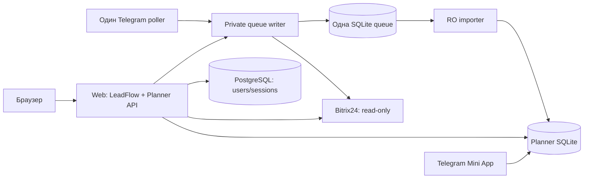

# Рабочее пространство

Единая система управления лидами, распределения недозвонов, планирования работы отдела продаж и контроля результатов.

Это самостоятельный исходный репозиторий: **нужен только этот checkout**. Отдельная папка LeadFlow, неопубликованные Git-коммиты и внешние source directories для сборки не нужны. Исходный LeadFlow не изменяется. Происхождение и разрешение включения — [docs/PROVENANCE.md](docs/PROVENANCE.md).

## Возможности и состояние

Для менеджеров, руководителей отдела и администраторов. Общий web-login, главная, sidebar, профиль; LeadFlow лиды/назначение; «План дня» менеджера и руководителя, восемь дневных показателей, задачи, таймеры, результаты, комментарии, согласования, история и неизменяемые отчёты; web-распределение недозвонов. Администратор LeadFlow не становится руководителем Planner автоматически.

Telegram-бот сохраняет ACL, команды, группы, напоминания, выбор менеджеров и стадий, периоды **3/4/5/6/7/10/15**, альтернативные варианты, ручные даты и замену пустых дат. Mini App использует существующего бота и прежние планы/задачи/историю. Второй polling не нужен.

RC1/RC2 и исправления независимого review реализованы локально. **Готово к review исходников, не к немедленной установке.** Предыдущая регрессия:236 Planner,94 web Python,60 frontend,33 Edge-группы. Новый перенос проверяется отдельно в [отчёте](COMPLETE_WORKSPACE_REPOSITORY_REPORT.md).

Не реализованы новые общие задачи/подпункты, «В течение дня» и правило D40. Не выполнены live Bitrix, PostgreSQL integration/перенос Planner, Linux UDS/mounts и production deployment.

## Компоненты



Клиенты не получают CRM webhook. Новые LeadFlow записи имеют `sync_status=local`, не отправляются в CRM. Workspace worker/service/gateway запрещают CRM-write. Все новые CRM адаптеры — read-only; исходники старого standalone экспортного сервиса сохранены для совместимости, **его нельзя запускать в workspace**. Подтверждения web/Telegram проходят один private writer, единственный дневной слот и одну очередь.

## Исходники

```text
bot.py, access.py, bitrix.py, config.py, distribution.py, reminders.py
planner/                 единственный Store, daily, queue, importer, CRM adapters
miniapp/                 React Telegram Mini App и отдельный desktop-прототип
web/backend/app/         LeadFlow API, модели, sessions, services
web/backend/workspace/   общий server runtime, CSRF, identity, private writer
web/backend/alembic/     auth migrations до0005
web/backend/local_web/   только synthetic harness, не production entrypoint
web/backend/tests/       web/session/queue regression
web/frontend/            обычный React/TypeScript source + зафиксированные зависимости
deploy/, web/deploy/      Dockerfiles, private config examples, Linux smoke recipes
tools/, web/tools/       single-checkout checks, synthetic browser, packaging
tests/                   Telegram/Planner regression
docs/                    связанная техническая документация
```

## Требования и чистое окружение

Python3.12+ (локально проверяется также3.14), Node22.12+, pnpm11.25.0. Production auth требует **реальный PostgreSQL**, HTTPS и Linux для UDS. PostgreSQL server не устанавливается этими командами. Windows synthetic tests используют временный SQLite только вместо auth transport; production factory такой fallback отвергает.

```bash
git clone https://github.com/emerald634/planner.git
cd planner
# Пока PR не объединён: git switch review/complete-workspace-20261028
python -m venv .venv
# Linux/macOS: source .venv/bin/activate
# Windows: .venv\Scripts\Activate.ps1
python -m pip install -r requirements-workspace-dev.txt
pnpm --dir web/frontend install --frozen-lockfile
pnpm --dir miniapp install --frozen-lockfile
```

Работайте в новом checkout: не заменяйте чужие `.venv`, `.env` или рабочую базу. Python pins совместимы с aiogram: Pydantic2.13.5; это устраняет конфликт прежнего web pin2.14.1. Web direct versions взяты из принятого package-lock, pnpm-lock фиксирует итоговую установку. Security/supply-chain checks не отключаются. Linux wheels/полный CVE gate остаются отдельной проверкой.

## Сборка и проверки

```bash
python tools/check_repository.py
python -B -m tests.run_foundation_checks
python -B web/tools/run_session_checks.py
pnpm --dir web/frontend test
pnpm --dir web/frontend lint
pnpm --dir web/frontend build
pnpm --dir miniapp build
```

Runner удаляет реальные secrets из test environment, запрещает внешние сети/рабочие SQLite/.env. Тесты CRM используют mocks. Telegram тесты проверяют callbacks без polling и настоящих сообщений. Не запускайте `bot.py` для регрессии.

Synthetic browser (существующий Edge, никаких настоящих токенов):

```bash
python -B web/tools/run_working_web.py prepare
python -B web/tools/run_runtime_browser_review.py --run RUN_ID
# В другом терминале:
node web/tools/runtime_workspace_smoke.cjs RUN_ID
python -B web/tools/stop_runtime_review.py --run RUN_ID
```

Для `runtime_core_smoke.cjs` создайте **другой** новый run. Все исходники и fixtures берутся из этого checkout; внешние `--planner-source` отвергаются. Детали и чистый clone gate — [docs/TESTING.md](docs/TESTING.md).

## Конфигурация runtime

[web/deploy/runtime.example.json](web/deploy/runtime.example.json) — шаблон без секретов/полномочий. Production web: `WORKSPACE_RUNTIME=1`, `WORKSPACE_CONFIG_FILE` с абсолютным private JSON, `DATABASE_URL_FILE` с owner-only DSN, совпадающие HTTPS `PUBLIC_APP_URL`/`FRONTEND_URL`, Secure cookies. `.env` web runtime не читает, bootstrap здесь запрещён. Web session90/30, CSRF для mutations включая login/logout, grants/ownership на API.

Бот: private env по [.env.example](.env.example), подтверждение только явным allowlist; `QUEUE_WRITER_SOCKET` и `QUEUE_WRITER_KEY_FILE` задаются вместе. Mini App: [deploy/planner.env.example](deploy/planner.env.example). Права, UID, mounts и секреты — [docs/API_AND_AUTH.md](docs/API_AND_AUTH.md), [docs/DEPLOYMENT_REVIEW.md](docs/DEPLOYMENT_REVIEW.md).

Не копируйте реальные secrets в tracked examples, браузер, GitHub Actions или командный вывод. Имена/ID в исторических тестах — существующие протокольные fixtures, не автоматически разрешённые рабочие web-аккаунты.

## Release и Docker review

```bash
python tools/package_workspace.py --output release-artifacts/workspace-review.zip
# Только на отдельно разрешённом ИЗОЛИРОВАННОМ Linux стенде:
docker build -f web/deploy/Workspace.Dockerfile --target runtime -t workspace:review .
docker build -f deploy/Bot.Dockerfile -t workspace-bot:review .
docker build -f deploy/Planner.Dockerfile -t workspace-miniapp:review .
```

Упаковщик обязательно заново собирает оба frontend; включает исходники, prebuilt assets, общий manifest схем/commits/files и SHA256. Не включает `.env`, БД, keys, node_modules, sourcemaps, private workbench. Это не команда установки VPS. Runtime image не содержит Node/pnpm; frontend строится локально. Bot Docker context остаётся корень, web context тоже корень. Не использовать прежние инструкции автоматического `compose up` из старого LeadFlow.

Web factory: `workspace.application:create_app --factory`; private UDS writer: `workspace.writer:create_writer --factory`. Минимальный review compose — [web/deploy/compose.workspace-review.yaml](web/deploy/compose.workspace-review.yaml). В нём **нет PostgreSQL сервиса** и нового poller. Существующий bot переключается только отдельно согласованным cutover, не вторым экземпляром.

## Данные и выпуск

Planner core4 + daily/observations extensions, queue1, auth Alembic0005. Миграции только явно на копии: [docs/DATABASES_AND_MIGRATIONS.md](docs/DATABASES_AND_MIGRATIONS.md). Сначала online backup/restore proof, затем отдельное решение. Не cp живой SQLite main без журнала. Новый `local` нельзя менять в `pending` ради отката. Старый writable backend, не знающий этот статус, не является безопасным rollback.

Оставшиеся gates: Linux image/UDS/UID/RO mounts/DELETE locking; real PostgreSQL integration/DDL/least privilege; HTTPS/proxy; live CRM contracts/quotas; полный dependency/CVE gate; combined load и реальный server headroom. Владелец сообщил6ГБ RAM, это не новый замер сервера.

## Документация

- [Архитектура](docs/ARCHITECTURE.md), [компоненты](docs/COMPONENTS.md), [API/auth](docs/API_AND_AUTH.md).
- [Read-only CRM](docs/CRM_READONLY.md), [данные/миграции](docs/DATABASES_AND_MIGRATIONS.md), [тестирование](docs/TESTING.md).
- [Deployment review](docs/DEPLOYMENT_REVIEW.md), [backup/rollback](docs/BACKUP_AND_ROLLBACK.md), [ограничения](docs/KNOWN_LIMITATIONS.md).
- [Решения/история](docs/DECISIONS_AND_HISTORY.md), [provenance](docs/PROVENANCE.md), [публичная база знаний](PROJECT_MASTER_KNOWLEDGE.md).
- [Отчёт о самостоятельном репозитории](COMPLETE_WORKSPACE_REPOSITORY_REPORT.md).

Публичная база знаний — проверенная техническая редакция. Полная внутренняя история сохранена локально отдельно и не переносится новой веткой. Исторические документы корня не являются новым разрешением deploy/migrations.
