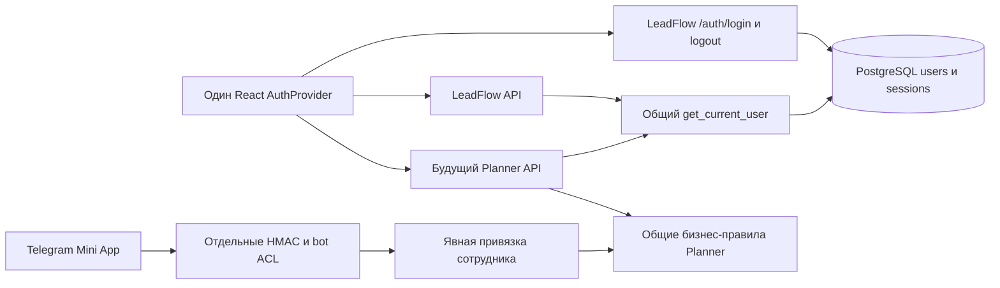

# Единая авторизация LeadFlow + «План дня»

23.10.2026. Архитектурная сверка и локальный proof of concept. **Не production.**
Последнее решение владельца заменяет SQLite-путь создания отдельного web-auth:
одно приложение, один backend/auth boundary, целевая PostgreSQL и существующая
авторизация LeadFlow как основа. TTL 90/30 дней, reset-код 30 минут, независимость
web от Telegram ACL и защита бизнес-данных не отменены.

## 1. Проверенные исходные версии и границы

| Объект | Проверено |
|---|---|
| Planner main | `6501ef264e17f8a8c2ff166515a014c7c843b47c` |
| Planner PR №6 | Открыт, не объединён, HEAD `7cc780818a71b22b19d5db1cab7d6e697839aa41` |
| LeadFlow master | `d3e461f89532b997e8f236ae77f1fd15ed5515c9` |
| Локальный PoC LeadFlow | `feature/unified-auth-poc`, commit `837fbbfdb5d058fa4a9c15d20723cbcd03f969ef` |
| Локальный каталог LeadFlow | `C:\Users\user\Documents\ChatGPT\План дня\lead-flow-auth-poc` |
| Planner ветка этого этапа | `docs/unified-auth-integration`, от проверенной main |

Удалённые HEAD перед анализом совпали с заданием. PR №6 и его артефакты сохранены;
его необходимость перед PostgreSQL-переходом ещё отдельно решается. Отчёты
bridge доступны в [PR №6](https://github.com/emerald634/planner/pull/6), в частности
[технический отчёт на сохранённом commit](https://github.com/emerald634/planner/blob/7cc780818a71b22b19d5db1cab7d6e697839aa41/SCHEMA5_COMPATIBILITY_REPORT.md).
Текущая ветка не подтягивает неутверждённый PR №6 в main и не меняет его.

В LeadFlow нет remote push/PR: изменения закоммичены только локально. Передача
туда требует отдельного разрешения и согласования владельца репозитория.
Обзорный diff для проверки — `review/leadflow-unified-auth-poc.patch`.
Это добавочный PoC, не скопированные auth-модули и не backend авторизации Planner.

## 2. Что реально делает авторизация LeadFlow

Основание — исходники именно проверенного SHA, не предположения о production.

| Участок | Реальное поведение |
|---|---|
| [auth.py](https://github.com/zadkie1ll/lead-flow/blob/d3e461f89532b997e8f236ae77f1fd15ed5515c9/backend/app/api/routes/auth.py#L38) | POST /auth/login ищет email, проверяет active/пароль, выдаёт HttpOnly-cookie access_token; /me использует общую dependency; /logout лишь удаляет cookie |
| [dependencies.py](https://github.com/zadkie1ll/lead-flow/blob/d3e461f89532b997e8f236ae77f1fd15ed5515c9/backend/app/api/dependencies.py#L13) | get_current_user читает cookie, декодирует sub, загружает User из БД, проверяет is_active; require_roles проверяет актуальную роль из этой записи |
| [security.py](https://github.com/zadkie1ll/lead-flow/blob/d3e461f89532b997e8f236ae77f1fd15ed5515c9/backend/app/core/security.py#L11) | pwdlib.PasswordHash.recommended() и verify; JWT sub/exp через PyJWT, алгоритм и secret из Settings |
| config.py | Default expiry 480 минут, cookie_secure=false, dev JWT/admin defaults; предупреждение вместо fail-closed |
| models/user.py, repositories/user.py | users.id, unique email, hashed_password, admin/supervisor/manager, is_active; email lookup lower(); Bitrix/chat поля не unique identity mapping |
| services/users.py, schemas/user.py | Создание/изменение пароля через общий hasher, email lower(); UserUpdate содержит role/password/is_active; UserRead исключает hash |
| api/routes/users.py | admin создаёт/редактирует/удаляет users; supervisor читает список/карточки; manager не управляет users |
| bootstrap.py, backend/Dockerfile | При стандартном запуске backend bootstrap создаёт первого admin, если его email ещё нет; defaults требуют отдельного production hardening |
| db/session.py | SQLAlchemy engine/session; PostgreSQL задаётся Compose, тесты используют in-memory SQLite; при импорте engine не создаёт таблицы автоматически |

Локально рекомендованный pwdlib дал Argon2id `m=65536,t=3,p=4` с установленными
pwdlib 0.3.1/argon2-cffi 25.1.0. Это измерение выбранных локальных библиотек,
не замер VPS и не утверждение параметров production. Concurrency/RAM ещё проверять.

Cookie имеет Path=/, SameSite=Lax, Max-Age=480*60 по default; Secure зависит от
настройки. Это уже постоянная cookie, но не согласованная серверная сессия 90/30.
Роли не берутся из пользовательского JSON/дополнительного JWT role claim.
Смена роли/active видна следующему запросу с новой DB session.

### Изученные связанные файлы

Полностью прочитаны backend auth.py/dependencies.py/security.py/config.py,
models/user.py, repositories/user.py, services/users.py, schemas/auth.py/user.py,
bootstrap.py, db/session.py, routes/users.py; дополнительно app/main.py/router.py,
routes/leads.py/stats.py и services/leads.py для реальных полномочий/семантики chat.
Изучены все три Alembic revisions 0001–0003, env.py, pyproject.toml и backend tests.
Frontend: AuthContext.tsx, LoginPage.tsx, lib/api.ts, App.tsx, types.ts и имеющиеся
четыре test-файла. Инфраструктура: docker-compose.yml, backend/frontend Dockerfile,
CI и deploy workflows. Planner: master knowledge, обе web-архитектурные заметки,
foundation spec/report и сохранённые bridge report/guide в ветке PR №6.

## 3. Подтверждённые возможности и ограничения

**Переиспользовать:** users, SQLAlchemy get_db, pwdlib hash/verify, email lookup,
единый auth router и get_current_user/require_roles; действующие LeadFlow API/DTO,
AuthProvider и credentials:include. Менять их смысл только отдельными малыми PR.

| Ограничение | Подтверждение и необходимая работа |
|---|---|
| JWT не имеет серверной записи сессии/отзыва | В security.py нет session lookup, jti/auth version; повтор cookie после logout в PoC снова даёт доступ. Нужно серверное состояние, не увеличение JWT TTL |
| 90/30/foreground отсутствуют | Есть лишь exp=now+480 минут. Нужны абсолютная граница, реальное посещение и прекращение polling-продления |
| Отключение active — не постоянный отзыв JWT | Запросы inactive отклоняются; отдельной invalidation generation нет. Повторное включение не должно оживлять старые сессии в целевой версии |
| Supervisor provision/reset отсутствуют | Admin UserUpdate(password) — иной процесс: нет reauth/reset_pending/кода/атомарного отзыва/аудита; его нельзя выдать за согласованный reset |
| Rate limit в process defaultdict | 5 неудач за 300 секунд по host+email; нет общего лимита процессов, предел роста ключей не задан. Разобрать NAT/proxy, shared storage, bounded cleanup и DoS |
| CSRF не реализован как общий серверный протокол | Не найдены CSRF/Origin/Fetch Metadata проверки. Lax/JSON/CORS — частичные барьеры, не доказательство полной защиты; конкретный cross-site exploit здесь не воспроизводился |
| Dev defaults и LoginPage prefill | Не переносить заранее заполненные demo credentials; production должен отвергать dev secrets/insecure cookies, bootstrap отдельно ограничить |
| Admin может менять role, включая свою | UserUpdate.role + admin PATCH users: до business integration нужно согласовать назначения ролей/entitlements. PoC не доказывает защищённость planner от администратора, управляющего ролями |
| DELETE users физический | Новые Planner history/FK нельзя молча обнулить/каскадно удалить. Согласовать disable/tombstone для связанных identities, сохранить историю |
| Frontend logout скрывает сетевую ошибку | AuthContext очищает local user даже при failed logout; cookie может остаться. Будущий общий transport должен различать локальный выход и подтверждённый server revoke |
| Frontend transport не имеет deadline/JSON shape validation | При объединении сохранить опыт хотфикса Planner: deadline включает JSON, независимые loaders/errors/retry, abort/stale-context; без автоповторов мутаций |
| Репозиторные зависимости | Python ranges без lock; npm audit неизменённого lockfile сообщил 7 packages (5 high,2 moderate). Это отдельный review, не автоматически исправленные проблемы |

Последний audit не доказывает эксплуатацию этих пакетов на работающем Nginx:
нужно отдельно разделить build/dev/runtime reachability. Ни npm audit fix, ни
обновление исходных lock/dependency файлов в этом этапе не выполнялись.

Deploy workflow запускается после успешного CI master при наличии deploy secrets.
Поэтому master не трогали, workflow/Compose не запускали, LeadFlow не публиковали.

## 4. Целевая граница одного приложения

Общий backend размещать в **существующем LeadFlow backend/app**, добавляя туда
модуль бизнес-функций Planner после переноса хранения. Окончательное имя/репозиторий
объединённого продукта — организационное решение, а не причина копировать auth.
Не создавать отдельный auth-service или независимый Planner login ради GitHub.

Один HTTPS origin, один cookie/session backend, login/password не пересылается
между приложениями. Web API использует canonical User, Telegram API — подписанный
Telegram user + ACL, затем подтверждённый mapping и актуальную глобальную активность.
Ни cookie→HMAC fallback, ни initData→web fallback, ни фиктивного initData.
Бот сохраняет свой ACL и единственный polling-процесс. Отключение только web
не лишает Telegram доступа; глобальная деактивация целевого сотрудника блокирует оба.

**Сейчас:** действующий Planner Mini App всё ещё читает свой employees.active;
реальной связи с LeadFlow users нет. PoC доказывает общий web login только между
LeadFlow API и диагностическим endpoint, не глобальную деактивацию рабочих систем.

До переноса бизнес-хранилища не объявлять два процесса общим входом посредством
копии JWT_SECRET. Предпочтительный cutover подключает Planner в общий backend.
Если два процесса действительно понадобятся, отдельный review: закрытый gateway,
аутентификация сервисов, короткое audience-bound delegated actor proof, серверная
проверка текущего пользователя/прав, защита replay и отсутствие прямого доступа.
Это альтернатива для отдельного решения, не реализованный межсервисный протокол.

## 5. Identity и таблица соответствий

Канонический web key — **LeadFlow users.id**. Planner employees.id остаётся
исходным идентификатором для миграции/аудита. Ни равенства PK, ни merge по имени.
Bitrix ID — лишь кандидат после проверки портала/unique соответствия. Проверенный
Telegram user ID также кандидат, но LeadFlow telegram_chat_id — адрес доставки:
services/leads.py передаёт его TelegramGateway.send, это может быть групповой chat,
а не подтверждённая личность. Нельзя использовать его как Telegram user ID.

Рабочие БД не читались, поэтому фактические LeadFlow IDs/email **неизвестны**:

| Сотрудник из требований Planner | Telegram user ID | Bitrix ID | Planner PK | LeadFlow users.id/email | Статус |
|---|---|---|---|---|---|
| Вячеслав | 8306778724 | 460 | Не проверен в рабочей БД | Неизвестны | Только кандидат, подтвердить вручную |
| Яна | 7939114214 | 110 | Не проверен в рабочей БД | Неизвестны | Только кандидат, подтвердить вручную |
| Руководитель | 1073597301 | Не указан | Не проверен в рабочей БД | Неизвестны | Подтвердить роль; не связывать с первым admin |
| Прочие/отключённые исторические сотрудники | Не выводятся из имён | Не выводятся из имён | Сохранить исходный | Не создавать login автоматически | История сохраняется, конфликты блокируют cutover |

Номера выше — ранее утверждённые конфигурационные сведения, не выгрузка аккаунтов.
Синтетические users.id=1/2/3 из тестов не являются найденными реальными связями.

Предлагаемый PG registry `planner_employee_links` (точный DDL — будущий review):

- source_instance + legacy_employee_id UNIQUE, canonical_user_id FK users ON DELETE RESTRICT;
- confirmed mapping — UNIQUE canonical_user_id на один source_instance;
- статус pending/confirmed/conflict/retired, verified_by/at, provenance/legacy active/role;
- исходные Telegram user/Bitrix/имя сохраняются как provenance, не как login proof;
- нерешённые/исторические записи могут не иметь canonical_user_id, но не получают вход;
- mapping/role/active конфликты разбираются человеком; не создавать второй user автоматически.

Этот registry может стать FK-опорой migrated Planner employee references, чтобы
сохранить legacy ID в планах/задачах/отчётах/requests. Auth actor содержит canonical
user_id и найденный сервером planner employee ref, не подставленный клиентом PK.
LeadFlow leads.manager_id остаётся FK users.id. Закрытые JSON snapshots и исходные
actor IDs сохраняются с namespace; системный импорт не переименовывается сотрудником.

## 6. Матрица ролей: действующее и целевое

| Операция | Manager | Supervisor | Admin LeadFlow |
|---|---|---|---|
| Текущие LeadFlow leads/stats | Свои | Командные по текущему API | Прежние полномочия |
| Текущие users list/read | Нет | Да | Да |
| Текущие users create/update/delete | Нет | Нет | Да; semantics сохранить до отдельного review |
| PoC identity | Только текущий user | Только текущий user | Только текущий user; это не бизнес-доступ Planner |
| PoC supervisor-check | 403 | 200 | 403 при role=admin; изменение DB role — отдельный существующий admin capability |
| Будущие личные Planner plans/tasks/reports | Свои при confirmed mapping | По прежним правилам отдела | Не выводить полномочия из названия admin; требуется явное решение |
| Цели/отчёты/назначения команды | Нет чужого доступа | Прежние Planner supervisor права | Отдельное явное назначение, не auto-grant |
| Provision/reset manager | Нет | Утверждённый scope + свой пароль | Точный scope надо согласовать; не обходить reset через старый PATCH password |
| Reset другого supervisor | Нет | Нет через manager API | Отдельный защищённый recovery-процесс, пока не утверждён |

Не понижать/повышать реальные роли этим документом. Team/tenant границы и admin
entitlements окончательно согласовать до настоящих бизнес-endpoints. В частности,
кто имеет право назначить supervisor и может ли admin менять свою роль — открыто.
Скрытие меню не заменяет backend ownership/role/active проверки.

## 7. Предлагаемое расширение PostgreSQL auth

Это **проект**, новых моделей/Alembic revisions/миграций здесь нет.

| Изменение | Назначение |
|---|---|
| users auth state/version, отдельный web_enabled | users.is_active — глобальная активность; web_enabled отключает только web. Role/active берутся из users; version отзывает старые сессии |
| hashed_password/state CHECK | Сохранить имеющиеся pwdlib hashes для ready users без перехеширования/паролей из production; pending/invited запрещает обычный login, hash можно делать NULL по согласованному DDL |
| web_sessions в PostgreSQL | Одна общая таблица, token digest UNIQUE, user FK, auth_version, issued/expires/last_visited/revoked timestamps; не второй набор credentials Planner |
| web_password_actions | Hash одноразового секрета, user/version/purpose/initiator, issued/expires/used/revoked; атомарное одноразовое погашение |
| auth_audit | Реальный actor/target/system и безопасные event codes, без пароля/cookie/кода; retention отдельно |
| Shared rate limits | Общие bounded counters в PG либо согласованный proxy/storage; не вводить Redis/service только ради PoC |
| planner_employee_links | Явная identity migration/crosswalk, не совпадение первичных ключей |

Существующая цепочка Alembic 0001→0002→0003 сохраняется. Будущие revisions
последовательно: additive auth state/session tables → backfill ready/versions
на synthetic existing users → constraints и проверка сохранности hashes/lead FKs;
затем identity links и отдельно Planner business tables. Каждая revision проверяется
на PostgreSQL, на повтор/сбой/конкуренцию и backup/restore; SQLite create_all из
тестов не доказывает PG DDL. Не выбирать окончательный номер следующей revision
до сверки актуального master (его Alembic chain может измениться).

### Сессия 90/30

Предпочтительный вариант — сохранить /auth/login, /me, /logout и UserRead, но
заменить независимый JWT-only proof серверной общей сессией. Cookie содержит
непрозрачный CSPRNG token, в PG только digest и связь с users. Допустимая альтернатива
JWT+jti требует того же обязательного server lookup/revoke и отдельного review;
увеличить ACCESS_TOKEN_EXPIRE_MINUTES до 90 дней недостаточно.

На каждом запросе проверять active/web_enabled/state/version/revocation, абсолютный
срок **90 дней от исходного входа**, срок **30 дней без настоящего посещения**;
на границе отказ. Cookie Secure/HttpOnly/persistent, same-origin и CSRF. Закрытие
браузера не завершает сессию; polling не обновляет last_visited. Протокол посещения,
cookie name/SameSite и frequency batching ещё выбрать; не считать любой header
или background /me посещением. Logout отзывает серверную запись и удаляет cookie.

Переход старых JWT на новую сессию — явная re-login граница, если нет отдельно
проверенного безопасного обмена. Не держать бессрочный fallback, принимающий старый
JWT без session/revocation/state check. Cookie/CSRF rotation обязательны, legacy
JWT отозванного/reset user нельзя оживить откатом старого бинарника.

### Атомарный reset

Supervisor подтверждает собственный пароль для конкретного manager/action.
Дорогой verifier выполнять с ограничением ресурсов; после проверки под PG lock
повторно проверить актуальные hash/version/role/active, чтобы reset/login/reauth
не работали по устаревшему состоянию. Единый порядок блокировок user→sessions→actions.

Одна транзакция: запрет старого пароля/reset_pending + version bump + revoke
всех web-сессий + отмена прежних неиспользованных actions + создание нового кода
на **30 минут** + audit. Выдать код только после commit. Новый login берёт тот же
lock/проверяет version до выдачи сессии: результат проверки пароля до reset не
создаёт пригодную сессию после reset commit. Ошибка — полный rollback.

Погашение: lock user/action, проверить digest/purpose/version/expiry/unused,
атомарно установить новый pwdlib hash, отметить used, снять только reset_pending,
не отменять inactive/web_disabled. Повтор и параллельное погашение — один успех.
Expired/reset-replaced code не возвращает старый пароль. Manager сам выбирает
пароль; supervisor его не видит; Telegram ACL/история/таймеры не меняются.
Все альтернативные password setters, включая admin PATCH users, должны проходить
те же revoke/state/audit правила; иначе механизм обходится старым API.

## 8. Frontend и работающие API

Один AuthProvider LeadFlow над общим Layout/router. /auth/me восстанавливает одну
web-сессию; /planner/* UI использует тот же api(credentials:include), не второй
provider/password form/token storage. /login и /logout остаются общими, cookie
недоступна JS, пароль не сохраняется в контексте. Канонический UserRead можно
сохранить; новые capabilities возвращать сервером в согласованном DTO, не доверять
свойству role из localStorage/JSON. Удалить demo-prefill до production.

LeadFlow /auth paths и leads/users/sources/stats DTO переиспользовать; менять
внутренности auth/recovery только через отдельные тестируемые PR. Planner Telegram
API остаётся отдельным transport, без cookie fallback. После переноса PG бизнес-
сервисы получают один внутренний actor с verified mapping и прежними правилами
ownership/revision/locked/closed/timer/immutable reports, не дублированные SQL копии.

Объединение UI здесь **не выполнено**: старые экраны и frontend source не менялись.
График LeadFlow по default 09–18 не заменяет утверждённые Planner 10–19 Moscow;
до решения хранить module-specific правила и не менять алгоритм новых лидов.

## 9. Реализованный локальный PoC

В LeadFlow добавлены только четыре файла:

- backend/poc/__init__.py;
- backend/poc/unified_auth.py — factory create_poc_app, исходный api_router и два GET;
- backend/poc/run_checks.py — безопасный runner синтетических тестов;
- backend/tests/test_unified_auth_poc.py — тесты настоящего hasher/JWT/cookie/dependency.

Factory подключает **исходный** LeadFlow api_router (включая /auth/login и /me).
GET /api/v1/planner-poc/identity возвращает только canonical_user_id/current_role
текущего пользователя; ни plans, ни SQLite, ни чужих профилей. GET supervisor-check
использует исходный require_roles(SUPERVISOR), без admin alias. Никаких password
таблиц/сессий/нового login endpoint/копирования JWT_SECRET в Planner.

В app.main/router.py, settings, security, ORM, migrations, frontend и workflows
нет изменений. Обычное приложение не регистрирует PoC routes. Docker COPY . . мог
бы перенести файлы после будущей публикации, но его CMD по-прежнему app.main:
не считать изоляцию гарантированным отсутствием файлов в образе. Сейчас ни
образы, ни deployment не запускались. Не включать этот factory в production.

Проверено: один login → LeadFlow /auth/me + diagnostic identity с той же cookie;
нет повторного пароля/выдачи второго token; current DB role/active; manager own
identity и отказ supervisor; admin identity без автоматических supervisor прав;
unknown/wrong/inactive/forged/expired/missing cookie/Telegram header denial;
logout удаляет browser cookie, но повтор старого JWT показывает текущий inherited gap.

PG-сессии 90/30, reset_pending, CSRF и настоящий visit protocol **не реализованы**.
Использован original JWT480 только для локального proof, не принят как новое
бизнес-требование. Стандартный production router не менялся; схемы не мигрировались.

## 10. Тестирование, сохранность и cutover

Подробные команды, версии, test IDs и ограничения — `UNIFIED_AUTH_TEST_REPORT.md`.
LeadFlow backend 28 passed, frontend 19 passed, lint/build passed; Planner 190 OK.
SQLAlchemy fixtures — только SQLite :memory:, **PostgreSQL не проверен**.
Команды postgres/psql/initdb/docker не обнаружены, WSL не настроен; не создавали
контейнеров и не подключались к чужому серверу ради теста.

Будущий migration/cutover требует отдельной приёмки:

1. Read-only сверка реальных версий/roles/active и операторское утверждение mapping;
   до разрешения не выгружать production PII и не использовать рабочие копии в тестах.
2. PostgreSQL contract tests со synthetic schema/users и schema/data migration
   tests; точные строки/FK/snapshots/import UUID+hash/locked targets/timers сохранить.
3. Backup обоих источников и очереди, pg_dump/restore trial в изоляции; единый
   согласованный checkpoint и остановка только нужных writers в отдельное окно.
4. Переносить owner/actor refs через mapping, сохранять legacy IDs и immutable
   report/audit payload; не объединять по именам, не перехешировать реальные пароли.
5. Cutover на один auth boundary и единый источник identity/active; не оставлять
   независимых writers в старой и новой Planner БД. Никакого слепого dual-write.
6. Telegram transport с прежним HMAC/ACL подключать к canonical identity только
   после доказанной mapping/active совместимости; алгоритмы распределений сохранить.
7. Новые PG планы/факт/отчёты после cutover входят в rollback-план. Возврат старой
   SQLite-копии не содержит их. Предпочитать совместимую предыдущую версию backend
   с актуальной PG; обратный перенос требует отдельной сверки и разрешения.
8. Старый LeadFlow JWT-only backend нельзя автоматически считать безопасным
   rollback после внедрения reset/session state: он может обойти новые ограничения.
   Нужен проверенный auth-compatible rollback с учётом отзывов/версий/state.

SQLite foundation остаётся принятым историческим результатом/набором тестовых
контрактов. Не удаляется, но production web-credentials/session tables из него
не переносятся в Planner как второй password store. PR №6 сохраняет отдельный
SQLite rollback-кандидат; его объединение/применение не условие «по умолчанию»
для нового PG-пути и требует решения владельца.

## 11. Следующие небольшие PR и необходимые решения

1. **LeadFlow auth hardening**: session/revoke/90–30/CSRF/reset/state/all setters,
   bounded rate/CPU/RAM, production config/defaults. До этого PoC не production-ready.
2. **Identity mapping**: operator-approved registry, active/role conflict policy,
   admin/role-assignment/recovery полномочия; никаких автоматических real-account merges.
3. **Planner PG storage/data migration**: additive Alembic и совместимые репозитории,
   existing contract/transaction/restart/history tests, PostgreSQL backup/restore.
4. **Business API**: общий actor и auth dependency, отдельный Telegram transport,
   полная ownership/role/goal/timer/report/import regression.
5. **Общий React router/AuthProvider**: один вход/выход, независимые loaders,
   deadlines/validation/CSRF/stale context; прежние Mini App screens сохранить.
6. **Интеграционная приёмка/rollback**: PG concurrency/load, Linux/HTTPS/browser,
   identity reconciliation, current-data rollback и безопасность revoked sessions.
7. **Production**: отдельный согласованный release/cutover с fresh server checks.

Решения владельца до следующих этапов: право публикации PoC/PR в LeadFlow;
точные admin/supervisor/назначение ролей/командные границы; crosswalk реальных
сотрудников и конфликты active; cookie/visit/reauth/delivery/bootstrap детали;
retention/rate/concurrency и dependency lock/audit; нужен ли PR №6 перед PG;
организация общего репозитория и отдельный план production cutover.

Для read-only identity PoC эти вопросы не потребовали менять права реальных
аккаунтов или выбирать production DDL; для настоящих бизнес-endpoints они блокирующие.
После локального PoC работа останавливается. LeadFlow изменения не публиковать
без отдельного согласования владельца; никакого merge/deploy текущим заданием.
